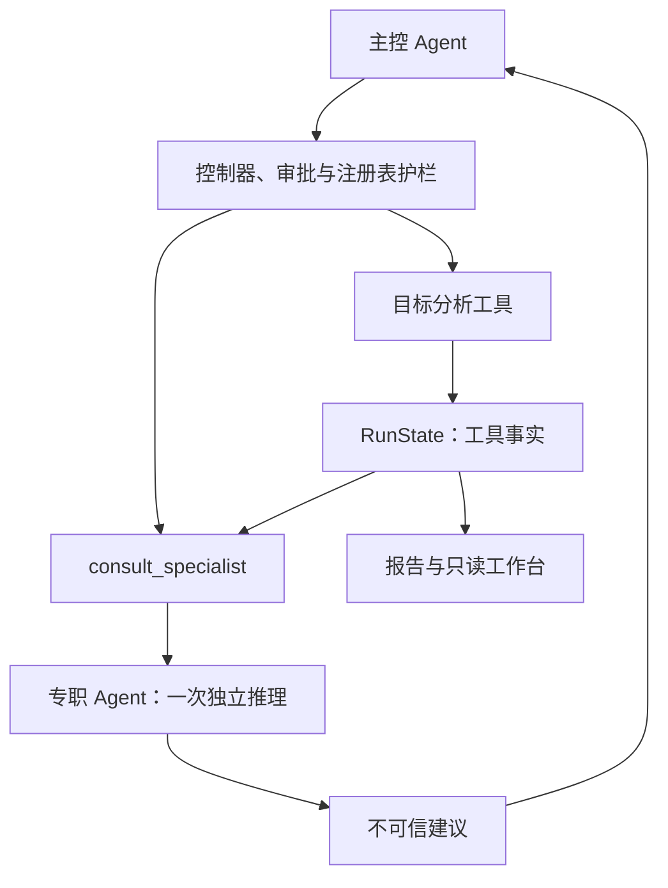

# ADR-0017：按需咨询专职 Agent，执行权集中，不引入协作黑板

- 日期：2026-10-21
- 状态：已实现，默认关闭；启用方式 `--set run.specialists=true`
- 关联：[ADR-0003](0003-single-execution-chokepoint.md)、[ADR-0006](0006-planner-controller-separation.md)、[ADR-0018](0018-fact-context-and-atomic-snapshots.md)

## 问题与约束

Trina 已有任务大脑、对话大脑、假设台账、证据关系图和只读复核器。
给这些模块分别起一个 Agent 名字，不会自动获得多智能体能力。
值得解决的问题是：主控遇到复杂线索时，能否把一个明确问题交给具有独立上下文的专职推理角色，
同时保持执行权限、预算、审计与事实来源不变。

本仓库没有多个 Agent 共写的黑板。`trina.board` 是运行状态的视图，
`RunState` 是工具事实与报告输入，`HypothesisLedger` 保存待验证问题；三者不是同一种东西。
删除 `board.py` 会损坏 `/board` 和 `watch`，却不会简化模型协作。

## 决定

采用主控调用专职 Agent 的工具模式，第一版为同步、单次咨询。

1. `consult_specialist` 必须注册到 `ToolRegistry`，声明 `detect` 等级与 `target/role/task` 参数。
2. 调用咨询本身也经过控制器、人工审批、ScopeGuard、超时和审计。
3. 专职角色只有 `recon`、`web`、`review`，不能由模型临时创建角色或任意系统提示词。
4. `Specialist` 只接收字符串快照与工具规格，持有模型后端，不持有 `ToolContext`、HTTP 客户端、
   控制器、RunState 或文件写入接口。授权边界由 `config.scope_prompt_block()` 生成。
5. `recon/web` 返回一个候选动作或摘要；`review` 只能返回摘要。递归咨询与角色范围外工具会被拒绝。
6. 建议通过普通观察结果交回主控。主控采纳后必须再发一个普通工具动作，重新经过全部执行检查。
7. 咨询结果的 `facts/evidence` 始终为空；子 Agent 自报的状态、flag、发现不会合并进 RunState。
8. 不新增共享黑板、消息总线、自由群聊、独立执行线程或多写者状态合并。

这里的隔离是应用接口隔离，不是操作系统进程沙箱。可信 Python 实现若恶意读取全局对象，
本设计无法阻止；保证的是模型输出没有直接执行通道。

## 备选方案与取舍

| 方案 | 好处 | 本次为何不选 / 如何处理 |
|---|---|---|
| 只保留单 Agent | 调用少、调试简单 | 继续作为默认基线；复杂线索可显式开启咨询 |
| 共享可写黑板 | 多角色容易交换全部信息 | 已有事实库足以承载当前需求；再建黑板增加真相来源、污染、冲突解决和版本问题 |
| 专职 Agent 直接执行工具 | 少一次主控决策，局部任务可独立推进 | 子预算、撤权、审批、限速、超时与事实合并都需重新设计；第一版收益未验证 |
| 把任务大脑复制成多个 PentestAgent | 快速形成多个自治循环 | 各自阶段机、预算与工作目录会重复，难以保证共同停止与覆盖统计 |
| 自由群聊或角色辩论 | 适合开放讨论 | 没有自然停止条件，多个角色意见一致也不是证据 |
| 固定所有任务都调用三个角色 | 角色分工看起来完整 | 简单扫描也额外付费，无法判断角色是否带来实际增益 |
| 直接接入 LangGraph / AutoGen | 有现成编排能力 | 当前需求用既有后端和注册表即可完成；新增框架不能替代已有授权契约 |

## 配置与真实成本

| 配置 | 默认值 | 含义 |
|---|---:|---|
| `run.specialists` | `false` | 关闭时不向主控展示咨询工具，直接调用也会被拒绝 |
| `run.specialist_max_calls` | `3` | 每次任务 / 每段对话会话的子模型调用上限；失败照样消耗 |
| `run.specialist_max_tokens` | `1200` | 子模型每次输出上限；依赖后端正确执行该上限 |
| `run.specialist_context_chars` | `6000` | 任务事实与注册项快照字符上限，不包含系统提示、工具规格、目标和最多 1200 字符的咨询问题 |

所有角色复用当前配置的后端和模型，因此无需新密钥；复用后端的用量台账记录子调用成本。
这是同一模型的多角色独立上下文，不是不同模型的投票系统。

每次咨询增加一次子模型调用，占用一个主控工具步骤和一份控制器检查预算。
主控读取建议并决定是否执行，还需要后续正常决策步骤。不能把“一次子调用”解释成端到端只增加一次调用。
咨询不产生新目标事实，会消耗连续无新证据预算，连续咨询不能绕过停止合同。

`strict` 模式下不会自动放行咨询。只有授权人把咨询工具加入该目标的注册检查项后才能使用，
配置开关不能替代注册。不能把 `test_id` 写成已有 SQLi 检查来冒用授权，工具绑定仍会检查。

## 审计、回放与故障

- `tool.start/end` 记录咨询入口；`specialist.start/end` 记录角色、调用序号、上下文摘要哈希与建议。
- `--record` 按主控与子模型的真实调用顺序记录成功响应，`--replay` 用同一条序列回放。
- 未知角色、异常结构、递归、无后端、超额咨询都返回失败观察，不执行建议动作。
- 时间预算到期不再启动咨询。现有线程超时不能硬杀正在执行的后端调用，
  因而这不是进程级硬截止或费用硬上限；异步执行与硬取消不在本版承诺内。
- 无独立 PoC 重放；review 角色只能根据有限、可能截断的证据片段指出缺口，不能充当独立验证器。

## 验证与重新决策条件

`tests/test_collaboration.py` 覆盖注册、授权与人工拒绝、角色限制、递归拒绝、预算隔离、
伪造 flag/status 丢弃、建议不自动执行、主控再次触发护栏、对话接入与录制回放。

是否默认开启，需用相同模型、目标、授权和总预算，对照开启与关闭咨询两组：
统计任务成功率、误报、Time to Evidence、总输入输出 token、成本、拒绝次数和未测项。
至少区分简单任务与复杂多线索任务，保留逐次记录；不能用别人的研究评测成绩宣称 Trina 提效。

只有当真实任务证明独立分支持续带来收益，且已具备共享预算、取消、确定性结果合并与并发护栏测试，
再考虑受控并行执行。只有出现多个长期存活的角色必须反复交换增量状态时，才重新讨论黑板。

## 参考及本项目推论

- [Anthropic：Building effective agents](https://www.anthropic.com/research/building-effective-agents)：优先采用简单、可组合的结构。本项目据此保留单主控基线。
- [LangChain：Choosing the Right Multi-Agent Architecture](https://www.langchain.com/blog/choosing-the-right-multi-agent-architecture)：主控把子 Agent 当工具调用，便于隔离上下文。本项目采用该模式，但不开放子角色执行权。
- [Anthropic：How we built our multi-agent research system](https://www.anthropic.com/research/multi-agent-research-system)：多 Agent 的 token 消耗需要与任务收益匹配。本项目据此增加独立调用预算并默认关闭。
- [Cognition：Don't Build Multi-Agents](https://cognition.com/blog/dont-build-multi-agents)：缺少上下文及相互冲突的隐含决策会破坏一致性。本项目据此保持一个执行决策入口。
- [Cognition：Multi-Agents: What's Actually Working](https://cognition.com/blog/multi-agents-working)：后续实践区分协作推理与多方同时写入。本项目据此选择专职建议、主控串行执行。

以上是工程经验来源，不是“黑板永远无用”或“本版性能更强”的证明。
