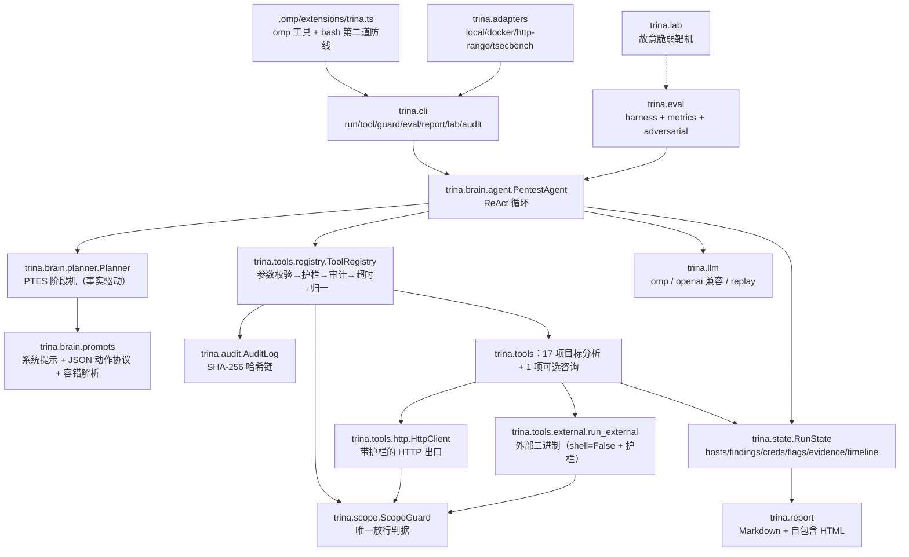

# 架构与模块契约

## 1. 总览



## 2. 单步数据流

```
RunState.summary_for_prompt()  ┐
Planner.directive(phase)       ├→ user prompt ┐
上一步观察 + 注入提示          ┘               │
                                              ├→ LLM → 文本
system = 角色 + 铁律 + 工具清单 + 授权边界 ────┘        │
                                                parse_action()（多级容错）
                                                        │
                        ┌───────────────────────────────┴────────────┐
                        │ {"action": …, "params": …}                 │ {"final": …}
                        ▼                                            ▼
        ToolRegistry.execute(name, params, ctx)                  收敛与终态判定
        ├─ 参数校验（未知/缺失/类型/enum）
        ├─ 可用性（外部二进制缺失→工具自述原因）
        ├─ 护栏：action_level → destructive → check_target
        ├─ 审计 tool.start
        ├─ 执行（线程池 + 超时；异常一律转为结果）
        ├─ state.absorb(result.facts) / evidence 入账
        └─ 审计 tool.end（含 stdout 摘要的哈希）
                        │
                        ▼
        ToolResult.to_observation() → 下一步的观察
```

## 3. 模块契约

| 模块 | 关键类型 / 函数 | 约定 |
|---|---|---|
| `trina.config` | `TrinaConfig.load(path, overrides)`、`ScopeConfig`、`scope_prompt_block()` | 配置是护栏的**唯一**数据源；`TRINA_<SECTION>_<KEY>` 环境变量可覆盖标量；未知字段直接报错（宁可启动失败） |
| `trina.scope` | `ScopeGuard.check_target/check_argv/check_payload/check_http/check_action_level/check_destructive/check_brute_scale/throttle`；`Decision`；`ScopeViolation` | 所有判定返回 `Decision`（含 `reason`/`hint`/`category`），拒绝时把 `hint` 回灌给模型换路径 |
| `trina.audit` | `AuditLog.open/append/verify/summary` | 每条记录 `hash = sha256(canonical(record - hash))`，`prev_hash` 链接；写入即 fsync；敏感字段自动脱敏 |
| `trina.state` | `RunState.absorb(facts)`、`add_finding`、`knowledge_digest`、`summary_for_prompt`、`to_dict/from_dict` | 工具声明 facts，状态集中合并；`knowledge_digest` 排除时间、重复条目与笔记，用事实变化计算进展；`from_dict` 供工作台/复核读历史运行 |
| `trina.tools.registry` | `ToolSpec`/`ParamSpec`/`ToolResult`/`ToolContext`/`Tool`/`ToolRegistry.execute` | 执行链是**唯一**入口；工具实现 `run(ctx, **params)`，返回 `ToolResult` |
| `trina.tools.http` | `HttpClient.request/get/post`、`HttpResult.as_evidence()` | 出网唯一出口：护栏 → 限速 → 请求 → 证据化；护栏拒绝时返回带 `error` 的结果而不是抛异常 |
| `trina.tools.external` | `run_external(argv, ctx, …)`、`which/have` | `shell=False`、先护栏后执行、命令与输出摘要进审计 |
| `trina.brain.agent` | `PentestAgent(config, registry=, backend=, on_step=).run(target, goal=, max_steps=, max_seconds=, record_path=) -> RunState` | 评测框架与 CLI 都只依赖这个签名 |
| `trina.brain.planner` | `Planner.tick/objective_met/directive/force_advance/should_finish` | 阶段推进只看**事实**；每阶段有步数预算，停滞可强制推进 |
| `trina.brain.goal` | `GoalRequirements.parse(goal)`、`unsatisfied(state)/soft_hints/satisfied` | 把任务描述解析成硬条件（漏洞类 / 路径 / 端口 / 凭证）；未满足时不允许收敛，也不允许把"取巧拿到 flag"判为成功；**不使用 ground truth** |
| `trina.hypotheses` | `HypothesisLedger.add/from_action/record_tool_outcome/record_outcome/prompt_block/finalize/summary` | 假设的排序/状态机与证据判定；模型仍选择动作，但确定性选取由 `trina.brain.scheduler` 每步派发；任务/对话共用验证对象匹配；`hypothesis_id` 复用台账；无新信息只降优先级，明确反证才能否定 |
| `trina.brain.failure` | `classify_failure`、`LoopGuard.observe`、`advice_for`、`alternatives_for` | 失败归因（boundary/tool/environment/budget/hypothesis）+ 无新信息重复识别，给出递进建议（换参数→换工具→人工） |
| `trina.brain.scheduler` | `HypothesisScheduler.decide(ledger, tests, executed_tests=, goal_classes=)`、`observe(decision, test_id=, tool=)` | **确定性假设调度**：只调度能绑定注册检查项的假设；任务要求的漏洞类优先（无假设时直接派该类检查项）；未遵从进审计链与 `state.scheduler` |
| `trina.evidence_graph` | `build(state, registry=, hypotheses=)`、`EvidenceGraph.to_mermaid/to_dict` | 结论可反向追溯：目标→主机→端口→路径→发现→证据，另有检查项/假设→发现；构建失败不影响报告 |
| `trina.board` | `render_board(state, hypotheses=)`、`summarise`、`latest_state_file`、`load_run_state` | 工作台视图的**唯一**渲染实现（控制台 `/board` 与 `trina watch` 共用）；`load_run_state` 把 state.json 还原成 `RunState` |
| `trina.brain.prompts` | `render_system_prompt(include_hypothesis)`、`build_system_prompt`、`build_step_prompt`、`parse_action`、`protocol_reminder` | 动作协议与阶段指引的**唯一**文本源；`include_hypothesis=False` 即基线口径（对照实验用），两条臂同模板渲染、不会漂移 |
| `trina.brain.chat` | `ChatAgent(config, registry=, backend=, approval=, steer_queue=, controller=).ask(text) -> str` | **对话式大脑**：共用护栏/控制器/审计/审批；每条消息最多 12 个动作；本轮请求 + 事实摘要 + 有界历史，保存动作/观察关系并回灌失败建议；不宣称具有任务模式的阶段机 |
| `trina.collaboration` | `SpecialistRole/Request/Result`、`Specialist.consult` | 专职 Agent 只持有后端并接收快照，返回不可信建议；recon/web 可建议白名单工具，review 只返回摘要；无工具执行、状态写入或递归委派入口 |
| `trina.tools.specialists` | `ConsultSpecialist`、`TOOLS` | 注册咨询工具，默认关闭；共享审批/控制器/护栏/审计；子调用数、输出长度与快照长度有界；空 facts/evidence；子响应按实际顺序进入任务录制 |
| `trina.llm` | `make_backend(LLMConfig)`、`LLMBackend.complete(system, user)`、`LLMUsage` | 后端实现只管"给提示词 → 返回文本 + 用量"；`ledger` 汇总进报告 |
| `trina.adapters` | `load_adapter/list_adapters`、`RangeAdapter.prepare/status/ground_truth/check_flag`、`score_tsecbench` | 靶场自描述（目标 + ground truth + flag 模式），评测框架据此自动判分 |
| `trina.policy` | `PolicyRegistry.load()`、`AuthorizationController.check/note_evidence/revoke/coverage`、`Budget` | **计划器提出、控制器批准**：注册目标/检查项 + 预算 + 撤权，逐动作裁决；模型无写权限 |
| `trina.session` | `Session.request_approval/answer/steer/toggle_pause/request_stop`、`level_needs_approval` | 人机协同原语；审批**超时即拒绝**（fail-closed） |
| `trina.play` | `build_plan(config, target=, range_name=)`、`run_plan(config, plan, approval=, steer_queue=, …)` | 一条命令开打的准备与执行；谁拉起靶机谁负责回收 |
| `trina.interactive` | `Console(config, input_fn=, output=).run()/handle(line)` | 行式交互控制台；空闲命令复用 CLI，运行中只放行介入类命令 |
| `trina.review` | `review_state(state, audit_path=, registry=) -> ReviewNote`、`ReviewNote.to_markdown()` | 评价 Agent（只读）：核对声明/证据、结论一致性、覆盖缺口、边界事件、审计链 |
| `trina.eval` | `EvalHarness(config, runner=).run(suite)`、`compute_metrics`、`AdversarialProxy` | `runner` 可注入，便于离线/回放评测 |
| `trina.report` | `build_report(state, cfg, meta=, audit_summary=) -> Report`、`Report.save()` | HTML 自包含（内联 CSS/SVG，无外部资源）；章节含"六、证据链与假设台账"（Markdown 带 mermaid，HTML 用起点-关系-终点表） |

## 4. 关键设计决策与理由

1. **大脑自研（Python ReAct）而不是把决策交给 omp 内建 agent**
   护栏、审计、指标、超时、停滞检测都需要确定性控制；评测要求可复现。
   omp 仍然承担它最强的部分——**模型接入与鉴权**（`omp -p --mode=json`，含 usage/cost）。
2. **动作协议用文本 JSON**：不依赖各家 function-calling，换模型不改协议；单步动作可解析、可校验、可回放（`--record` / `--replay` 是离线回归的基础设施）。
3. **工具"外部优先 + 内置兜底"**：实训环境普遍缺 nmap/nuclei/sqlmap/hydra；把能力都实现一遍不现实，
   但**评测必须能跑**，所以每个能力都有一个纯 Python 的最小可用实现，外部工具存在时自动升级并在结果里标注 `engine`。
4. **执行链单点收口**：护栏如果有第二个入口，就等于没有。`ToolRegistry.execute()` 之外不允许有出网/执行路径（新增工具走注册表）。
5. **事实驱动阶段机**：让模型自称"我现在在利用阶段"不可验证；用可观测事实（有端口 / 有技术栈 / 有已验证漏洞 / 有 flag）来推进阶段，并给每阶段步数预算避免原地打转。
6. **哈希链审计**：实训/竞赛都要求"全程可追溯"，且需要能证明日志未被事后修改；链式哈希是最小代价的方案。

## 5. 错误隔离与收敛

| 情形 | 行为 |
|---|---|
| 工具抛异常 | 捕获 → `ToolResult(ok=False, error=…)`，计入 `counters.errors`，审计 `tool.error`，循环继续 |
| 工具超时 | 线程池 `future.result(timeout)` → 超时结果 + 提示换更快工具（预算取 `min(run.tool_timeout, 剩余时间)`） |
| LLM 调用失败 | 重试 2 次（1.5s/3s 退避）；累计 3 次失败则终态 `failed` |
| 模型输出非 JSON | 多级容错解析 → 仍失败则注入"只输出 JSON"提示并继续（计入 errors） |
| 动作被护栏拒绝 | 拒绝结果 + `hint` 回灌；计入 `counters.denied`；写入审计 `tool.denied` |
| 同一动作重复 | 连续 ≥ `llm.stall_limit` 次 → 注入纠正提示 + 强制阶段推进 |
| 步数/时长耗尽 | 循环退出，按已有事实判定终态（`success` / `partial` / `failed`） |
| 目标越界 | 预检阶段直接 `blocked`，**不进入 LLM**（模型无权授权） |

## 6. 状态与终态判定

```
flags 或 存在 verified/exploited 漏洞 → success
仅 detected 级漏洞                    → partial
无任何发现                            → failed
目标越界被预检拒绝                    → blocked
```

`verified/exploited` 必须同时带证据。存在明确目标时由 `GoalRequirements` 判定，
用户停止保留 `stopped`；只有主机探测或被拒动作时可为 `partial`。
模型 `final.status` 与 `final.flags` 仅作声明记录，不改写事实和成功状态。
本机制仍信任已注册工具的验证结果，独立重放 PoC 与修复复测尚未实现。

`RunState` 同时是报告的输入：`hosts / findings / credentials / flags / evidence / timeline / steps / ledger / counters / artifacts / verdict / coverage / boundary_events`。

### 6.1 结论状态与覆盖（P3 口径）

| 结论 | 判定 | 报告里必须同时给出 |
|---|---|---|
| `CONFIRMED` | 存在 `verified`/`exploited` 且带证据的发现 | 证据、复现命令、影响面 |
| `NOT_CONFIRMED` | 检查跑完、无失败无受限、无已验证发现 | 「**仅限已执行检查**，不代表全系统安全」 |
| `INCONCLUSIVE` | 有错误/超时/撤权/被拒，或压根没执行检查 | 缺口清单 + 原因（预算/未调度/撤权） |

运行状态机（与结论状态正交）：`PLANNED → ALLOWED → RUNNING → EVIDENCE_COLLECTED → {CONFIRMED|NOT_CONFIRMED|INCONCLUSIVE} → STOPPED`。

三类越界的记录方式（`RunState.boundary_events`）：
- **建议越界**：模型在 thought 里提到越界（只存在于审计的 `react.action.thought`）；
- **请求越界**：动作参数越界 → 控制器/护栏拒绝 → `boundary_events` 记 `stage=request, result=blocked`；
- **实际越界**：本系统不产生——执行链单点收口，未获批准的动作不会执行（若出现即视为实现缺陷，需按事故处理）。

### 6.2 人工介入点

| 介入点 | 位置 | 语义 |
|---|---|---|
| 审批闸门 | `PentestAgent(approval=…)` ← `Session.request_approval` | 按动作等级拦截，超时即拒绝 |
| 实时提示 | `PentestAgent(steer_queue=…)` ← 控制台 `hint` | 下一步注入 `[人工介入]` 提示 |
| 暂停/停止 | `pause_event` / `stop_event` | 循环边界检查；停止后按已获证据给出结论 |
| 撤权 | `AuthorizationController.revoke(target_id)` | 执行层立即拒绝该目标的一切检查（减权不绕路） |

## 7. 扩展点

| 想加什么 | 改哪里 | 注意 |
|---|---|---|
| 新工具 | `trina/tools/<module>.py` 定义 `Tool` 子类 + 导出 `TOOLS` | 声明 `action_level`、`params`、`produces`；用 `ctx.http`/`run_external` |
| 新靶场 | `configs/ranges/<name>.yaml`（+ 必要时 `trina/adapters/` 新适配器类） | 给出 `targets`、`ground_truth`、`flag_patterns` |
| 新评测场景 | `trina/eval/scenarios/<suite>.yaml` | 必须声明 ground truth 与 `scoped_classes`，否则 precision 口径失真 |
| 新 LLM 后端 | `trina/llm/<name>_backend.py` + `make_backend` 分支 | 只需实现 `complete()` 并填 `usage` |
| 新报告格式 | `trina/report/` | 保持 HTML 自包含 |
| omp 侧新工具 | `.omp/extensions/trina.ts` | 一律转调 `python3 -m trina …`，不要绕过护栏 |

## 8. 专职 Agent 与状态一致性

主控可通过 `consult_specialist` 咨询具有独立上下文的 recon/web/review 角色，
默认关闭，配置为 `run.specialists`。它与普通工具共用执行链，子角色只返回建议，
主控需要再发出工具动作才能执行；没有第二套共享黑板或子 Agent 直接修改事实的入口。
`trina.board` 仍是只读视图，`RunState` 与假设台账分别保存事实和未验证问题。

调度使用控制器当前的检查记录，先过滤已执行项再按漏洞类归组；
已明确解析出检查 ID 时，不能仅凭同工具名把另一项检查计作遵从。
对话提示由本轮请求、事实摘要和近期动作/观察构成，失败反馈也直接进入下一次模型输入。
状态文件采用同目录临时文件写完后替换，避免进度视图读到半份快照。

方案比较、成本、超时局限、验证与重新决策条件见
[Agent 设计审查](AGENT_DESIGN_REVIEW.md)、
[ADR-0017](../design/adr/0017-specialist-consultation-without-blackboard.md) 和
[ADR-0018](../design/adr/0018-fact-context-and-atomic-snapshots.md)。
