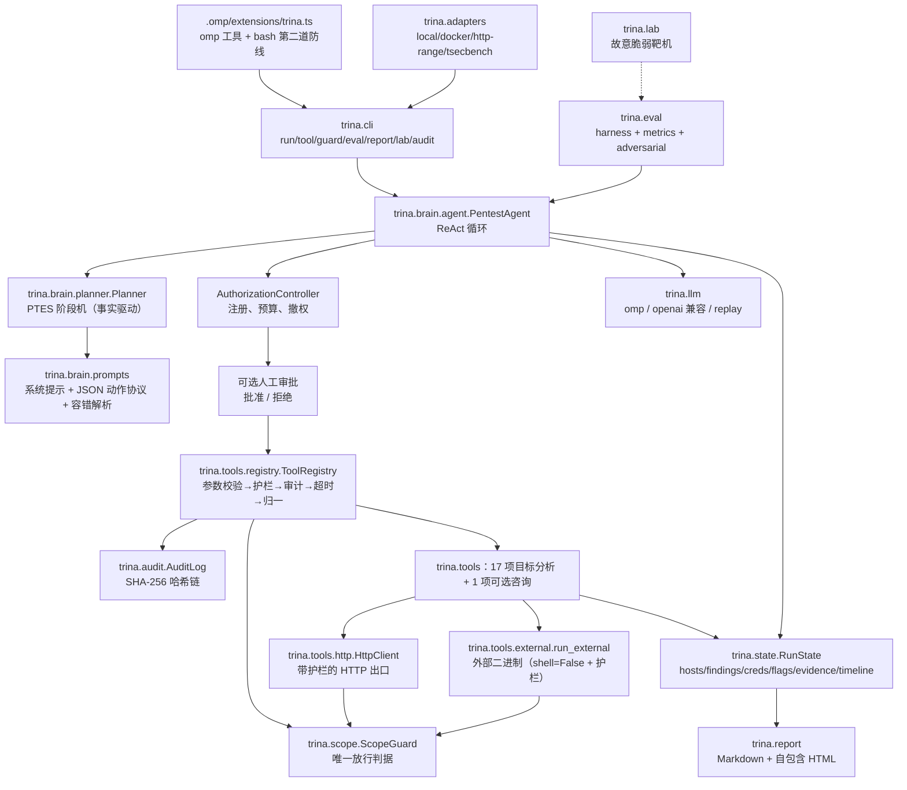

# 架构与模块契约

决策流程及每一步的设计理由详见[《设计决策》](../设计决策.md)。该文按实际执行顺序展开输入输出、规则、替代方案、失败分支和验证依据；本页保留总体模块契约。相关描述于 2026-10-26 对照实现核对。

## 1. 总览



## 2. 单步数据流

```
人工信号与任务剩余时间
    → GoalRequirements 缺口 + Planner 阶段 + 台账与方向调度
    → RunState 摘要 + 上一步观察 + 提示 + 预算
    → LLM 返回文本 → parse_action()
        ├─ 非法协议：记录错误并反馈下一轮
        ├─ final：检查目标缺口，最多拒绝两次提前结束，再按事实收尾
        └─ action：提取 test_id / target，计算候选动作等级，登记或引用假设
             → AuthorizationController.check（注册 / 预算 / 撤权）
             → 可选人工审批
             → ToolRegistry.execute(name, params, ctx)
                 ├─ 参数校验（未知 / 缺失 / 类型 / enum）
                 ├─ 工具可用性
                 ├─ 根据规范化参数计算等级，检查护栏与目标
                 ├─ tool.start → 工具执行与等待超时
                 └─ facts / evidence 吸收 → tool.end
             → 知识摘要变化、假设更新、失败分类、重复检测、调度遵从
             → 预算停止合同与周期快照
             → 下一步观察，或统一收尾
```

该顺序对应任务模式。控制器允许发生在完整工具参数校验和实际完成之前，故 `executed` 不能直接用作成功覆盖证明。对话模式共用执行组件，但没有相同的阶段机、方向调度和任务收尾流程。

## 3. 模块契约

| 模块 | 关键类型 / 函数 | 约定 |
|---|---|---|
| `trina.config` | `TrinaConfig.load(path, overrides)`、`ScopeConfig`、`scope_prompt_block()` | 配置是护栏的**唯一**数据源；`TRINA_<SECTION>_<KEY>` 环境变量可覆盖标量；未知字段直接报错（宁可启动失败） |
| `trina.scope` | `ScopeGuard.check_target/check_argv/check_payload/check_http/check_action_level/check_destructive/check_brute_scale/throttle`；`Decision`；`ScopeViolation` | 所有判定返回 `Decision`（含 `reason`/`hint`/`category`），拒绝时把 `hint` 回灌给模型换路径 |
| `trina.audit` | `AuditLog.open/append/verify/summary` | 每条记录 `hash = sha256(canonical(record - hash))`，`prev_hash` 链接；写入即 fsync；敏感字段自动脱敏 |
| `trina.state` | `RunState.absorb(facts)`、`add_finding`、`knowledge_digest`、`summary_for_prompt`、`to_dict/from_dict` | 工具声明 facts，状态集中合并；`knowledge_digest` 排除时间、重复条目与笔记，用事实变化计算进展；`from_dict` 供工作台/复核读历史运行 |
| `trina.tools.registry` | `ToolSpec`/`ParamSpec`/`ToolResult`/`ToolContext`/`Tool`/`ToolRegistry.execute` | 执行链是**唯一**入口；工具实现 `run(ctx, **params)`，返回 `ToolResult` |
| `trina.tools.http` | `HttpClient.request/get/post`、`HttpResult.as_evidence()` | 出网唯一出口：护栏 → 限速 → 请求 → 证据化；护栏拒绝时返回带 `error` 的结果而不是抛异常 |
| `trina.tools.external` | `run_external(argv, ctx, …)`、`which/have` | `shell=False`、先护栏后执行、命令与输出摘要进审计 |
| `trina.brain.agent` | `PentestAgent(config, registry=, backend=, on_step=).run(target, goal=, max_steps=, max_seconds=, record_path=) -> RunState` | 评测框架与 CLI 都只依赖这个签名 |
| `trina.brain.planner` | `Planner.tick/objective_met/directive/force_advance/should_finish` | 阶段推进只看**事实**；每阶段有步数预算，停滞可强制推进 |
| `trina.brain.goal` | `GoalRequirements.parse(goal)`、`unsatisfied(state)/soft_hints/satisfied` | 漏洞类与端口形成硬条件；路径在没有类要求时为硬条件，否则为提示；凭据形成验证提示。最终成功依据已表达的条件，不读取 ground truth；关键词解析不能表达全部自然语言语义 |
| `trina.hypotheses` | `HypothesisLedger.add/from_action/record_tool_outcome/record_outcome/prompt_block/finalize/summary` | 假设的排序/状态机与证据判定；模型仍选择动作，但确定性选取由 `trina.brain.scheduler` 每步派发；任务/对话共用验证对象匹配；`hypothesis_id` 复用台账；无新信息只降优先级，明确反证才能否定 |
| `trina.brain.failure` | `classify_failure`、`LoopGuard.observe`、`advice_for`、`alternatives_for` | 失败归因（boundary/tool/environment/budget/hypothesis）+ 无新信息重复识别，给出递进建议（换参数→换工具→人工） |
| `trina.brain.scheduler` | `HypothesisScheduler.decide(ledger, tests, executed_tests=, goal_classes=)`、`observe(decision, test_id=, tool=)` | **确定性假设调度**：只调度能绑定注册检查项的假设；任务要求的漏洞类优先（无假设时直接派该类检查项）；未遵从进审计链与 `state.scheduler` |
| `trina.evidence_graph` | `build(state, registry=, hypotheses=)`、`EvidenceGraph.to_mermaid/to_dict` | 结论可反向追溯：目标→主机→端口→路径→发现→证据，另有检查项/假设→发现；构建失败不影响报告 |
| `trina.board` | `render_board(state, hypotheses=)`、`summarise`、`latest_state_file`、`load_run_state` | 工作台视图的**唯一**渲染实现（控制台 `/board` 与 `trina watch` 共用）；`load_run_state` 把 state.json 还原成 `RunState` |
| `trina.brain.prompts` | `render_system_prompt(include_hypothesis)`、`build_system_prompt`、`build_step_prompt`、`parse_action`、`protocol_reminder` | 动作协议与阶段指引的**唯一**文本源；`include_hypothesis=False` 即基线口径（对照实验用），两条臂同模板渲染、不会漂移 |
| `trina.brain.chat` | `ChatAgent(config, registry=, backend=, approval=, steer_queue=, controller=).ask(text) -> str` | **对话式大脑**：共用护栏/控制器/审计/审批；每条消息最多 12 个动作；本轮请求 + 事实摘要 + 有界历史，保存动作/观察关系并回灌失败建议；不宣称具有任务模式的阶段机 |
| `trina.collaboration` | `SpecialistRole/Request/Result`、`Specialist.consult` | 专职 Agent 只持有后端并接收快照，返回不可信建议；recon/web 可建议白名单工具，review 只返回摘要；无工具执行、状态写入或递归委派入口 |
| `trina.tools.specialists` | `ConsultSpecialist`、`TOOLS` | 注册咨询工具，默认关闭；共享审批/控制器/护栏/审计；子调用数、输出长度与快照长度有界；空 facts/evidence；子响应按实际顺序进入任务录制 |
| `trina.llm` | `make_backend(LLMConfig)`、`LLMBackend.complete(system, user)`、`LLMUsage` | 后端实现只管"给提示词 → 返回文本 + 用量"；`ledger` 汇总进报告 |
| `trina.adapters` | `load_adapter/list_adapters`、`RangeAdapter.prepare/status/ground_truth/check_flag`、`score_tsecbench` | 靶场自描述（目标 + ground truth + flag 模式），评测框架据此自动判分 |
| `trina.policy` | `PolicyRegistry.load()`、`AuthorizationController.check/note_evidence/revoke/coverage`、`Budget` | **计划器提出、控制器批准**：注册目标/检查项 + 预算 + 撤权，逐动作裁决；模型无写权限 |
| `trina.session` | `Session.request_approval/answer/steer/toggle_pause/request_stop`、`level_needs_approval` | 人机协同原语；审批**超时即拒绝**（fail-closed） |
| `trina.play` | `build_plan(config, target=, range_name=)`、`run_plan(config, plan, approval=, steer_queue=, …)` | 一条命令开打的准备与执行；谁拉起靶机谁负责回收 |
| `trina.interactive` | `Console(config, input_fn=, output=).run()/handle(line)` | 行式交互控制台；空闲命令复用 CLI，运行中只放行介入类命令 |
| `trina.review` | `review_state(state, audit_path=, registry=) -> ReviewNote`、`ReviewNote.to_markdown()` | 评价 Agent（只读）：核对声明/证据、结论一致性、覆盖缺口、边界事件、审计链 |
| `trina.eval` | `EvalHarness(config, runner=).run(suite)`、`compute_metrics`、`AdversarialProxy` | `runner` 可注入，便于离线/回放评测 |
| `trina.report` | `build_report(state, cfg, meta=, audit_summary=) -> Report`、`Report.save()` | HTML 自包含（内联 CSS/SVG，无外部资源）；章节含"六、证据链与假设台账"（Markdown 带 mermaid，HTML 用起点-关系-终点表） |

## 4. 关键设计决策与理由

| 设计选择 | 解决的问题及理由 | 代价和限制 |
|---|---|---|
| 宿主自有循环、后端可替换 | 授权、状态和收尾有明确程序入口，模型连接与业务控制解耦 | 需要维护解析、反馈、上下文和不同入口的一致性；通用框架并非天然不能满足要求 |
| 单步 JSON 动作 | 每次执行后使用新观察，参数可校验，轨迹可录制 | 增加模型往返；解析器仍需容错与语义校验 |
| 目标约束独立于 final | 防止顺路 flag 或模型自评代替指定验证 | 当前是关键词规则，复杂目标和精确位置语义有限 |
| 阶段骨架加动态动作 | 用事实和阶段预算组织重点，保留根据新线索调整的空间 | 阶段可以预算推进，进入 exploit 不等于利用成功 |
| 假设台账与方向调度 | 记录待验证对象，比较期望检查与实际动作 | 优先级是启发式，绑定主要按漏洞类，调度不直接执行 |
| 控制器、审批与护栏分层 | 注册及预算、操作者判断、实际参数及传输分别裁决 | 提前允许记录与成功完成仍需区分，入口调用关系需要单独核对 |
| 工具统一契约 | 避免各工具遗漏参数、异常、审计和状态处理 | 仍信任工具返回的事实，尚无通用独立重放验证 |
| 内置能力与外部工具适配 | 常见能力在缺少外部二进制时可有降级路径 | 各工具能力与依赖不同，不能承诺全部外部能力均有等价内置实现 |
| 知识摘要与重复指纹 | 时间变化、重复发现不能持续冒充新进展 | 字段归一化不理解全部语义，raw 中变化文本仍可能影响指纹 |
| 哈希链、快照和报告 | 分别保存过程一致性、当前状态和可读派生视图 | 哈希链没有外部可信锚；快照读取不等于进程续跑 |

各选择的完整依据、计算示例、方案比较和验证见[设计决策](../设计决策.md)；控制归属见 [ADR-0001](../design/adr/0001-brain-own-react-loop.md)。

## 5. 错误隔离与收敛

| 情形 | 行为 |
|---|---|
| 工具抛异常 | 捕获 → `ToolResult(ok=False, error=…)`，计入 `counters.errors`，审计 `tool.error`，循环继续 |
| 工具超时 | `future.result(timeout)` 返回错误；预算为 `min(tool_timeout, max(5.0, remaining))`，未提供任务截止时使用工具预算；后台线程不会因此强制终止 |
| LLM 调用失败 | 单步最多 5 次尝试，间隔 2/4/6/8 秒；单步仍失败时增加共享 errors，达到 6 进入结束路径。errors 并非只含连续模型失败，最终状态仍依目标分支计算 |
| 模型输出非 JSON | 多级容错解析 → 仍失败则注入"只输出 JSON"提示并继续（计入 errors） |
| 动作被护栏拒绝 | 拒绝结果 + `hint` 回灌；计入 `counters.denied`；写入审计 `tool.denied` |
| 同一动作重复 | stall 首次为 0，默认阈值 3 通常在连续第 4 次相同动作触发纠正与阶段推进；不等于直接结束任务 |
| 步数/时长耗尽 | 在相应检查点退出并按事实收尾；模型重试、线程和在途请求具有独立等待边界 |
| 目标越界 | 预检阶段直接 `blocked`，**不进入 LLM**（模型无权授权） |

## 6. 状态与终态判定

`status` 描述任务执行结果：初始化越界直接 blocked，人工停止保留 stopped；存在非空硬性目标时，全部满足为 success，未满足但已有 flag/发现为 partial，其余为 failed。无硬性目标且状态仍为 running 时，有工具 flag 或带证据 verified/exploited 发现为 success，只有发现、主机或拒绝记录为 partial，其余为 failed。

主控收到 final 后最多两次拒绝未达成目标的提前结束，之后可以退出，但仍按实际目标和事实计算状态。模型 `final.status` 与 `final.flags` 不改写事实。任务目标、阶段和漏洞结论是不同概念，具体分支及现有边界见决策层说明第 19 节。

`RunState` 同时是报告的输入：`hosts / findings / credentials / flags / evidence / timeline / steps / ledger / counters / artifacts / verdict / coverage / boundary_events`。

### 6.1 结论状态与覆盖（P3 口径）

| 结论 | 判定 | 报告里必须同时给出 |
|---|---|---|
| `CONFIRMED` | 有控制器 executed 记录，且存在 verified/exploited、非空证据发现；优先于后续错误分支 | 已确认对象及证据，同时保留其他检查的缺口 |
| `NOT_CONFIRMED` | 有 executed 记录、无上述发现，且未命中 errors/failures/撤权/denied 分支 | 结论限于本次记录；不代表全部检查完成或全系统安全 |
| `INCONCLUSIVE` | 没有 executed 记录，或未确认发现且存在上述受限条件 | 缺口及原因，不将失败当作阴性证明 |

实际任务状态包括 running、success、partial、failed、blocked、stopped，verdict 单独保存；对话入口使用 chat 状态。PLANNED、ALLOWED、EVIDENCE_COLLECTED 可用于概念流程说明，不是当前 RunState 的一套完整已实现状态枚举。控制器在实际工具完成前写 executed，故覆盖与结论还受 [OQ-01](course/open-questions.md) 限制。

三类越界的记录方式（`RunState.boundary_events`）：
- **建议越界**：模型在 thought 里提到越界（只存在于审计的 `react.action.thought`）；
- **请求越界**：动作参数越界 → 控制器/护栏拒绝 → `boundary_events` 记 `stage=request, result=blocked`；
- **实际越界**：设计要求通过执行裁决阻止；如果观察到未获允许的目标行为，必须按实现缺陷记录并修复，不能仅凭架构图排除其可能。

### 6.2 人工介入点

| 介入点 | 位置 | 语义 |
|---|---|---|
| 审批闸门 | `PentestAgent(approval=…)` ← `Session.request_approval` | 按动作等级拦截，超时即拒绝 |
| 实时提示 | `PentestAgent(steer_queue=…)` ← 控制台 `hint` | 下一步注入 `[人工介入]` 提示 |
| 暂停/停止 | `pause_event` / `stop_event` | 循环边界检查；停止后按已获证据给出结论 |
| 撤权 | `AuthorizationController.revoke(target_id)` | 后续控制器 check 拒绝匹配目标，不承诺取消已放行或已在途动作 |

## 7. 扩展点

| 想加什么 | 改哪里 | 注意 |
|---|---|---|
| 新工具 | `trina/tools/<module>.py` 定义 `Tool` 子类 + 导出 `TOOLS` | 声明 `action_level`、`params`、`produces`；用 `ctx.http`/`run_external` |
| 新靶场 | `configs/ranges/<name>.yaml`（+ 必要时 `trina/adapters/` 新适配器类） | 给出 `targets`、`ground_truth`、`flag_patterns` |
| 新评测场景 | `trina/eval/scenarios/<suite>.yaml` | 必须声明 ground truth 与 `scoped_classes`，否则 precision 口径失真 |
| 新 LLM 后端 | `trina/llm/<name>_backend.py` + `make_backend` 分支 | 只需实现 `complete()` 并填 `usage` |
| 新报告格式 | `trina/report/` | 保持 HTML 自包含 |
| omp 侧新工具 | `.omp/extensions/trina.ts` | 一律转调 `python3 -m trina …`，不要绕过护栏 |

## 8. 专职 Agent 与状态一致性

主控可通过 `consult_specialist` 咨询具有独立上下文的 recon/web/review 角色，
默认关闭，配置为 `run.specialists`。它与普通工具共用执行链，子角色只返回建议，
主控需要再发出工具动作才能执行；没有第二套共享黑板或子 Agent 直接修改事实的入口。
`trina.board` 仍是只读视图，`RunState` 与假设台账分别保存事实和未验证问题。

调度使用控制器当前的检查记录；目标驱动分支先过滤已记录执行项再按漏洞类归组，假设绑定分支在该假设已有尝试时才过滤旧检查，新假设仍可能重用同类第一项。
已明确解析出检查 ID 时，不能仅凭同工具名把另一项检查计作遵从。
对话提示由本轮请求、事实摘要和近期动作/观察构成，失败反馈也直接进入下一次模型输入。
状态文件采用同目录临时文件写完后替换，避免进度视图读到半份快照。

方案比较、成本、超时局限、验证与重新决策条件见
[Agent 设计审查](AGENT_DESIGN_REVIEW.md)、
[ADR-0017](../design/adr/0017-specialist-consultation-without-blackboard.md) 和
[ADR-0018](../design/adr/0018-fact-context-and-atomic-snapshots.md)。
