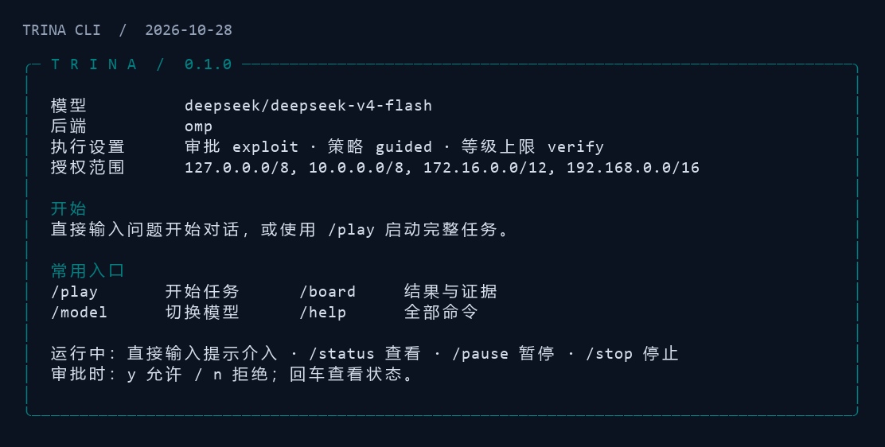

# CLI 界面与交互说明

版本：2026-10-28。界面保持行式交互，首页、模型回复、审批和结果采用统一卡片。终端窗口缩小时按显示宽度换行，中文、长 URL 和文件路径可以完整查看。



上图按实际渲染器的 88 列输出绘制；字体与颜色随终端设置变化。

## 启动与首页

```bash
python -m trina
python -m trina console --plain
```

正常终端自动使用颜色；`--plain`、`NO_COLOR`、`TERM=dumb` 或输出重定向时关闭颜色。`rich` 不可用时使用普通文本。`--plain` 控制的是颜色，仍保留卡片和中文文字。

首页集中显示模型、后端、审批模式、策略、动作等级上限和配置中的授权网段/主机。常用命令优先显示，完整说明保留在 `/help`。首页范围是配置摘要，实际允许与否仍以执行时的护栏判断为准。

| 操作 | 输入 | 展示与行为 |
|---|---|---|
| 开始对话 | 直接输入问题 | 显示正在分析提示，回复以单张卡片呈现，会话统计放在卡片底部 |
| 完整任务 | `/play` 或 `/run <target>` | 显示任务开始信息、逐步结果及结束工作台；配置和执行规则沿用原入口 |
| 运行状态 | `/status` 或空行 | 显示运行、暂停、停止中或待审批；可查看最近步骤和耗时 |
| 工作台 | `/board` | 空闲时显示已有状态；运行中可用，尚未取得完整状态时展示当前任务摘要 |
| 人工提示 | 运行中直接输入文字或 `hint <文本>` | 投递给当前任务，下一轮由原有执行循环读取 |
| 暂停与恢复 | `/pause`、`/resume` | 发出原有控制信号；提示符在下一次读取输入时显示相应状态 |
| 停止 | `/stop` | 请求原有停止流程，不将“停止中”显示为“已停止” |
| 审批 | `y`、`n` | 展示工具、等级、检查项、参数和理由；交互控制台超时仍拒绝 |
| 帮助 | `/help` | 分组展示会话、模型、工具、任务和运行中命令 |

当前仍使用标准行输入，后台进展会追加输出；没有实现全屏 TUI、自动补全或逐 token 流式回复。提示符的状态在下一次读取输入时刷新，等待期间通过进展行和审批卡片提示变化。

`trina run` 与 `trina play` 也使用相同的步骤和结果展示。一次性 `play` 入口仍按原规则同步等待输入，回车拒绝；它不显示控制台专用的审批超时承诺。

## 工作台数据如何阅读

工作台的流程行标出当前记录的阶段，不把阶段位置换算为完成百分比。阶段可以因预算推进，因此“进入验证阶段”不能解释为已经获得验证结果。

步数取 `RunState.counters.steps`，避免把同一步的工具日志和决策记录重复计数。最近动作从工具记录中筛选，决策记录不会把真正的最近工具挤出列表。

覆盖栏使用“获准检查 / 未覆盖”。当前控制器在放行时写 `executed`，可能随后被人工拒绝或执行失败，因此界面明确提示“获准记录不等于执行完成”。这次修改纠正展示用语，底层覆盖生命周期问题仍见 [OQ-01](course/open-questions.md)。

“标记已验证”统计发现自身状态，最终漏洞结论单独显示。查看结论时仍需要结合证据和审计，不把发现数量、阶段或模型回复当作确认依据。结果卡片同时显示工作目录、状态文件和审计路径，方便查找原件。

运行中的 `/board` 优先展示当前会话；当任务尚未返回完整状态时，显示当前目标和最近一步，不回退展示上一轮任务。完整任务与聊天会话的假设台账按状态对象对应，避免将另一段聊天中的假设混入任务结果。

## 输入与显示边界

带 `/` 的命令如果引号未闭合，显示具体错误并保留在命令入口，不发给模型。未知命令显示相近命令提示；自然语言仍按原有聊天路径处理。

`quit` 与 `/quit` 使用同一退出流程。任务运行中第一次输入提醒先停止，第二次输入退出并进入既有清理流程。清理仍受当前线程和工具取消机制的限制。

模型文本、目标和工具摘要作为字面量显示；类似 `[bold red]` 的字符串不会变成终端样式。卡片去掉外部 ANSI 控制序列及方向控制字符，避免响应文本清屏、改窗口标题或伪造显示方向。审批卡片对常见敏感字段做显示脱敏，实际执行参数不由展示层改写；自由文本中的敏感内容不属于字段脱敏的完整保证。

## 独立监视与日志

```bash
python -m trina watch --once
python -m trina watch <run_id>
```

交互终端中的 `watch` 按间隔刷新；输出到文件或管道时只输出一份快照并结束，不发送清屏字符。这使日志和自动化采集能够读取普通文本。需要持续采样时由调用方定时执行 `watch --once`。

## 实现与验收

- [terminal.py](../trina/terminal.py)：卡片、消息、首页、步骤和审批渲染，以及显示宽度和颜色判断。
- [interactive.py](../trina/interactive.py)：输入分发、当前任务选择、回复和状态展示。
- [board.py](../trina/board.py)：从已有运行状态构造只读工作台；与多 Agent 共享黑板无关。
- [test_terminal_ui.py](../tests/test_terminal_ui.py)：覆盖 20/40/64/88/120 列窗口、颜色与纯文本、缺少 rich、控制字符、步骤统计、台账隔离、审批超时、命令错误及重定向监视。

执行验证：

```bash
python -m unittest discover -s tests -p test_terminal_ui.py -v
python -m unittest discover -s tests
python -m scripts.verify_course_pack
```

[本轮测试与启动记录](../evidence/20261028-cli-ui/README.md)保存实际输出。多 Agent 与黑板的研究判断见 [ADR-0017 的 2026-10-28 复核](../design/adr/0017-specialist-consultation-without-blackboard.md)。
