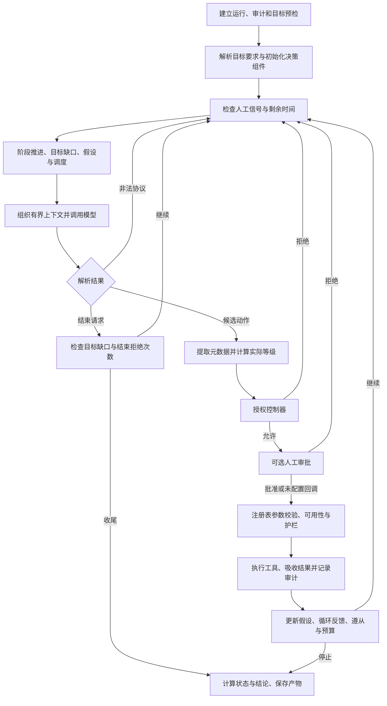

# Trina 决策层设计说明

版本：2026-10-26。适用实现：产品代码基线 `24fb637`，核对起点为仓库提交 `cede4ef`；两者之间的课程提交未改变决策代码。本文解释现有设计及其代价，不把设计目标、历史实验和未来能力混写为已经实现的事实。

教师阅读入口：[开题报告与第一次汇报](../开题报告与第一次汇报.md)。模块接口见[架构与模块契约](ARCHITECTURE.md)，具体需求编号见[课程规格](course/specification.md)，本次核对记录见[2026-10-26 文档验证](../evidence/20261026-decision-docs/README.md)。

## 阅读顺序

本文围绕一次任务的实际执行顺序展开。第 1—3 节说明决策职责和总体结构；第 4—20 节逐步解释任务建立、目标约束、阶段推进、假设排序、调度、模型动作、执行裁决、证据更新和收尾；第 21—24 节说明对话模式、专职咨询、完整案例及方案取舍；第 25—27 节给出验证入口、已知限制和设计演进条件。

阅读单个步骤时，需要同时看它的输入、判断依据、输出和失败分支。一个模块的“允许”只表示通过该模块负责的条件，不能自动解释为后续审批、工具执行和漏洞验证均已完成。

## 1. 决策层究竟要解决什么问题

安全测试的下一步取决于前一步实际发现了什么。发现开放端口后需要识别服务；发现带参数的接口后需要判断哪一种验证方法能区分假设；工具报错后需要区分参数错误、服务不可达和证据不足。如果预先固定全部命令，流程难以适应不同目标；如果把所有选择交给模型自由展开，任务又可能偏离目标、反复尝试或提前宣布成功。

Trina 的决策层负责把“用户提出任务”转为“一次次可以裁决和复核的动作”。它需要回答五个具体问题：当前还有什么目标未完成；现有事实支持优先检查什么；候选动作是否具备合法的执行条件；结果带来了哪些新事实；继续执行是否仍有必要和预算。大模型主要处理不确定的解释与候选动作，宿主 Python 程序处理可明确计算的规则、状态和边界。

设计目标包含三个相互制约的方面。第一，允许根据工具观察调整路线，使系统具有任务适应能力。第二，保留单步控制点，使授权、人工介入、超时和审计可落实到具体动作。第三，将运行结果和模型文字分开，使报告中的事实能够反向定位到工具产物。这三个目标共同决定了当前“主控循环 + 阶段机 + 假设台账 + 确定性方向调度 + 分层裁决”的结构。

这里的“决策可解释”指保存候选动作理由、选取规则、裁决结果和事实变化。`thought` 是模型提供的简短理由声明，不能据此声称系统取得了模型内部全部推理过程；复核仍需结合当时的状态、规则与执行结果。

## 2. 决策权怎样分配

| 决策问题 | 实际承担者 | 可读取的依据 | 可以产生的结果 |
|---|---|---|---|
| 本任务要求什么 | `GoalRequirements` 与用户原始目标 | 目标文本、当前事实 | 硬性缺口、路径提示、凭据提示 |
| 当前处于什么作业阶段 | `Planner` | 端口、技术栈、路径、发现、flag、阶段步数 | 当前阶段、阶段指引及推进原因 |
| 哪个待验证问题更值得处理 | `HypothesisLedger` | 假设字段、尝试结果和状态 | 排序后的待验证问题 |
| 本步优先落到哪个注册检查 | `HypothesisScheduler` | 台账、当前目标检查项、控制器记录、目标漏洞类 | `ScheduleDecision`，进入提示词 |
| 实际提出什么工具和参数 | 主控模型 | 有界状态摘要、阶段任务、调度及上一步观察 | JSON 候选动作或结束请求 |
| 注册、预算与撤权条件是否允许 | `AuthorizationController` | 宿主注册表、策略模式、预算和撤权集合 | allow / deny、解析后的检查 ID、原因 |
| 操作者是否批准该候选动作 | 可选审批回调与 `Session` | 工具、参数、实际等级、目标和理由 | 批准、拒绝或超时拒绝 |
| 工具参数与实际请求是否可执行 | `ToolRegistry`、`ScopeGuard`、受控传输封装 | 参数表、工具等级、目标、请求及命令内容 | 结构化结果或拒绝结果 |
| 哪些内容可以成为事实 | 工具契约、`RunState`、台账更新规则 | 工具 facts、evidence 和对象匹配 | 状态变化、发现升级、假设状态 |
| 是否满足目标、如何收尾 | 主控的确定性收尾代码 | 目标要求、带证据发现、运行错误及覆盖记录 | `status`、`verdict`、未解决项和审计 |

分配职责的原因在于各类判断的稳定性不同。漏洞假设和下一步参数存在探索空间，适合由模型提出；目标范围、注册 ID、预算和状态写入具有明确规则，应由程序处理。把它们全部放进提示词会使权限取决于模型是否遵守文字；把它们全部写成固定扫描顺序，又会丢失根据观察调整路线的能力。

上述模块仍运行在同一宿主进程或其线程中。职责划分提供代码层面的控制和审查位置，当前没有借此实现进程级隔离、多人身份系统或可信远程审批服务。

## 3. 一次任务的总体执行顺序



该图按 `PentestAgent.run()` 的当前调用顺序绘制。控制器和人工审批位于 `ToolRegistry.execute()` 之前，工具参数的完整校验位于注册表内部。这一点决定了后面的“已允许”记录为何不能直接当作成功执行证明。

循环采用单步单动作。每次工具执行后先回收结果，再组织下一次模型输入，因此下一步可以使用最新事实。批量执行一整段模型计划会使中途撤权、失败、预算变化和新证据难以及时影响后续动作。当前设计承担了较多轮次的模型调用成本，换取逐动作控制和清晰的动作—观察对应关系。

## 4. 步骤一：建立运行并在模型调用前预检目标

### 4.1 输入、动作和输出

入口接收目标、自然语言目标描述、步数及时长覆盖值、附加规则、初始提示和可选录制路径。宿主创建 `run_id`、`RunState`、运行目录和审计对象，先写 `run.start`，再通过 `ScopeGuard.check_target(target, action="preflight")` 检查初始目标。

预检拒绝时，运行状态设为 `blocked`，记录原因、结束时间和产物位置，保存状态后直接返回。此分支不进入模型推理，也不执行目标工具。范围判断可能进行域名解析；“模型零调用、目标工具零调用”不应扩大解释为绝对没有任何 DNS 活动。

### 4.2 为什么把预检放在最前面

初始目标是否允许访问由配置决定，调用模型不会增加这项判断的可信度。提前检查能避免为明显无权执行的任务消耗模型预算，也能给操作者稳定的拒绝原因。审计先于拒绝判断建立，则被拒任务仍有可定位的记录，不会只在终端留下临时提示。

预检只能覆盖任务入口。模型后续可能提出另一个 URL，HTTP 也可能跳转，因此每次动作及后续请求仍需检查。只做一次预检会让后续地址变化绕过最初的范围判断。

### 4.3 代码与验收依据

实现位于 [`PentestAgent.run`](../trina/brain/agent.py) 的初始化和 preflight 分支，以及 [`ScopeGuard`](../trina/scope.py)。现有测试 `test_brain.TestReActLoop.test_out_of_scope_is_blocked_without_llm` 验证初始拒绝与模型调用边界；`test_mid_run_pivot_to_out_of_scope_is_denied` 验证中途改目标仍受限制。

## 5. 步骤二：把自然语言目标转成可检查的完成条件

### 5.1 实际解析哪些内容

[`GoalRequirements.parse`](../trina/brain/goal.py) 使用明确的关键词和正则提取漏洞类、路径、端口、凭据提示及是否提到 flag。它没有调用第二个模型理解目标，也没有读取评测 ground truth。由同一段用户描述产生相同的结构化要求，有利于离线重放和解释任务为何未完成。

| 内容 | 当前处理方式 | 设计理由与代价 |
|---|---|---|
| 漏洞类 | SQL 注入、LFI、命令执行等关键词映射到规范类型，作为硬条件 | 防止无关发现代替任务；关键词语义有限，不能理解任意否定、条件和复杂组合 |
| 端口 | 过滤明显年份、计数、时间单位后形成硬条件；在任一主机记录该端口即视为覆盖 | 避免把“3600 秒”当作端口；当前没有把端口要求完整绑定到指定主机对象 |
| 路径 | 没有漏洞类要求时为硬条件；已有漏洞类时降为提示 | 减少辅助路径未形成 finding 导致的误判；精确指定位置的任务契约仍不完整 |
| 凭据 | 提取用户名和口令，形成单组验证提示 | 用于选择验证方式；凭据本身不使 `empty` 变为 False，也不是独立成功硬条件 |
| flag | 记录 `explicit_flag`，通用收尾仍依赖工具事实 | 仅出现“拿到 flag”不会形成漏洞类硬条件；模型自报 flag 不写入事实 |

普通漏洞类要求必须由同类、带证据、状态为 `verified` 或 `exploited` 的发现满足。信息泄露、开放端口、服务指纹和安全头配置等 `DETECTION_ONLY` 类允许以带证据的发现满足。路径匹配当前使用 URL/target 中的子串，要求发现携带证据，并非完整的 HTTP 路由约束解析器。

### 5.2 为什么目标检查独立于模型结束声明

假设用户要求“验证 SQL 注入”，工具顺路读到一个 flag。flag 是一个事实，但没有回答 SQL 注入是否存在。如果成功判定只看 flag，运行会提前结束，报告却仍可能看起来完整。目标要求在每轮重算缺口，并在收尾再次判断，可以阻止这种目标替换。

规则化解析的代价也需要明确。例如“不要测试 SQL 注入”仍包含关键词，当前解析器没有完整的否定语义。对于路径与漏洞类必须同时精确满足的要求，现有“类为硬条件、路径为软提示”也不足以表达。此类任务应采用明确的结构化任务契约后再提高自动验收承诺，不能把当前解析器描述为通用需求理解引擎。

### 5.3 验证入口

查看 [`tests/test_brain.py`](../tests/test_brain.py) 中 `TestGoalRequirements`：`test_path_only_requirement_is_hard`、`test_path_requirement_is_soft_when_class_present`、`test_port_requirement_blocks_until_scanned` 和 `test_class_requirement_needs_evidenced_finding`。这些测试分别覆盖规则的不同分支，不能仅用一个“任务成功”用例代替目标语义检查。

## 6. 步骤三：处理人工信号与运行时间

每轮开始先检查停止事件，再等待暂停事件解除，随后取出人工提示队列，最后检查 `ToolContext` 的剩余时间。提示写入本轮待发送上下文，并在状态时间线中留下记录。已到时间预算时结束推进，保存此前获得的事实。

将人工信号放在循环边界，使操作者能够在两次动作之间改变任务方向。人工提示只补充上下文，执行权限仍由配置和程序判据控制。暂停保留内存中的任务状态，继续后可以接着推进；它没有建立跨进程续跑协议。

当前检查位置有明确限制。停止信号不能中断正在等待的模型或正在运行的工具；暂停等待会持续检查停止事件，但跳出暂停等待后没有立刻再次执行循环顶部的停止分支，仍可能继续本轮逻辑。因此准确语义是“在可响应的检查点停止推进”，不能表述为“按下停止瞬间所有行为终止”。运行时强取消需要为模型、HTTP 和子进程分别建立取消协议。

总任务 deadline 使用单调时钟，减少系统时间调整对预算的影响。控制器另有从创建时刻开始累计的逻辑时间，两者起点和检查位置不同。它们共同限制推进，不能简单取一个数字当作整次任务的绝对墙钟上限。

## 7. 步骤四：用阶段机组织作业重点

### 7.1 阶段推进规则

[`Planner`](../trina/brain/planner.py) 提供 `recon → enum → vuln → exploit → post → report` 的作业骨架。每轮 `tick()` 先累计阶段步数与停滞信息，再判断阶段目标、阶段预算和强制推进标记。

| 阶段 | 当前代码判据 | 为什么采用这个信号 |
|---|---|---|
| recon | 任一主机已有端口记录 | 说明已有可供服务识别的入口，继续无目标地重复扫描收益下降 |
| enum | 任一主机已有技术栈或 Web 路径 | 单纯“主机存在”不足以证明攻击面已识别，需要可继续验证的线索 |
| vuln | 存在 verified/exploited 状态发现，或已有发现且阶段步数至少 3 | 优先利用较强线索，也允许线索有限时进入定向验证，避免阶段永久卡住 |
| exploit | 存在 verified/exploited 状态发现或 flag | 以已有执行结果判断是否转向后续取证 |
| post | 存在 flag 或凭据 | 已具备收尾所需的一部分材料，转交最终目标检查 |
| report | 阶段目标默认满足；主循环检查能否结束 | 将最终收敛集中到统一位置 |

阶段预算为 `max(4, max_steps // 6)`；默认总步数 40 时，每阶段预算为 6。这个预算控制某个阶段占用的轮次，阶段目标未达成时也可能因预算或强制推进进入下一阶段。`vuln` 没有发现时，当前 `_next_phase()` 仍返回 `exploit`，让现有定向工具尝试验证可利用性。

### 7.2 为什么阶段推进不能当作漏洞证明

阶段表示“当前重点做什么”。进入 exploit 可能来自已有线索，也可能来自预算推进；它不证明已经获得利用能力。`Planner.has_verified()` 当前只检查发现状态，没有像最终结论那样再次要求非空证据。最终目标满足、假设确认和 verdict 因而必须各自执行证据判断。

这种分离允许流程在信息不足时继续探索，同时保留严格的最终事实门槛。若把阶段变化直接写成“侦察完成、漏洞已验证、利用已成功”，会把调度启发式误当成验收证据。报告应同时展示阶段原因和实际发现状态。

### 7.3 阶段如何影响动作

阶段指引会向模型提供当前重点，以及开放端口、已知路径和发现等摘要。当前任务入口构造工具提示时提供全量可见注册工具，并未调用 `tools_categories()` 强制限制阶段工具。因此阶段是一种方向约束；真正的权限边界在控制器和护栏。

这一选择允许模型在验证阶段返回侦察补足信息，避免阶段切换后失去必要工具。代价是模型仍可能选偏，需要目标缺口、调度、重复检测和最终验收共同约束。验证见 `TestPlanner` 的阶段、预算、停滞推进及指引相关测试。

## 8. 步骤五：把待验证问题保存为假设

### 8.1 假设对象解决什么问题

只有聊天文字时，“这个接口可能有 SQL 注入”会随着上下文截断而丢失，也难以知道它是否已尝试、为何暂缓或对应哪条证据。`Hypothesis` 将 statement、漏洞类、目标、参数、置信度、价值、信息增量、成本、风险、尝试数及状态保存为结构化对象。

模型可以在动作中提出 `hypothesis`，后续使用 `hypothesis_id` 引用已有对象。引用已有 ID 时直接复用台账记录，不允许通过附带同 ID 的新描述覆盖旧假设。相同描述出现在不同 URL 或参数上时分别保存，以免一个位置的验证结果污染另一个位置。

新假设是在本轮模型动作解析后登记。因此本轮模型刚提出的假设不会反过来参与本轮已经完成的调度选择；它先随当前动作获得结果，再在后续轮次参与排序。第一轮没有假设时，调度仍可依据目标类直接选择注册检查。

### 8.2 优先级公式为什么这样组成

```text
priority = confidence × value × info_gain / (cost + λ × risk + 0.05)
```

置信度表示现有线索的可信程度；价值表示该问题与任务成果的关联；信息增量表示验证结果能否明显减少不确定性。三项相乘，使“很可能成立但与任务无关”或“反复验证却学不到新信息”的问题不轻易占据首位。成本和风险放在分母，减少昂贵或高风险路径的优先级；`0.05` 防止分母趋零，`λ` 用于调整风险权重。

例如 A 的 P/V/I/C/R 分别为 0.8/0.8/0.6/0.4/0.2，λ 为 1，则得分约 0.5908；B 分别为 0.6/0.6/0.8/0.2/0.1，得分约 0.8229。B 的置信度较低，但信息量相对成本更好，因此排序可能靠前。之后调度还会优先任务所要求的漏洞类，分数并非唯一裁决依据。

这些值是启发式输入，不是统计校准后的概率。“高、中、低”映射到有限数值，数值输入则被限制在 0.05—1.0 范围。模型可以影响排序权重，但不能用高分获取执行权限；真正的风险等级和范围仍由工具与护栏计算。确认或否定后的假设优先级为零，不再作为开放问题调度。

### 8.3 容量和去重的边界

台账默认最多 40 项；新增开放假设时结合验证对象和描述前缀做复用，描述截断保存。该方法成本低，适合课程原型，但不是完整的语义去重。容量达到上限时，当前实现从所有项中移除最低分项，因此已确认或已否定的零分记录也可能被移除；不能声称其只淘汰未解决项或永久保留全部历史。

台账本身也不构成任务依赖图，没有“先登录成功才能检查接口”的通用前置条件求解。它主要回答当前保存的问题、尝试和证据状态。实现见 [`trina/hypotheses.py`](../trina/hypotheses.py)，对象匹配及引用保护见 [`tests/test_decision_evidence.py`](../tests/test_decision_evidence.py)。

## 9. 步骤六：将假设排序转成确定的检查方向

### 9.1 为什么还需要一个调度器

把排好序的假设放进提示词，只能证明模型看到了这些内容，无法知道模型是否实际处理了最高优先级问题。`HypothesisScheduler` 在调用模型前选择一个可以绑定到注册检查项的方向，形成包含检查 ID、工具、假设、分数和理由的 `ScheduleDecision`。这样可以比较“期望检查”与“实际动作”，并记录偏离情况。

调度器使用确定性规则，适合做稳定的候选筛选；模型继续负责结合最新观察给出实际参数，必要时说明换路原因。当前设计没有把调度结果直接变成自动工具调用，因此允许错误或不适用的调度被后续推理纠正，但也保留了模型不遵从的可能。

### 9.2 真实选择顺序

1. 从台账中取得 `open` 或 `verifying` 项。缺少漏洞类或目标的描述性假设不参与调度，因为无法知道它具体要验证什么。
2. 计算优先级，低于默认 `0.15` 的项跳过。门槛是当前经验参数，用来避免低价值问题持续占用调度位置，没有经过概率意义上的最优性证明。
3. 用规范化漏洞类匹配当前目标注册检查的 `expect_finding`。例如别名可以映射到同一类型；阶段名 recon、enum 不属于发现类型，通常无法绑定。
4. 若任务有漏洞类要求，先保留命中这些类的候选。没有对应假设候选时，尝试从注册表生成 `source="goal"` 的目标驱动指令。
5. 假设候选中选择最高分；相同分数和同类检查的选择受当前迭代顺序影响，没有额外求解全局最优计划。
6. 将结果加入本轮上下文。若没有可绑定方向则返回 None，让模型依据状态、阶段与任务继续选择。

目标驱动分支先排除已记录执行的检查，再按类型选取代表项，最后按类型名称的稳定排序派发。其 `score=1.0` 表示目标驱动指令的标记值，不能解释成漏洞存在概率为 100%。`goal_classes` 当前接收全部解析出的目标类，并没有按每一类是否已经有证据完成来重新计算剩余类集合。

### 9.3 “不重复”的实际条件

调度器读取当前 `controller.executed`，避免使用直到收尾才刷新的旧覆盖快照。但假设绑定分支还有一项条件：当该假设 `attempts > 0` 时，才过滤已经执行的同类检查；从未尝试的新假设仍可能绑定第一条同类检查，即使该检查已经为另一个假设记录执行。

因此，当前实现能解决旧快照和部分重复绑定问题，尚不能保证“每个检查 ID 全局只运行一次”。而 `executed` 又是控制器允许阶段的记录，过滤它可能跳过后来被人工拒绝或工具失败的检查。这是调度与生命周期耦合的代价，详见 OQ-01、OQ-04。

绑定主要依据漏洞类，不完整比较假设 URL、参数、端口和前置条件。相同类型的多个接口需要更细的对象关联才能避免错配。`ScheduleDecision` 携带这些字段有助于提示与解释，但字段存在不等于绑定算法已经使用它们。

### 9.4 如何定义遵从

执行返回后，`observe()` 比较控制器解析后的实际 `test_id` 与调度 ID。双方都有 ID 时必须相等；没有解析出实际 ID 时才回退比较工具名。因此同一工具执行另一个检查，不应在已有明确 ID 的情况下计为遵从。

连续两次未遵从后，提示使用更强的 `required` 文案；程序不会据此绕过控制器，也不会直接强制执行工具。控制器拒绝、人工拒绝等提前 continue 的分支没有进入该次 observe，因此 `decisions` 可能大于 `followed + missed`。遵从率的分母是后两者之和，反映到达观察位置的动作匹配情况，不等于任务完成率、成功覆盖率或漏洞发现率。

该设计记录“选择有没有落实到动作”，为调度实验提供可解释指标。它不判定动作是否成功：一个按指定 ID 调用但被后续护栏拒绝的结果，仍可能满足 ID 层面的遵从。代码和接口见 [`scheduler.py`](../trina/brain/scheduler.py)，决策背景见 [ADR-0016](../design/adr/0016-deterministic-hypothesis-scheduling.md)。

## 10. 步骤七：构造模型真正看到的上下文

### 10.1 固定规则与动态事实为什么分开

系统提示包含角色、动作协议、工具清单、由 `scope_prompt_block()` 生成的范围描述，以及注册检查项。配置同时供程序判据读取，使说明和执行规则有共同来源。动态提示每轮重新构造，包含当前事实摘要、阶段指引、预算、人工提示、目标缺口、假设排序、调度和上一条观察。

固定规则较少变化，动态事实随工具结果更新。分开组织后，模型能看到当前任务缺什么，而无需从完整历史中重新推断全部状态。当前任务模式主要依赖结构化状态与上一条观察，没有把无限增长的聊天记录反复发送给模型。

### 10.2 上下文预算怎样落地

| 片段 | 当前限制或组织方式 | 原因与损失 |
|---|---|---|
| 状态摘要 | 默认约 4000 字符；端口、技术栈、路径、凭据标识、flag 和发现按规则组织 | 控制上下文体积，但尾部内容可能截断，不能保证所有发现每轮可见 |
| 上一条观察 | `build_step_prompt()` 再截断到 3000 字符 | 避免长扫描输出占满提示；详细证据仍应从产物追溯 |
| 提醒 | 最多前 6 条 | 减少多个错误反馈互相淹没；顺序会影响哪些提示实际进入模型 |
| 假设摘要 | 默认展示前 5 个开放问题 | 突出当前优先级，但不能据此认为台账只包含 5 项 |
| 工具清单 | 构建任务系统提示时加入；咨询关闭时排除咨询工具 | 让模型使用合法工具名与参数，同时减少关闭能力的误调用 |

结构化摘要由已有事实生成，不额外调用模型总结，可避免摘要模型再次创造事实。摘要中的凭据只列用户和服务等信息，不直接展示口令；但任务原文、凭据提示、工具原始观察仍可能含敏感内容。这一局部处理不能推广为全链路自动脱敏。

外部响应在提示中被标记为数据，实际授权仍由程序控制。该组合能降低外部文本被误用为许可的风险，但不能保证模型的所有内容选择都不受提示注入影响。重点是让受到影响的候选动作仍接受范围和执行裁决。

## 11. 步骤八：调用模型及处理暂时失败

### 11.1 为什么模型只返回文本与用量

主控通过统一后端接口请求响应，后端可以是模型接入工具、OpenAI 兼容接口或固定回放。后端负责连接、文本与用量，主控保存工具执行权。更换模型时，目标、工具注册、授权及事实结构无需一起替换。

回放后端能够在相同的固定候选动作下重测执行机制。它有助于定位“模型选错动作”与“执行链处理错误”的区别，但不能证明真实模型在同样任务中会自主产生这些动作。

### 11.2 具体重试规则

`MAX_LLM_RETRIES=4`，`_ask()` 中使用 `range(MAX_LLM_RETRIES + 1)`，所以单个决策步最多尝试 **5 次后端调用**。未得到成功且非空的响应时，四次间隔分别为 2、4、6、8 秒。这个有限退避允许短暂服务抖动恢复，也防止立即连续重试挤占后端。

当 `_ask()` 返回 `response.ok=False` 时，外层增加 `state.counters["errors"]`，写入 `llm.error`，返回失败观察；达到 `MAX_LLM_FAILURES=6` 阈值时进入结束路径，否则再等待最多 8 秒后继续下一轮。如果最后一次响应标记 ok 但文本仍为空，则会继续进入协议解析失败分支，不能把这两条路径混作同一种后端错误。

`errors` 还会被协议解析失败和部分工具异常增加，成功响应也没有在这里清零。因此当前阈值是共享错误计数的比较，不能写成“连续六次纯模型失败”。`llm_calls` 在任务模式成功返回后增加，也不是底层全部重试次数；费用与调用分析应结合后端 ledger，不能只看这一个计数器。

### 11.3 重试与总预算的关系

`_ask()` 的重试间隙没有重新检查 stop_event 和任务剩余时间。模型单次 timeout 与任务时长是不同层的限制，长调用及重试可能使实际墙钟时间越过主循环预计截止点。有限重试限制了尝试次数，但没有实现整条调用链共享的强制截止机制。

这项取舍让当前后端适配保持简单。严格截止需要后端支持取消或可中断等待，并将剩余预算逐次传递下去；仅修改提示词中的“剩余秒数”无法获得相同保证。

## 12. 步骤九：解析 JSON，保留一步一个动作

### 12.1 采用文本 JSON 的理由

文本 JSON 可以在不同后端间保持同一份动作结构，也便于录制、回放、审计及测试。字段能明确区分工具名、参数、检查 ID、假设和结束请求。相比执行自由文本命令，它提供了后续校验所需的结构化接口。

代价是需要处理模型夹带说明、代码围栏、多对象和缺字段等情况。当前 `parse_action()` 使用字符串与转义感知的括号扫描提取顶层对象，避免简单正则把 JSON 字符串内部的大括号误当作对象边界。

### 12.2 容错如何工作

解析器收集去掉代码围栏后的文本和扫描到的 JSON 对象，再按偏好尝试。任务模式默认优先最后一个包含 `action` 或 `final` 的合法对象，适应模型先写草稿、最后修正动作的输出；对话模式使用 `prefer="first"`，避免一段解释中包含多个候选时直接跳到后面的动作。

当前解析器要求结果为对象，并存在 action/final 字段；它不负责完整语义校验，也没有在主控入口强制二者互斥。若两者同时存在，任务代码先处理 final。`params` 不是对象时，主控转为空字典，随后由工具参数表处理缺参。未知工具名也不会因为 JSON 合法就成为可执行工具。

非法协议会消耗当前决策轮次，增加错误计数，记录原始片段，并向下一轮注入协议纠正提示。这样可以恢复偶发格式偏差；若反复失败，总步数和错误机制仍会使任务收尾。

### 12.3 元数据为什么要从工具参数中摘出

`test_id` 可以出现在动作顶层，也容忍字符串形式放在 `params` 内；后者在执行前被取出。因为检查 ID 属于控制器元数据，工具函数通常不声明该参数，直接传入会被注册表判为未知参数。兼容这种常见输出形式，能减少没有业务价值的格式重试。

控制器使用 `params.target`、`params.url` 或任务目标计算动作目标，并先取得工具的动态等级。等级函数异常时回退静态声明；这个回退的保守程度取决于工具静态等级是否设计正确，不能泛称任意工具异常都绝对不会降低实际风险。

## 13. 步骤十：让独立控制器裁决注册、撤权与预算

### 13.1 控制器按什么顺序检查

[`AuthorizationController.check`](../trina/policy.py) 先尝试匹配目标，并可能按本次任务的默认目标做同主机继承。随后依次检查检查数与逻辑时间预算、目标撤权、目标注册要求和检查注册要求。允许后增加 `checks_used`，将解析出的检查 ID 加入 `executed`，写入 policy 审计并返回。

先检查预算和撤权，可以使这些条件对多种工具一致生效。注册表由宿主加载，模型只能引用已有 ID，无法在同一个候选动作里自建一条批准记录。返回解析后的 test_id，使人工审批、调度比较和覆盖视图使用相同标识，减少 guided 反查导致的名称不一致。

### 13.2 三种策略模式的具体区别

| 模式 | 目标与检查注册的处理 | 仍然存在的共同限制 |
|---|---|---|
| free | 不强制 guided/strict 的注册约束 | 控制器的预算、适用的撤权逻辑和后续护栏仍存在 |
| guided | 注册表提供方向；可按工具和目标反查检查 ID；未注册动作记录后交给后续护栏 | 提示中的“已注册检查”不等于所有动作都必须属于注册表 |
| strict | 在注册表非空的条件下，要求合法目标、test_id、绑定工具和所属目标关系 | 仍需工具参数校验、人工审批与真实请求护栏 |

当前 strict 检查带有 `not registry.empty` 条件，空注册表时不会按“无注册即拒绝全部”的方式执行。默认目标继承按同主机判断，不能保证端口约束完整；注册检查的 params 也没有在此成为逐项不可修改的参数模板。这些是实际边界，需要在提高 strict 使用承诺前关闭。

### 13.3 为什么控制器允许不等于完成

控制器的位置在人工审批和注册表执行之前。因此它的 `checks_used` 表示已获该层允许的请求数量，`executed` 表示已被该层允许过的检查 ID。随后人工拒绝、参数错误、工具不可用、护栏拒绝或超时，都可能使工具没有成功完成。

早期采用单一列表降低了覆盖统计和调度接入的复杂度，但也把多个生命周期压缩到一个名称里。严谨的覆盖证明需要分别记录 requested、allowed、approved、started、completed、failed 以及证据状态，当前尚未实现这种细分。文档保留现有字段名，并明确其语义，避免把字段重新命名为“全部成功”。

### 13.4 控制器拒绝后为什么继续反馈

拒绝会记录原因和边界事件，对关联假设标记 blocked，将提示和观察返回模型，并结束当前轮动作。模型可能改选合法检查或结束任务。直接把任何拒绝都变成进程崩溃，会丢失已获得结果，也无法完成未覆盖说明；无条件忽略拒绝继续原样执行，则失去控制器的意义。

这些提前 continue 分支不会经过工具执行后的统一反馈、调度 observe 和周期快照位置。它们消耗外层轮次，但未必增加“连续无新事实”计数。因此不能假定所有拒绝都在完全相同的计数与落盘位置被处理。

## 14. 步骤十一：把人工审批放在实际执行之前

控制器允许后，如果配置了审批回调，主控提交工具、参数、目标、实际等级、阶段、简短理由和解析后的检查 ID。回调返回 False 时记录人工拒绝、边界事件和后续提示，工具不执行。`Session` 的审批等待采用超时拒绝，避免无人响应被当作默认同意。

审批与控制器分别解决两个问题：控制器判断是否符合已经配置的规则，操作者判断当前动作是否适合此时的任务。人工批准不能替代后面的参数与范围判断；即使操作者点了批准，越界参数仍应由护栏拒绝。反过来，通过配置规则也不意味着必须绕过人工决定。

当前设计将审批放在完整参数校验前，可能让操作者看到稍后会被参数表拒绝的候选动作。这样保持了主控与工具注册表的职责边界，但会产生无效审批和提前记账问题。若未来将参数规范化前移，需要确保控制器、审批界面和实际执行使用同一份规范化参数，避免“批准的内容”和“执行的内容”不一致。

没有提供审批回调时，这一步直接跳过；不能把所有 CLI 入口描述为一定有人确认。审批者身份由本地使用环境保证，当前没有可信多人身份和持久审批凭证系统。暂停、停止、提示及撤权的具体原语见 [`trina/session.py`](../trina/session.py)。

## 15. 步骤十二：注册表执行及最后的参数、范围校验

### 15.1 为什么所有工具都需要统一入口

如果每个工具自行处理参数、超时和审计，新增工具很容易遗漏其中一个步骤。`ToolRegistry.execute()` 统一承担这些重复职责，工具实现主要关注具体能力和结构化结果。任务 Agent、对话 Agent 和单工具入口都可以复用这条链。

注册表自身主要处理工具契约和护栏。任务与对话的授权控制器、人工审批由上层调用；不能因为所有工具经过注册表，就声称任何直接调用入口都自动具备相同的注册策略审批。评估执行边界时需要同时核对调用者和注册表。

### 15.2 当前内部顺序与理由

| 顺序 | 处理 | 为什么放在这里 |
|---|---|---|
| 1 | 查找工具 | 未注册名称没有执行实现，返回可用工具信息供纠正 |
| 2 | 拒绝未知参数、补默认值、转换类型、检查必填与 enum | 确保后面的等级与执行使用定义明确的值 |
| 3 | 检查工具可用性 | 依赖缺失应形成明确结果，避免进入无意义执行 |
| 4 | 根据校验后的参数重算动态等级，检查等级、破坏性条件和目标 | 模型不能靠低风险工具名掩盖实际高风险参数 |
| 5 | 写 `tool.start` 并保存实际等级 | 留下执行前的允许记录，便于区分未开始与已进入工具 |
| 6 | 在线程中执行并等待结果 | 限制主控等待时间，将异常转成统一结果 |
| 7 | 吸收 facts 与 evidence，写 `tool.end` 和工具步骤 | 将输出接入状态和审计，使后续决策使用真实返回值 |

参数检查失败会写 `tool.invalid` 并增加 denied 计数，但当前返回的 `ToolResult` 不一定把 `denied` 标志设为 True。主控还可能将它计入普通失败。因此不同统计字段描述不同路径，不能只根据名字判断它们完全等价。

实际 HTTP 和外部命令继续使用受控封装，检查跳转、请求或命令参数等更贴近实际行为的信息。上层一次判断不能代替后续传输过程的再次检查。工具的动态等级在主控候选阶段和注册表校验后阶段分别计算，既为审批提供信息，也让执行前使用规范化参数再判断。

### 15.3 超时的真实含义

工具等待预算默认 300 秒；存在任务 deadline 时，当前计算是 `min(tool_timeout, max(5.0, remaining))`。其中 5 秒下限意味着剩余时间很少时仍可能获得最多 5 秒等待额度，不能简化成严格的 `min(tool_timeout, remaining)`。

`future.result(timeout)` 超时会返回错误结果，线程池采用 `shutdown(wait=False)`。这限制主控等待，不会强行终止正在执行的 Python 线程。工具内部的 HTTP、外部进程和共享状态操作仍需要各自的截止与取消处理。把线程等待超时称为强隔离或事务回滚，会超出实际实现。

对于工具已返回的 facts，注册表会调用 `state.absorb()`，并不统一要求 `result.ok=True` 才吸收。这允许保留部分失败前已经得到的结果，但也说明受信任工具插件的事实契约非常重要。模型不能直接写 facts，并不意味着程序会独立重放每条工具事实。

## 16. 步骤十三：吸收事实，并判断是否真正有新进展

### 16.1 为什么统一保存 RunState

模型下一步、工作台、报告和复核都需要知道已发现的主机、端口、路径、漏洞、凭据和 flag。`RunState` 为这些内容提供统一结构，避免各视图分别从聊天文本猜测状态。`absorb()` 按事实类别合并，`add_finding()` 按漏洞类、URL/目标和参数去重，并保留证据、较强状态和相关说明。

同一位置从 detected 升级到 verified 时，应保留相同发现身份，让早期线索与后续证据能连接。完全相同的发现再次出现时，不能仅因为列表处理函数被调用，就认定任务获得新知识。状态中记录“工具返回过什么”和“知识是否变化”因此需要分别处理。

### 16.2 知识摘要为什么忽略时间和重复记录

主控在执行前后计算 `knowledge_digest()`。摘要包括主机、发现、凭据和 flag，剔除指定的时间字段与主机 notes，对列表项规范化、去重和排序后计算哈希。这样相同证据以不同顺序再次返回，或仅更新 last_seen，就不会持续刷新“有新进展”的预算。

发现状态升级、出现新的参数位置、得到新的主机或凭据则会改变摘要。相比只比较发现条数，这能识别“数量没变但证据质量提升”；相比直接哈希整个 state，又能排除步数、耗时和时间线不断增长造成的假进展。

该摘要没有包含独立的全局 evidence 列表，证据主要通过发现中的内容参与摘要；单独追加一个未关联发现的全局证据项，未必被判为新知识。摘要也只是按字段规则比较，不能自动判断两段不同文本是否具有相同语义，或一条新事实是否真正重要。

### 16.3 失败仍保留事实的理由

一个工具可能完成前半部分探测，随后在后续步骤失败。保留已得到的事实有利于复核和下一步恢复，整批丢弃会丢失已经发生的观察。但保留 facts 并不授权模型宣布全部工具成功；运行失败、证据是否足够以及具体发现等级需要各自判断。

测试 `test_decision_evidence.TestEvidenceDecisions.test_knowledge_ignores_duplicate_facts_and_timestamps_but_sees_upgrade` 验证了摘要对重复、时间和状态升级的区别；`TestEvidenceRun.test_repeated_facts_trigger_stop_contract` 验证重复事实不能持续重置停止合同。

## 17. 步骤十四：将工具结果关联到当前假设

### 17.1 为什么需要精确关联

一次任务可能存在多个 SQL 注入假设。如果只要本轮出现任意 SQLi 发现就确认当前假设，接口 A 的证据可能错误确认接口 B。`record_tool_outcome()` 只查看本次工具返回的 findings，并核对当前假设的漏洞类、位置和可选参数，再连接到事实库中已保存的发现。

自动确认要求同时满足：本次结果 ok、没有 denied、匹配发现为 verified/exploited、匹配发现携带证据，并能建立保存后的发现引用。历史状态中另一个已验证发现不能单独使本次假设确认；模型 final 中的自评字段也不参与这项更新。

### 17.2 对象匹配到底精确到哪里

URL 对象比较 scheme、hostname、有效端口和 path，默认 HTTP/HTTPS 端口被规范化，查询串被忽略。假设写了 parameter 时要求参数名相同；没有写 parameter 时不要求参数一致。非 URL 目标以原始字符串比较，解析异常视为不匹配。

这里的漏洞类比较使用去空白后的大小写无关字符串，当前没有调用调度器使用的别名归一化。因而“调度时 SQL Injection 能匹配 sqli”不能推导为“假设确认时也接受所有相同别名”。不同层的输入应使用规范类型，并通过测试明确跨层兼容性。

### 17.3 状态为什么这样变化

| 输入情况 | 假设状态与字段变化 | 设计理由 |
|---|---|---|
| 被控制器、人工或工具护栏阻断 | blocked，置信度乘 0.7，并记录下一步方向 | 保留问题与阻断原因，避免把没有执行误记为阴性结论 |
| 本次获得匹配、带证据的验证结果 | confirmed，置信度设为 0.9 | 状态由明确规则升级，0.9 是内部标记值，不是统计可靠度 |
| 显式反证且有证据引用 | refuted | 否定同样需要证据，不能只因超时或无输出就关闭问题 |
| 有新事实但未满足确认 | verifying，置信度小幅增加、清零 stale 次数 | 记录探索正在推进，同时保留未确认状态 |
| 无新信息 | 降低置信度，前两次提高成本；达到 3 次后回到 open | 减少重复路线的优先级，保留待解决问题 |
| 已 confirmed/refuted 后又出现重复或超时 | 保留原结论，继续记录尝试与说明 | 避免后续临时失败抹去已有证据，冲突交给复核 |

主循环的通用工具结果处理没有自动构造 `refuted=True` 的完整反证路径；台账接口支持否定状态，并不意味着所有阴性扫描都会自动形成反证。收尾时 open/verifying 统一保留为未解决，blocked 也不被改写为已解决。

## 18. 步骤十五：识别失败和重复，决定怎样调整

### 18.1 失败分类为何与重试策略关联

参数错误应修正输入，目标连接失败应先核对服务，范围拒绝应改走允许路径，预算耗尽则应收尾。对所有失败统一“再试一次”会重复消耗预算，而且无法解释为何下一步有价值。

`classify_failure()` 先看 denied；结果 ok 则直接归为 ok。其余结果按文字模式依次判断预算、工具用法/依赖、环境网络问题，剩余失败再依据是否有新信息归为 hypothesis_error 或 tool_error。该分类是启发式字符串规则，不是完整的故障诊断系统。

一个成功返回但没有新事实的工具仍可能分类为 ok，重复性由 LoopGuard 处理。将“无新信息”统一叫作“假设被证伪”也不符合实现：它只表明当前尝试没有提供足够支持，不能自动产生反证。

### 18.2 三种防重复机制各自处理什么

| 机制 | 比较对象 | 触发后的行为 |
|---|---|---|
| LoopGuard | 工具名、规范化参数、结果指纹，并结合知识是否变化 | 第二次相同无新信息结果提示换参数，第三次提示换工具或阶段，更多重复提示人工判断 |
| 主循环 stall | 连续相同工具和参数 | 达到配置阈值后提示改变策略，并要求阶段机推进 |
| 控制器 stale_steps | 到达执行后反馈位置的连续无新知识结果 | 默认达到 4 次时触发停止合同 |

LoopGuard 的指纹计数保存在整个会话中，未在每次不同动作后清零，因此相同结果可以是跨轮重复，不能严格称为连续重复。其结果指纹忽略结构化 data 中指定的时间字段，但 raw 原文仍参与计算；如果 raw 每次包含变化的时间文本，可能降低重复识别效果。

主循环 `stall` 在首次动作时计为 0，后续相同动作递增。默认 `stall_limit=3` 实际通常对应连续第 4 次相同工具和参数触发纠正，不能直接写成“第三次一定强制停止”。它触发的是提示和阶段推进，也没有直接取消工具或结束整个任务。

LoopGuard 的 `needs_human()` 形成日志与提示，不会自动打开一套新的强制审批流程。重复结果出现时，真正结束推进主要依赖控制器停止合同、总步数和时间等现有检查点。

### 18.3 替代工具如何选择

`alternatives_for()` 从相同类别中寻找未尝试工具，并按较低静态动作等级优先排序。这提供一条可解释的换路候选，避免模型任意编造工具名。相同类别只说明用途相关，不保证功能完全等价、参数兼容或一定可用，因此最终候选仍需要模型构造参数并重新通过全部裁决。

关闭 `run.loop_guard` 时，当前循环统计仍然记录，只有部分反馈不再注入模型。保留共同度量口径可以用于对照实验。但其他机制仍会提供拒绝、工具失败和 stall 提示，不能把这个开关描述为关闭全部反馈与防重复能力。

## 19. 步骤十六：拒绝过早结束并计算最终结论

### 19.1 为什么结束请求也需要裁决

模型可能在取得局部结果后输出 final，或因连续失败而放弃。主控收到 final 时重新计算目标缺口，最多两次拒绝提前结束，并把未完成要求反馈到下一轮。超过两次后允许退出循环，避免模型持续拒绝推进导致无限往返。

允许第三次结束请求退出，不会自动把任务判成成功。最终状态仍按事实和要求计算，未达成目标会形成 partial 或 failed。这里区分了“可以停止继续尝试”和“已经完成任务”，使有限预算下的失败也能得到正常归档。

`MAX_FINAL_REJECTS` 为运行内累计次数，没有在一次工具成功后重置。已经进入 report 阶段时，阶段提示要求结束，而目标缺口可能要求继续；主控通过有限拒绝处理这种冲突，尚未实现目标未满足时自动回退到某个更合适阶段的完整策略。

### 19.2 运行状态 status 的实际判定

| 条件 | 当前状态处理 | 业务含义 |
|---|---|---|
| 初始化范围预检拒绝 | blocked 并提前返回 | 任务没有进入模型与目标工具流程 |
| 已记录人工停止 | 保留 stopped | 操作者结束推进，事实和漏洞结论仍可保留 |
| 存在非空硬性目标且全部满足 | success | 满足当前目标解析器表达的条件 |
| 存在硬性目标、尚未全部满足，但已有 flag 或发现 | partial | 有成果，任务仍有缺口 |
| 存在硬性目标、未满足且没有 flag 或发现 | failed | 未达到目标；仅有主机信息在此分支不自动得到 partial |
| 无硬性目标且原状态仍为 running，有工具 flag 或带证据 verified/exploited 发现 | success | 通用任务取得了代码认定的成果 |
| 无硬性目标且原状态仍为 running，仅有发现、主机或拒绝记录 | partial | 有部分探索或受限记录 |
| 无硬性目标且原状态仍为 running，无上述成果 | failed | 没有形成有效成果 |

外层错误处理可能先将状态设为 failed；无硬性目标时仅 running 分支会按通用规则重算，而有硬性目标时仍会依据实际要求重新计算。这是当前分支顺序，不应简化成“只要任何异常就全部失败”或“只要找到一个 flag 就必定成功”。

### 19.3 漏洞结论 verdict 为什么独立

`status` 回答任务是否达到当前要求，`verdict` 回答本次证据支持什么漏洞判断。一个端口探测任务可以达到自身目标，却没有已验证漏洞；一个任务被人工停止前也可能已经获得可信的漏洞证据。用一个 success 字段同时表达两件事，会造成报告歧义。

当前收尾顺序为：blocked 或没有控制器 executed 记录时使用 INCONCLUSIVE；否则有带证据的 verified/exploited 发现时使用 CONFIRMED；再检查 errors、failures、撤权或 denied，存在这些受限情况时为 INCONCLUSIVE；剩余情况为 NOT_CONFIRMED。

CONFIRMED 在有已记录检查的前提下优先于其他检查错误，表示至少存在被确认的发现，不表示全部任务顺利完成。NOT_CONFIRMED 的适用范围也只到本次实际证据与检查，不能扩展为整个目标系统安全。由于 executed 是提前允许记录，当前三态判断还受到 OQ-01 的生命周期限制。

### 19.4 为什么不采信 final.status、final.flags

主控记录模型 final 的摘要及声明痕迹，但不会把模型提供的 flags 或 status 直接写入事实和成功条件。这样可以阻断“输出一个成功 JSON 就通过验收”的捷径。`test_decision_evidence.TestEvidenceRun.test_model_final_cannot_create_flag_or_success` 明确验证了这个边界。

## 20. 步骤十七：保存过程，让决策能够被复核

### 20.1 三种产物分别负责什么

审计记录动作、裁决、工具开始结束、调度比较和运行收尾；状态快照保存当前事实、假设、覆盖及统计；报告将这些内容转换为可阅读的派生结果。三者用途不同，报告中的简短结论不能代替原始记录，状态文件也不能独立证明动作实际发生过。

审计哈希链能够检测当前样本的修改、断链和顺序问题，但没有外部签名及可信时间锚，不能抵御拥有全部写权限的人重新生成一整条链。工具输出摘要也不代表全部原始输出都被保存：例如当前 `tool.end` 对 raw 的前 20000 字符计算摘要。复核时应按对应字段的实际范围理解完整性。

### 20.2 为什么采用原子快照

周期保存先在同目录写临时文件，再替换 `state.json`。工作台读者因此通常看到完整的旧快照或完整的新快照，避免 JSON 写到一半就被读取。替换失败时保留旧文件，并记录保存错误；这比直接覆盖正在被读取的文件更适合实时查看。

周期落盘位于工具返回及预算检查之后，部分拒绝、解析失败和提前停止会跳过这个位置；最终收尾会再次保存。因而“默认每步刷新”更准确地表示在达到相应保存位置的轮次按配置刷新，不能保证每一个 continue 分支之后立即持久化。

`from_dict()` 可以恢复用于查看的 `RunState`，但控制器撤权、预算、模型上下文、线程和在途请求没有完整恢复协议。快照原子性解决读到半份文件的问题，不自动解决跨进程续跑、崩溃事务恢复或磁盘持久性的一切问题。

### 20.3 如何反向解释一个结论

复核者先找到 finding 的目标、参数、状态和证据，再查对应工具动作与返回，确认请求经过哪些 allow/deny 分支；如涉及假设，再检查假设 ID 和状态升级；如涉及调度，则比较 expected 与 actual。最后检查运行停止原因及未覆盖项，确定结论可以推广到什么范围。

这种反向路径能够回答“为什么做这一步”和“为什么得出这个结论”。它仍然依赖工具事实契约，通用独立漏洞重放和修复后复测尚未形成产品级链路。

## 21. 任务模式与对话模式为什么共用执行、分别组织决策

任务模式接收一个目标并持续推进到收尾，适合产生固定任务产物。对话模式需要允许用户讨论、追问和分段执行，适合以当前请求为单位展开动作。二者复用工具、控制器、护栏、审计、审批和假设证据规则，减少不同入口产生不同事实含义。

| 方面 | `PentestAgent` | `ChatAgent` |
|---|---|---|
| 主要输入 | 单目标、任务目标、预算与初始提示 | 当前用户请求与会话事实 |
| 阶段机 | 使用 Planner | 没有任务式 PTES 阶段机 |
| 目标完成条件 | 使用 GoalRequirements | 没有同等的任务目标收尾协议 |
| 确定性方向调度 | 使用 HypothesisScheduler，受开关控制 | 台账进入提示词，没有调用该调度器 |
| 模型调用失败 | 单步有限重试和外层错误处理 | `_ask_model()` 单次调用，失败返回对话错误 |
| 动作轮次 | 默认任务 40 轮 | 每条用户消息最多 12 轮；自然语言答复可提前返回 |
| 上下文 | 当前事实摘要、阶段、上一条观察 | 当前请求前 4000 字符、事实约 3000 字符、最近 12 条历史及总历史截断 |
| 时长 | ToolContext 有任务 deadline | ToolContext deadline 为 None，控制器仍有自己的时间和检查预算 |
| 收尾产物 | 统一计算 status/verdict、覆盖、图和快照 | 自然语言回复与会话 snapshot，不执行完全相同的任务收尾流程 |

对话历史保存动作和对应观察，滑动窗口以外的事实由 RunState 摘要继续提供，避免仅保留最近聊天后忘记已发现端口或漏洞。失败反馈追加到实际发给模型的观察中，而不只打印在终端，否则模型下一轮不会知道为什么需要调整。

同一执行组件并不意味着两种模式的完整控制语义相同。例如对话调用 `note_evidence()` 后没有像任务主循环一样据返回值立即 break；不能把任务模式的“连续无新事实即结束”直接套用于对话模式。决策设计应在保留共用边界的同时，分别说明入口差异。

## 22. 为什么采用主控按需咨询，而没有默认多 Agent 并发执行

### 22.1 当前咨询机制

`consult_specialist` 作为普通注册工具进入同一执行链，默认 `run.specialists=false`。开启后可以咨询 recon、web 和 review。recon/web 只可返回角色范围内的候选工具，review 只能返回 `final.summary`；子角色不持有 ToolContext、可写 RunState 或执行工具对象，也不能递归委派。

主控提供有界事实快照、发现引用和注册信息，子角色返回不可信建议。咨询工具的结果不包含漏洞 facts/evidence，主控采纳后必须再发起一个普通动作。这样可避免“分析角色说发现漏洞”直接进入已验证事实库。

### 22.2 预算为何在调用前扣除

默认最多咨询 3 次，每次输出预算 1200 tokens，快照约 6000 字符。计数保存在本次 ToolContext 中，而不是共享工具实例中，避免不同任务互相消耗额度。调用前扣除意味着模型失败、无效 JSON 或越角色建议也会消耗一次，防止通过失败重试无限咨询。

任务模式录制器按真实调用顺序保存主控与子角色响应。若只记录主控响应，回放时子调用会错误消费下一条主控动作，造成看似相同脚本却无法重现的错位。该设计让包含咨询的固定轨迹能够被准确重放。

### 22.3 方案取舍

独立上下文可以让某一角色聚焦一个具体问题，减少主控承担全部细节的负担；同时，咨询增加模型成本、延迟及需要核对的建议。默认关闭保留一个清晰基线，只有实际对照证明收益后才适合改变默认策略。

多个 Agent 并发执行还需要处理共享预算、状态冲突、重复探测、目标负载和事实合并。当前单主控执行权使这些问题较容易追踪。未来也可以设计受控并行执行，但必须先明确执行生命周期和共享事实一致性；直接增加角色数量不会自动得到更高质量。

设计依据见 [ADR-0017](../design/adr/0017-specialist-consultation-without-blackboard.md)。验证 `test_collaboration.TestCollaboration.test_advice_never_executes_or_mutates_facts`、`test_parent_must_issue_separate_action_and_record_replays_child` 和 `test_review_cannot_propose_execution`，分别覆盖无执行权、采纳后另发动作、角色范围及回放顺序。

## 23. 用完整案例理解每一个决定

### 23.1 已归档的两轮 SQL 注入机制运行

历史证据分别位于 [第一轮状态](../evidence/20261021-course-pack/round-1/state.json)和[第二轮状态](../evidence/20261021-course-pack/round-2/state.json)。两轮运行于 2026-10-21，使用不同的全新回环端口及运行目录。以下说明复核这两份已有记录，没有把它们标成 2026-10-26 新运行。

| 环节 | 输入或实际事实 | 判断及设计原因 |
|---|---|---|
| 任务建立 | 目标为当轮新 lab，目标描述“确认 SQL 注入并给出证据” | 回环范围预检允许；GoalRequirements 提取 sqli 硬条件 |
| 检查注册 | strict 注册目标和 `sqli_recheck`，绑定 `sqli_test` | 固定动作仍必须满足目标、检查 ID 和工具关系 |
| 第一条模型响应 | 固定回放输出 sqli_test，参数指定 `/sqli`、id、error，并提出结构化假设 | 动作与假设分开保存；假设此时仍是待验证问题 |
| 执行允许 | 控制器允许后记录检查，再进入工具注册表和请求护栏 | 允许记录只代表进入相应阶段，后续是否成功仍看工具输出 |
| 工具结果 | `TRINA-001`，类型 sqli，状态 verified，4 条发现证据 | 该结果由实际回环请求形成，满足目标类的证据条件 |
| 假设更新 | `H-001`，尝试数 1，状态 confirmed | 本次结果与假设位置和参数匹配，并携带 verified 证据 |
| 第二条模型响应 | 固定 final 摘要 | 目标缺口为空，允许进入收尾 |
| 运行结果 | 两轮均为 status=success、verdict=CONFIRMED | success 对应目标满足，CONFIRMED 对应存在带证据验证发现 |
| 归档 | 每轮 25 条审计记录，保存状态、原始摘要、Markdown/HTML 报告 | 可分别核对两轮来源与链一致性 |

两份状态中的 scheduler.decisions 都为 0。这组机制夹具的注册检查没有提供用于类型绑定的 `expect_finding`，所以它验证的是固定动作通过真实执行链到达证据与报告的过程，不能用来证明确定性调度曾选中该动作。调度算法另由 `test_insight` 和 `test_collaboration` 的专门用例验证。

这组运行也没有先依次执行所有 PTES 阶段。固定动作直接验证已知接口，说明阶段指引没有形成工具硬白名单。它适合隔离执行与证据机制，真实模型从未知攻击面自主探索的能力需要另一组实验。

### 23.2 多条线索的决策示例

以下为规则演算示例，使用虚构数据解释选择顺序，不计作运行成绩。任务要求验证 sqli，台账中 H-001 是信息泄露假设，得分 0.82；H-002 是 sqli 假设，得分 0.59。目标注册表中两类都有可绑定检查。

调度器先找到两条候选，再按 goal_classes 将候选限制到 sqli，所以选择 H-002。理由是任务目标构成优先约束，较高的探索分数不能自动把任务替换为信息泄露。如果 H-002 尚不存在，而注册表有未记录执行的 sqli 检查，则可生成目标驱动指令；如果没有相应注册检查，则该调度分支无法给出可执行绑定，模型仍需根据当前策略选择允许的动作。

模型随后选择 H-002 的检查，控制器允许，人工批准，注册表执行。如果工具只返回 detected 发现，状态可保存线索，假设保持 verifying，目标仍未完成。下一轮若返回同位置的 verified 发现并有证据，保持同一发现身份，假设才确认。模型在 detected 阶段提出 final 会因缺口被拒绝，直到达到结束拒绝次数或出现其他停止条件后按实际成果收尾。

### 23.3 失败分支为什么需要不同解释

| 分支 | 可观察事实 | 正确解释与下一处理 |
|---|---|---|
| 模型改成范围外 URL | 控制器或实际护栏拒绝，目标动作未执行 | 当前路径不被允许；反馈允许范围或结束未覆盖项 |
| 操作者拒绝 | policy 可能已有允许记录，但没有相应工具执行 | 人工拒绝不能计为漏洞阴性，也暴露 executed 提前记账的限制 |
| 工具参数非法 | `tool.invalid`，没有实际工具 run | 修正参数；不能将“HTTP 未返回结果”作为目标端异常 |
| 工具成功但仅重复旧发现 | 事实摘要未变化 | 当前尝试无新增知识，进入重复与 stale 预算处理 |
| 工具超时 | 结构化失败，可能仍有在途线程 | 当前未形成完整判断；核对后台行为后缩小范围或停止 |
| 只有另一个接口的 verified 发现 | 当前假设位置不匹配 | 保留该发现，但不能确认当前假设 |
| 模型 final 声称 success 且附 flag | 模型声明，没有相应工具事实 | 不写入 flag 事实，不替代确定性成功判定 |

## 24. 主要方案取舍及为什么保留当前结构

### 24.1 可替换模型后端与宿主自有循环

宿主拥有循环可以把授权、预算、状态更新、审计与测评接口直接落实到代码位置，当前团队也能用固定回放测试这些位置。代价是需要维护提示词、解析、重试、上下文裁剪和收尾逻辑，并承担不同入口之间语义漂移的风险。

通用 Agent 框架可以减少部分基础开发，并非天然无法实现同等控制。如果框架能提供稳定的逐动作拦截、取消、状态持久化和回放接口，也可以满足需求。当前选择宿主自有循环，是基于已有 Python 工具与课程可核对要求，减少迁移和适配成本；不据此宣称所有外部框架都不安全或不可审计。详细决策见 [ADR-0001](../design/adr/0001-brain-own-react-loop.md)。

### 24.2 固定阶段骨架与动态动作

完全固定扫描列表容易复现，但对新线索和环境错误适应较弱；完全自由规划适应面广，却难以限制重复和判断完成。当前阶段骨架给出作业重点，GoalRequirements 防止目标偏移，模型负责具体候选动作，调度把部分方向选择变成可测规则。

这种混合方案仍可能在阶段指引、目标缺口和调度之间出现冲突。例如 report 指引要求结束，但目标尚未满足。代码通过缺口提示和有限 final 拒绝缓解冲突，没有求解一个保证一致的全局计划。这是未来引入显式任务依赖和回退状态前必须处理的语义问题。

### 24.3 方向调度与直接派发工具

方向调度保留模型解释新情况和构造参数的能力，也使错误绑定能够在执行前被重新考虑。直接派发已批准、参数固定的工具能够降低模型偏离，但必须保证执行仍经过控制器、审批和护栏，并建立失败后的任务状态。

因此，直接派发本身不必然破坏单一执行入口。当前未采用它的具体原因是绑定主要只有漏洞类，精确参数、对象和依赖不足，直接把这种粗绑定变成强制执行会放大错配后果。在对象绑定和生命周期完善后，这一取舍可以重新评估。

### 24.4 统一事实库与完整自然语言记忆

结构化事实便于去重、证据升级和可计算验收，模型无法仅凭一段总结改写状态。完整历史保留更多解释细节，但会随任务增长，提高成本并增加噪声。当前采用事实库加有限近期观察，牺牲部分长程细节以保持有界上下文。

事实库能保存的内容受 Schema 和工具产出约束，尚未结构化的信息可能只存在原始观察中。未来扩展不能简单增加无限历史，应为新增事实类型明确来源、生命周期、可见性和验收规则。

### 24.5 软提示、强拒绝与人工判断

阶段建议、假设排名和调度 required 处理“优先做什么”，适合允许解释性偏离；参数、范围、撤权和预算处理“是否可以执行”，需要确定性裁决；目标是否合理、含糊授权和真实课程验收需要人工负责。

把所有规则都变成软提示会使边界不可保证；把所有探索偏离都变成硬拒绝又可能阻断合理补充侦察。当前分工试图在两个问题之间建立清晰接口，文档必须标出每条规则属于哪一种，不能把更强的提示文案宣传成新增的技术权限闸门。

## 25. 如何验证文档中的设计主张

### 25.1 逐类验证入口

| 设计主张 | 代表性测试或证据 | 需要检查的断言 |
|---|---|---|
| 预检和中途改目标受控 | `test_brain.TestReActLoop.test_out_of_scope_is_blocked_without_llm`；`test_mid_run_pivot_to_out_of_scope_is_denied` | 不允许目标不进入相应调用，拒绝有原因 |
| 目标不能被顺路 flag 替代 | `test_brain.TestReActLoop.test_flag_shortcut_does_not_satisfy_task_goal` | 不满足指定漏洞目标时不会仅凭 flag 成功 |
| 阶段依据事实和预算推进 | `test_brain.TestPlanner.test_enum_requires_surface_not_just_hosts`；`test_budget_forces_advance` | 有主机不等于完成枚举，预算推进与事实达成可区分 |
| 协议容错只选一个候选 | `test_brain.TestParseAction.test_last_valid_object_wins`；`test_braces_inside_strings` | 多对象偏好、字符串内括号正确处理 |
| 假设按对象确认 | `test_decision_evidence.TestEvidenceRun.test_unrelated_or_unevidenced_findings_do_not_confirm` | 无关位置及无证据发现不能确认当前问题 |
| 已有确认不会被超时抹去 | `test_decision_evidence.TestEvidenceDecisions.test_confirmation_cannot_be_erased_by_later_timeout` | 既有状态和证据保留 |
| 重复事实不延长探索 | `test_decision_evidence.TestEvidenceRun.test_repeated_facts_trigger_stop_contract` | 无新知识最终触发停止 |
| 目标类优先 | `test_insight.TestHypothesisScheduler.test_goal_classes_beat_higher_priority_other_class` | 较高分的无关类型不覆盖目标类候选 |
| 调度使用当前控制器记录 | `test_collaboration.TestCollaboration.test_scheduler_consumes_live_controller_coverage` | 同类未执行检查可继续派发 |
| 明确 ID 优先于工具名 | `test_collaboration.TestCollaboration.test_same_tool_with_wrong_test_id_is_not_compliance` | 同工具不同检查不会误计遵从 |
| strict 不接受错工具关系 | `test_policy.TestController.test_test_id_tool_mismatch_is_denied` | 检查 ID 与工具绑定不可被替换 |
| 参数错误与工具异常隔离 | `test_registry.TestRegistry.test_unknown_param_rejected`；`test_exception_isolated` | 不合法调用被拒，异常形成可处理结果 |
| 子角色只有建议权 | `test_collaboration.TestCollaboration.test_advice_never_executes_or_mutates_facts` | 咨询不能直接执行或写发现 |
| 对话保留本轮要求与事实 | `test_collaboration.TestCollaboration.test_chat_preserves_facts_and_current_request_after_history_rolls` | 滑动历史后仍有当前任务和已记录事实 |
| 快照替换失败保留旧文件 | `test_collaboration.TestCollaboration.test_atomic_save_keeps_previous_snapshot_when_replace_fails` | 没有以半份新快照覆盖旧文件 |
| 工具到证据的真实机制 | [2026-10-21 两轮 lab](../evidence/20261021-course-pack/README.md) | 固定动作产生实际请求、发现、假设、审计与报告 |

### 25.2 可执行命令

在仓库根目录使用安装了依赖的 Python 环境执行：

```bash
python -m unittest discover -s tests -p test_brain.py
python -m unittest discover -s tests -p test_decision_evidence.py
python -m unittest discover -s tests -p test_insight.py
python -m unittest discover -s tests -p test_collaboration.py
python -m unittest discover -s tests -p test_policy.py
python -m unittest discover -s tests -p test_registry.py
python -m scripts.verify_course_pack
```

完整回归使用 `python -m unittest discover -s tests`。这些用例验证具体机制，不能自动证明本文所有设计取舍都是最佳方案。文档机械检查只验证结构、路径、测试引用和登记关系；设计充分性、真实模型效果以及未知边界需要独立判断。

本次文档核对的实际命令、环境、结果及引用摘要另存于 [2026-10-26 验证目录](../evidence/20261026-decision-docs/README.md)。历史实验数字保留原时间与样本范围，不作为本次重新测得的成绩。

## 26. 当前限制怎样影响结论

| 限制 | 对解释和使用的影响 | 需要达到的改进条件 |
|---|---|---|
| 目标解析为关键词与正则 | 复杂条件、否定语义和精确位置约束不能完整表达 | 定义结构化目标对象，并验证自然语言到对象的确认流程 |
| 阶段机主要调整提示 | 阶段推进不能证明阶段成果全部完成 | 保留阶段原因，若增加门槛则同步目标、状态和失败回退测试 |
| 调度以类型绑定为主 | 同类不同 URL/参数可能错配，新假设也可能重用旧检查 | 明确位置、前置条件和重试身份，保留允许/完成区别 |
| 控制器提前写 executed | 覆盖与遵从不能直接当作成功完成率 | 建立允许、开始、结束、失败和证据生命周期 |
| strict 注册表为空与同主机继承 | strict 名称不等于完整对象授权承诺 | 明确空表拒绝、端口和参数绑定的产品合同及兼容方式 |
| 主循环、工具、模型分别计时 | 超时或停止后仍可能存在在途行为 | 共享截止、可取消 I/O 和外部进程回收机制 |
| 原始状态与观察的敏感内容 | 局部字段脱敏不能等同统一数据保护 | 定义秘密引用、持久化及模型可见性规则并做阴性验证 |
| 工具事实被信任 | 插件错误仍可能形成错误事实，模型隔离不足以替代工具验证 | 独立重放、阴性样本及修复后复测链路 |
| 台账容量与去重启发式 | 历史问题可能被淘汰，语义相近假设可能重复 | 将运行归档与活动候选分离，明确保留策略 |
| 任务/对话控制存在差异 | 不能用同一组预算和终态描述两个入口 | 为各入口保留清楚契约，再决定哪些语义需要统一 |
| 咨询与调度真实收益未充分验证 | 开关正确不代表成功率和成本一定更好 | 同模型、同预算、代表性任务和逐次数据的对照实验 |

与课程开放问题的对应为：生命周期对应 OQ-01，授权精度对应 OQ-02，取消与恢复对应 OQ-03，调度粒度对应 OQ-04，敏感内容对应 OQ-05，真实模型收益对应 OQ-06，独立工具证明对应 OQ-09。目标解析、台账保留和入口差异在本文作为现有语义限制展开，不预填不存在的产品修复。

## 27. 重新评估设计时应满足什么条件

如果更换模型或后端，先保持动作协议与代表性任务集一致，检查格式错误率、工具选择、目标完成情况、费用和延迟，再判断是否需要调整上下文。后端迁移的验收重点是接口和执行边界保持可解释，不能只看一次演示成功。

如果把方向调度升级为直接派发，需要先完成精确对象绑定、执行生命周期和撤权重查，确保任务执行同样通过既有注册表及护栏。验证应包含缺参、错误目标、人工拒绝、执行中失败、重试和重复任务，不只覆盖理想成功路径。

如果引入并行 Agent，需要明确共享预算、运行状态写入者、同一目标的并发限制和结果冲突处理。每个子任务必须有独立身份和可归档输出，任何角色都不能通过共享对象直接把未经验证的建议升级为事实。

如果引入持久恢复，需要保存控制器与任务的必要状态，在恢复前重新加载当前授权、撤权和预算，并确认旧任务没有仍在运行。读回 state.json 只能提供事实起点，恢复执行本身必须有独立验收。

这些变化分别对应新的工程任务和设计记录。评估时应说明问题、候选方案、选择理由、代价、验证与回滚条件，使后续维护者能够继续沿同一条证据路径理解决策。
