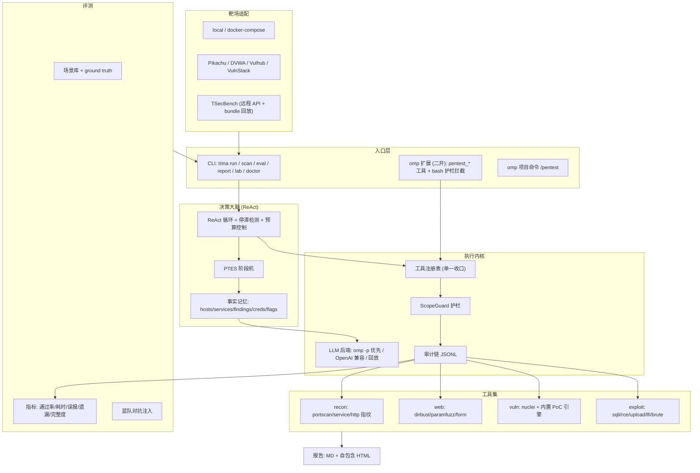

# Trina · 全自动渗透测试 Agent —— 总体方案与实施计划

> 代号 **Trina (Pentest AI)**。在 omp 之上二开：omp 提供模型接入、鉴权、会话与扩展运行时；
> Trina 提供渗透决策大脑、工具执行内核、靶场适配、合规护栏、报告与评测。

---

## 1. 目标与验收

### 1.1 五项核心能力（对应用户需求）

| # | 能力 | 交付物 | 验收方式 |
|---|---|---|---|
| 1 | 自动决策大脑 | `trina/brain/`：ReAct 循环 + PTES 阶段机 + 事实记忆 | 单目标全流程零人工触发：`trina run --target X` 自动完成侦察→利用→取证→收尾 |
| 2 | 工具统一封装 | `trina/tools/`：nmap/nuclei/sqlmap/hydra 封装 + 内置引擎兜底 | 每个工具 `--list-tools` 可查、参数 schema 校验、结果结构化 |
| 3 | 多靶场兼容 | `trina/adapters/`：local / docker-compose / http-range / tsecbench | 同一份 `trina run` 接入 Pikachu、DVWA、Vulhub、VulnStack、TSecBench |
| 4 | 安全合规护栏 | `trina/scope.py` + `trina/audit.py` | 越界目标被硬拒绝；审计日志哈希链可校验；破坏性动作默认拦截 |
| 5 | 标准报告 | `trina/report/`：Markdown + 自包含 HTML | 报告含漏洞详情/利用过程/flag/修复建议/CVSS/证据时间线 |

### 1.2 评测验收线（两轮）

- **第一轮**：Pikachu / DVWA / Vulhub / Bugku（Web）、VulnStack / 自建 Linux-Windows 靶机 / 墨者（主机），
  输出通过率、平均耗时、误报率、遗漏率、端口完整度、服务识别准确率。
- **第二轮**：TSecBench 官方基准（6 维加权 /100）+ 蓝队对抗（蜜罐、封禁、限速、流量篡改、假 flag）。

---

## 2. 架构



### 2.1 关键设计决策

| 决策 | 理由 | 代价 |
|---|---|---|
| **决策大脑自研 Python ReAct**，而不用 omp 内建 agent loop | 护栏、审计、指标、超时可确定性控制；评测可复现；不依赖交互式 TUI | 需自己写循环与提示词工程 |
| **LLM 走 `omp -p --mode=json`** | 复用 omp 已配置模型与密钥，零 API Key 管理；JSONL 带 usage/cost 可入报告 | 每次调用 ~3s 进程启动开销 |
| **动作协议用文本 JSON**（而非原生 function-calling） | 跨模型可移植；单步可校验、可回放；便于审计"思考-动作-观察"三元组 | 需解析容错（已实现多级回退解析） |
| **工具「外部二进制优先 + 内置 Python 引擎兜底」** | 实测 WSL 内无 nmap/nuclei/sqlmap/hydra；评测必须能跑 | 内置引擎能力弱于专业工具（明确标注覆盖边界） |
| **护栏收口在 `ToolRegistry.execute()` 单点** | 不可能绕过：所有工具（含 LLM 直接发起的）都必经此处 | 新工具必须注册而非直连 |
| **审计哈希链** | 实训/竞赛要求全程留痕可追溯，且需防篡改 | 写入有开销（可忽略） |

### 2.2 数据流（单步）

```
状态摘要 → LLM → {thought, tool, params} → 参数校验 → ScopeGuard
   ↓ 拒绝 → 审计记 deny → 观察回灌（模型换路子）
   ↓ 放行 → 审计记 allow → 工具执行(超时/限速) → 解析结构化结果
   ↓ → 事实记忆更新 → 观察回灌 → 下一步
```

---

## 3. 目录结构

```
网安实训中级/
├── README.md                 快速上手
├── pyproject.toml            包定义（uv 管理）
├── docs/
│   ├── PLAN.md               本文档
│   ├── ARCHITECTURE.md       模块契约与数据模型
│   ├── GUARDRAILS.md         护栏与合规细则
│   ├── EVAL.md               评测方法学与指标口径
│   └── RUNBOOK.md            运行手册（各靶场接入步骤）
├── configs/
│   ├── trina.yaml              主配置（授权网段 = 护栏数据源）
│   └── ranges/*.yaml         靶场注册表（含 ground truth）
├── trina/                      ★ 主包
│   ├── cli.py                命令行入口
│   ├── config.py             配置模型
│   ├── scope.py              合规护栏（唯一放行判据）
│   ├── audit.py              审计哈希链
│   ├── llm/                  omp / openai-compat / replay 后端
│   ├── tools/                工具实现 + 注册表
│   ├── brain/                ReAct、提示词、阶段机、记忆
│   ├── adapters/             靶场适配
│   ├── report/               报告生成
│   ├── eval/                 评测框架 + 场景库
│   └── lab/                  ★ 故意脆弱的本地靶机（验证与自测用）
├── .omp/                     omp 二开产物（skill / extension / config 覆盖）
├── reports/                  生成的报告
└── logs/                     审计与运行日志
```

---

## 4. 安全合规护栏（硬约束）

1. **授权网段硬编码 + 白名单**：`configs/trina.yaml#scope.authorized_cidrs`（默认仅私网 RFC1918 + 127.0.0.1）。
   任何目标在发起连接前解析为 IP 集合并逐一校验；非白名单**直接拒绝**，不进入 LLM 可选动作。
2. **公网默认禁止**：`allow_public: false`；开启需显式改动配置并在报告中留痕。
3. **破坏性动作分级**：`detect < verify < exploit`。
   - `detect`：只读探测（扫描、指纹、非侵入检测）。
   - `verify`：可致轻微状态变更（上传验证文件、回显型利用、单次弱口令验证）。
   - `exploit`：命令执行、写 shell、批量爆破、数据导出；**默认关闭**，需 `destructive: true` + 目标在 `destructive_hosts`。
   - 绝对禁止清单（代码级 deny，任何配置都无法开启）：DoS/洪水、格式化/删除系统文件、勒索加密、
     拖库导出业务数据、对第三方跳板攻击、`--os-shell/--os-pwn/--file-write` 类外带写文件。
4. **限速与并发**：全局 QPS 上限、每主机并发上限、爆破字典规模上限（避免意外打成 DoS）。
5. **审计留痕**：每次动作一条 JSONL，含 `prev_hash` 形成哈希链；`trina audit verify` 可校验完整性；
   拒绝事件同样记录（含拒绝原因）。
6. **证据最小化**：仅保存验证所需的最小证据（响应片段、flag、截图），不落地业务数据。

---

## 5. 实施计划（里程碑）

| 里程碑 | 内容 | 完成判据 | 状态 |
|---|---|---|---|
| **M0 骨架** | 方案文档、工程骨架、config/scope/audit | `trina doctor` 输出环境与护栏状态；`trina guard check 8.8.8.8` 被拒绝 | ✅ 已验证 |
| **M1 内核** | LLM 后端、工具注册表执行链、ReAct 大脑 | `trina run --target 127.0.0.1:8080` 能自主多步推进并给出终态 | ✅ 已验证 |
| **M2 工具集** | recon/web/vuln/exploit/creds 五类共 17 个工具 | `trina tools` 列全；对 lab 靶机每个工具单独可复现出结果 | ✅ 已验证 |
| **M3 靶场与报告** | 适配层（6 套注册表）、TSecBench 适配、报告生成 | `trina run --range lab` 出一条完整链路 + MD/HTML 报告 | ✅ 已验证 |
| **M4 评测** | 评测框架、场景库、蓝队对抗、lab 靶机 | `trina eval run --suite web` 输出指标表；`trina eval adversarial` 输出鲁棒性指标 | ✅ 已验证 |
| **M5 二开与验收** | omp 扩展/skill、端到端冒烟、文档 | omp 内 `/pentest` 可驱动；lab 端到端打穿并出报告 | ✅ 已验证 |

### 5.1 已完成里程碑的实测证据

| 证据 | 命令 | 结果 |
|---|---|---|
| 端到端全自动打穿 lab | `trina run --target http://127.0.0.1:9099 --allow-exploit` | 16 步 / 50s / $0.0068；SQLi 已验证、RCE 已验证、`rce_exec id` → `uid=33(www-data)`、取得 flag、0 次护栏拒绝、报告落盘 |
| 审计链完整性 | `trina audit verify logs/<run_id>.jsonl` | 185 条记录哈希链完整；人为改一条即报「第 3 条内容被篡改」 |
| 护栏拦截 | `trina guard check 8.8.8.8`、`trina guard argv -- sqlmap -u … --os-shell` | 均被拒绝并给出原因与合规提示 |
| omp 二开 | omp 内调用 `trina_guard`；bash 执行 `nmap -sV 8.8.8.8` | 技能 `pentest-agent` 被发现；扩展工具可调用；bash 被扩展拦截并回传拒绝原因 |
| 离线可复现 | `trina run --record … ` → `--replay …` | 两次运行决策序列完全一致；录制物是合法 JSON |
| 评测链路（零成本） | `bundle://tsecbench/web-0001` + replay | 8 步完成 → GT 命中 1/1、precision=recall=1.0、范围外发现 4 条单独计数 |
| Web 专项评测 | `python3 -m trina eval run --suite web` | 通过率 87.5%、precision 100%、recall 88.9%、误报率 0%、遗漏率 11.1% |
| 主机专项评测 | `python3 -m trina eval run --suite host` | 通过率 66.7%、precision 100%、recall 80%、端口覆盖率 260%、服务识别准确率 100% |
| 蓝队对抗 | `web` 套件中的对抗场景（WAF/封禁/限速/篡改/蜜罐） | 12 步内命中 /sqli 与 /lfi；代理统计 blocked=2、tampered=1，**未被假 flag 误导**、未踩蜜罐 |
| 单元测试 | `python3 -m unittest discover -s tests` | 128 个测试全部通过 |

---

## 6. 评测方法学

### 6.1 轮次一：多靶场基础能力

- **Web 专项**：Pikachu（全类型）、DVWA（难度分级）、Vulhub（CVE 一键靶场）、Bugku（线上题集）。
  指标：各类漏洞通过率、平均完成耗时、误报率 = FP/(TP+FP)、遗漏率 = FN/(TP+FN)。
- **主机专项**：VulnStack 内网、自建 Linux/Windows 靶机（SSH/MySQL/RDP/SMB）、墨者学院。
  指标：权限获取成功率、flag 获取率、端口扫描完整度（发现端口/真实开放端口）、服务识别准确率。
- **口径**：每个场景由 `configs/ranges/*.yaml` 声明 ground truth（漏洞类型、路径、flag 校验方式），
  评测框架据此自动判定 TP/FP/FN，**避免人工口径漂移**。

### 6.2 轮次二：TSecBench 权威基准 + 蓝队对抗

- **TSecBench**：63 题 / 6 维度（Web 挖掘 18、二进制挖掘 13、漏洞利用 9、多阶段渗透 3、云攻击 6、对抗规避 14），
  底层满分 23000，按难度加权归一化到 /100；单题限时 1 小时。
  Trina 侧实现：任务拉取→容器/远程执行→flag 提交→维度得分聚合；无官方 key 时支持 **bundle 本地回放模式**（离线自测）。
- **蓝队对抗**：在靶场前挂一层对抗代理，注入
  ① WAF 拦截（403/JS 挑战）② 源 IP 封禁 ③ 限速/延迟 ④ 响应篡改/假 flag ⑤ 蜜罐服务。
  指标：绕过率、恢复率（被封锁后换策略重启）、假阳性率（是否误报假 flag）、平均恢复步数。

### 6.3 结果呈现

统一输出：总分 + 维度分 + 逐场景明细 + 与行业基准线对比（TSecBench 榜单公开分档：<50 入门、50–70 基础可用、
70–80 中等、80+ 进阶、90+ 领先，注明为工程参考口径而非官方评级）。

---

## 7. 风险与对策

| 风险 | 影响 | 对策 |
|---|---|---|
| WSL 内无 nmap/nuclei/sqlmap/hydra | 无法评测 | 内置 Python 引擎兜底（端口/目录/SQLi/弱口令），外部工具存在时自动优先 |
| 无 docker socket | Vulhub/VulnStack 一键起不来 | 适配器支持远程靶场 URL 模式 + docker-compose 模式（补齐 docker 后即用）；本地 lab 保证可验证 |
| 靶场尚未部署 | 端到端无法验证 | 内置 `trina/lab` 故意脆弱靶机（stdlib 实现），全链路可自证 |
| TSecBench 需申请访问 | 基准分拿不到 | 适配器与评分模型先行，拿到 key 仅填配置 |
| 大模型幻觉/编造漏洞 | 误报 | 强制"证据制"：每条漏洞必须附可复现的请求/响应；无证据降级为"疑似" |
