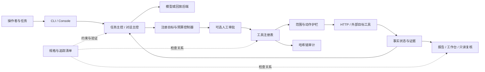

# 既有系统影响分析

## 基线与变更范围

分析基线为产品代码 `24fb637`。本次是既有系统的文档与验证资产补齐，新增课程文档、追踪检查及精选证据，更新首页和资料入口。不修改目标工具、依赖清单、模型配置、状态字段或授权判据。下表记录未来实现相应规格时会触及的契约，防止把文档补齐理解成允许顺带重构全系统。

## 调用与影响图

这是目标动作的责任分解图，实际参数校验、等级判断和审计事件的精确先后以 `ToolRegistry.execute` 为准。模型后端的控制通道与靶场 HTTP 通道分别实现，不能据此图宣称宿主机任意进程的网络行为都已经被 ScopeGuard 截获。

## 接口、数据与调用者

| 契约面 | 当前使用者及输入输出 | 变更风险与本次处理 |
|---|---|---|
| CLI | `trina` 的 run/play/console/tools/guard/eval/review 等子命令被启动器、用户和可选扩展调用 | 参数名和注入范围被测试依赖；本次只引用实际命令，不修改 parser 或脚本入口 |
| 模型动作 | 主控从文本 JSON 读取 action/params/test_id/final，回放文件复用同协议 | 删字段或改变动作名会破坏录制；本次增加协议解释，保留既有样本 |
| 配置覆盖 | YAML、`--set` 和已有环境变量接口由 config 装载 | 默认策略、等级或超时会改变评测结果；本次不改配置，原值写入 Harness |
| 检查注册 | `configs/ranges` 的 targets/tests 提供 ID、工具、等级与参数提示 | 改 ID 影响调度、覆盖、review 和测试；清单引用真实 ID，不创建虚构注册项 |
| 工具规格 | build_registry、主控提示词、CLI 描述及工具执行共享 ToolSpec | 不注册的新工具会旁路校验；本次文档脚本只检查本地资料，不作为目标工具加入注册表 |
| 状态 JSON | watch、board、报告、复核和历史证据读取 RunState | 字段类型与默认值是兼容面；本次不迁移，解释缺省字段和凭据风险 |
| 审计 JSONL | verify、summary、复核及精选证据依赖原始链 | 改写事件会破坏链；本次原样保存，解释放在独立 Markdown |
| 报告 | Markdown、HTML 由老师和操作者读取，链接到运行证据 | 复制旧报告会误指新版本；历史样本保留日期，新运行独立归档 |
| 评测 | 场景、真值、scoped classes 由 harness/metrics 消费 | 不同分母不可比较；本次记录统计口径，不把机制测试当基准成绩 |
| 可选咨询 | 主控和 replay 需记录实际主子响应顺序 | 漏记子响应将使回放错位；保留现有咨询回归，默认不启用 |

## 兼容、迁移与回滚

本次没有数据库、身份模型或状态 Schema 迁移。安装和启动路径保持不变，原 A1–A8 保留一级分类，新增 REQ 编号在课程矩阵中细化，不更名历史验收项。历史 evidence 保持原目录及原哈希，不能为了当前规格改写过去结果。

出现文档与代码不符时，先定位代码和实际测试，修正文档主张或创建后续代码任务，不放宽测试以匹配文字。发现新规格需要改变字段语义时，先定义读取旧样本的策略、默认值及迁移试验，再实施代码变更。

回滚点为本次提交的父版本 `24fb637`。协作仓库采用 `git revert <本次提交>` 产生可审查的反向提交，不强推改写他人历史，不对有未提交内容的工作树执行整体 reset。局部文档错误通过正常修订提交处理。验证产物保留原样用于定位，不删除历史运行来制造干净结果。

## 风险和观察要求

高风险集中在覆盖统计提前记账、注册目标/参数绑定不足、超时不能硬取消和原始状态含凭据。本次把这些风险定位到 [未决问题](open-questions.md)，不以完善文档宣称它们已修复。中等风险包括重复定义漂移、课件示例被误当需求、旧测试数和旧环境结论被当作当前事实，由明确规格权威、来源说明及重新验证控制。

新文档检查只读取仓库、发现测试对象并返回检查结果，不执行目标动作或付费模型。验证回归沿用当前用例，回环端到端沿用已有脚本。运行前后应检查 Git 差异，确认没有工具参数、目标范围或依赖发生意外变更。
