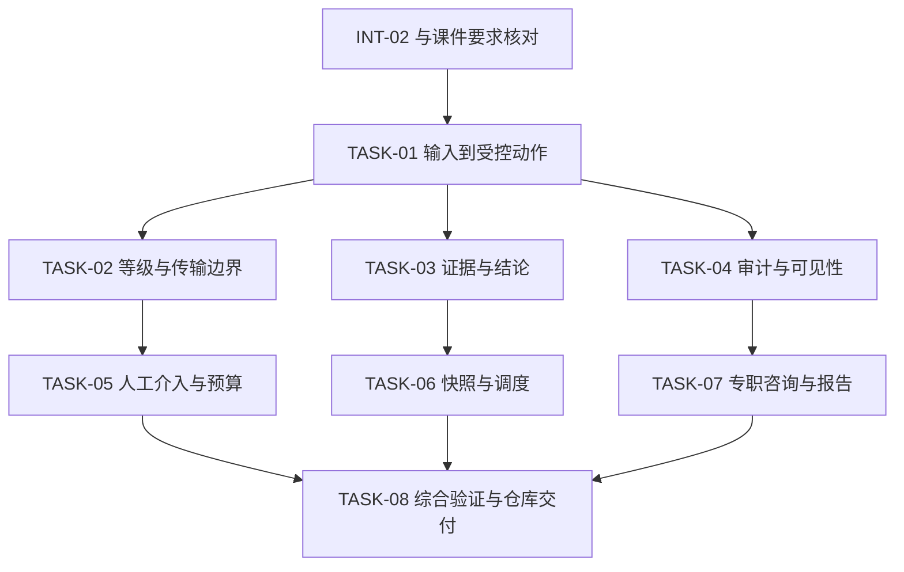

# 实施计划与质量关卡

## 计划定位

本计划将 `REQ-01` 至 `REQ-20` 分成 8 个可以独立验证的行为切片。TASK-01 至 TASK-07 是既有实现的验收与契约归档，不将过去代码开发虚构为本次新完成；TASK-08 是本次课程文档、追踪检查、证据整理及推送。代码基线 `24fb637`，本次不改变产品权限、工具或状态接口。

实现一条切片的完成条件是行为有代码、验证有结果、证据能定位、限制已说明。单纯新增文件或写完标题不算完成。任务的输入、范围、DoR、DoD、停止条件及责任分别写在 [任务卡](tasks.md)。

## 依赖与执行顺序

TASK-02、03、04 的测试夹具可以在契约稳定后独立执行；这表示任务间的逻辑并行性，不宣称本次实际使用了多个自治 Agent。修改相同规格、配置或控制器时仍顺序整合，避免共享事实产生互相覆盖。TASK-08 只能在追踪关系和相关证据归档后进入最终提交。

## 里程碑与检查点

| 阶段 | 输入和动作 | 退出条件与记录 |
|---|---|---|
| M0 基线与就绪 | 核对用户 Intent、94 页课件、Git 状态、配置及测试发现；阅读架构和护栏 | 明确 Trina 交付对象、允许修改范围、已知风险、测试环境和来源页码 |
| M1 规格与影响分析 | 完成问题框架、20 条规格、GWT、状态模型和影响分析；建立场景与任务 ID | 每条 MUST 至少对应可观察结果和验证入口；无虚构产品模块；未知项有阻塞范围 |
| M2 切片验证 | 执行 TASK-01 至 07 所对应回归，关注拒绝分支、证据阴性例和持久化 | 失败原样保存；没有通过降低等级约束、删断言或换真值获得通过 |
| M3 双层 Harness | 记录模型、工具、权限、可见性、预算、停止、恢复和 Host 权责 | 命令、文件和测试名称存在，运行配置与文档一致，不能机械保证的部分注明人工检查 |
| M4 综合证据 | 全量 unittest、两轮干净靶机机制验证、文档追踪检查和 diff 检查 | 原始输出可读，机器摘要能追到版本和文件，所有失败和跳过如实记录 |
| M5 仓库交付 | 检查提交清单，提交到 Gitee main，核对远端 SHA 与本地 | 教师可以从首页进入文档与证据；不包含课程原 PPT、照片、密钥和无关 artifacts；人工验收仍待教师 |

## Definition of Ready

进入实现或验证前，必须明确目标与非目标、修改范围、责任任务、对应规格及至少一个可观察验收结果。依赖模块和测试数据可用；授权等级、目标范围与停止条件明确；涉及安全语义的未决问题不能由执行者自行补成事实。本次纯文档交付已具备这些输入，产品缺口不在当前代码修改范围。

测试环境要求 Python 3.10 及以上、已有项目依赖、可创建临时目录及回环监听。缺少模型 Key 不阻塞固定决策验证；缺少 Docker 不阻塞内置 lab 验证。回环或依赖不可用时，在证据中标记环境问题并停止相关运行，不把失败改写为通过。

## Definition of Done

课程提交版本的 Done 包含：规格与矩阵没有强制要求断链；导航和命令经过检查；产品相关回归结果与两轮机制结果原样保存；本次差异仅触及允许范围；人工评审状态、AI 参与及未决问题明确；Git 提交和远端一致。它表示“已提交可审查材料”，不包含未经执行的教师隐藏测评、同行独立复现或最终签署。

产品完整验收另有条件：严格的检查完成生命周期、参数与端口授权约束、统一敏感内容处理、在途取消和模型效果对照等问题必须分别解决并验证。不能用本次文档 Done 覆盖这些开放缺口。

## 风险、停止与变更预算

发现文档主张与运行不符时回到最早不确定阶段，先保留状态和失败再判断属于文档修订或代码缺陷。同一关键失败经过三次局部修复仍不能解释时停止扩展，记录输入、差异、证据与人工问题。涉及范围扩张、依赖引入、核心 Schema 或不可逆数据处理时建立新任务和接受门。

本次新增外部依赖数为 0，新增目标工具数为 0，不做收费模型实验。文档篇幅依据风险和接口需要展开，不按字数制造完成度。综合检查有失败时允许提交明确标记的待审材料，但不得把受影响要求标为已验证通过。代码回滚和证据保留执行 [影响分析](impact-map.md) 与 [Harness 恢复流程](harness-manifest.md)。
