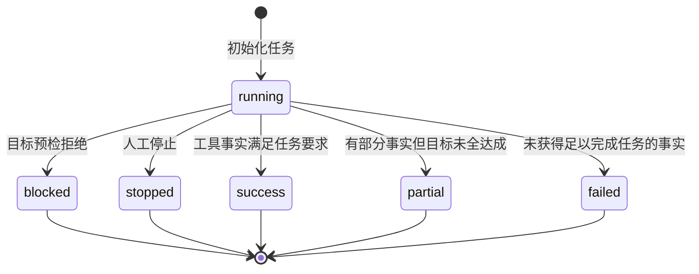
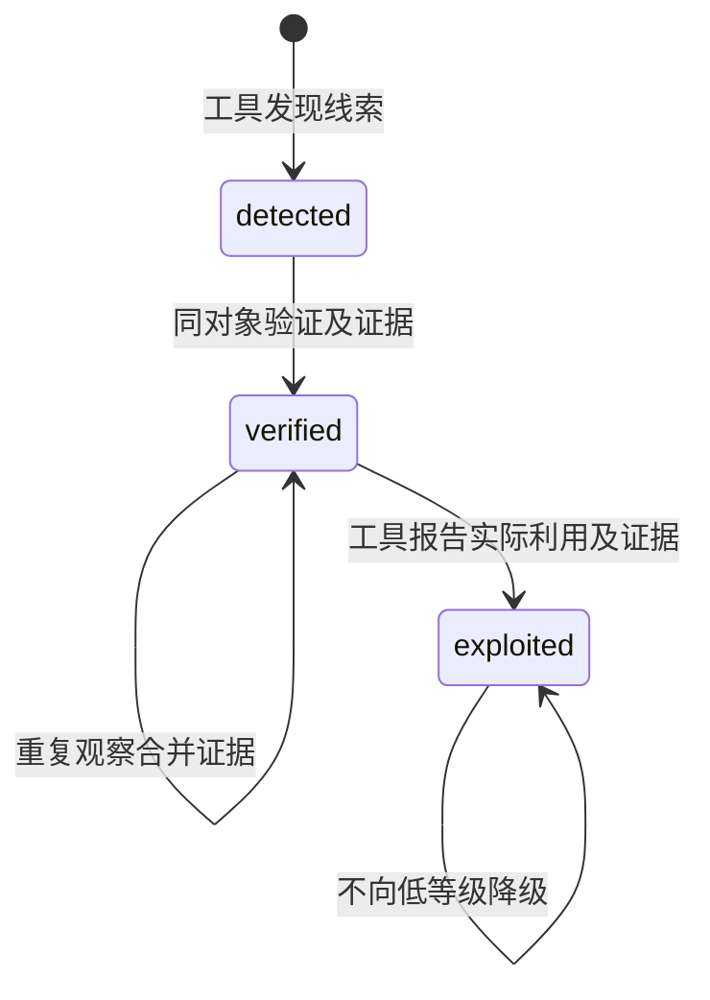

# 状态模型与转换契约

Trina 存在运行状态、漏洞验证状态、假设状态、控制器记录和报告结论。这些状态描述不同对象。课件中的完整任务状态机用于组织分析；仓库实际序列化字段以 `trina/state.py`、`trina/hypotheses.py`、`trina/policy.py` 及主控收尾逻辑为准。

## 1. 运行状态

`RunState.status` 的实际运行值包括 running、success、partial、failed、blocked 和 stopped。任务阶段 `phase` 另取 recon、enum、vuln、exploit、post、report，不是 status 的替代字段。阶段推进由事实和预算驱动，阶段名不代表已经成功完成相应攻击。

| 触发主体 | 前置条件与转换 | 副作用、可逆性及非法路径 |
|---|---|---|
| 主控初始化 | 配置加载、构造运行 ID 和工作区后进入 running | 保存任务目标，建立审计；新任务使用新工作区，不覆盖旧运行 |
| 护栏预检 | 目标不满足有效范围，运行变为 blocked | 不调用模型；拒绝可复核。扩大范围需另行修改并确认配置，模型不能自解锁 |
| 操作者 | stop 事件在循环边界被观察，进入 stopped | 保留已获得事实及结束时间；再次执行应创建新运行，当前未提供自动 resume |
| 主控收尾 | 明确任务要求全部满足为 success；部分事实为 partial；无可用进展为 failed | 模型 final 不能直接指定终态；已有 stopped 不被成功规则覆盖 |

没有明确目标时，真实 flag 或带证据的 verified/exploited 发现可以支持通用 success。有目标时由 `GoalRequirements` 决定，不能用无关 flag 代替 SQLi 或端口要求。预检、停止和状态保存的具体事件顺序应查看该版本实际轨迹，图中只表示允许的运行结果。

## 2. 漏洞与假设

`Finding` 按漏洞类、目标位置和参数等信息去重。状态只升级，重复观察补充证据。后续超时不是对既有漏洞的反证，因此不能把 verified 降回 detected。代码中已有状态升级不保证每条工具返回永远准确；缺证据的高状态会在 review 中被指出。

假设记录使用独立台账：待验证假设需要可定位验证对象，证据匹配时 confirmed，明确反证才可 refuted，边界拒绝可记 blocked，收尾仍未解决的假设保留待验证解释。无新信息只应降低优先级或触发换路，不自动构成反证。这里的 confirmed 是假设状态，报告大写 CONFIRMED 是运行结论，二者不能混用。

## 3. 报告结论

| 字段值 | 当前收尾判据 | 对外解释 |
|---|---|---|
| CONFIRMED | 存在带证据的 verified/exploited 发现，且满足当前收尾分支的执行条件 | 本轮确认至少一个发现，不表示全部注册项完成 |
| NOT_CONFIRMED | 有注册项记录执行，无已验证发现，且无错误、失败、撤权或拒绝等不确定因素 | 只说明本次已执行检查中未确认漏洞，未测项必须继续列出 |
| INCONCLUSIVE | 预检被阻断、没有注册项执行，或无验证发现且存在执行受限/失败 | 证据不足以作出本次检查的肯定或否定判断 |

例如 flag 工具取得真实 flag，可以满足无硬性漏洞目标的运行成功条件，但如果没有 verified 发现，报告结论仍可能是 NOT_CONFIRMED。反过来，已确认某个漏洞却没有完成用户全部要求，运行可以 partial，结论仍为 CONFIRMED。这两个字段同时呈现才不会误导。

## 4. 授权与检查生命周期

预期工程生命周期可写成 `proposed → policy allowed → human allowed → guard allowed → tool finished → evidence absorbed`，任一拒绝都应进入受限结果。当前代码没有持久化这一整套枚举，`AuthorizationController.executed` 在策略允许时就记录 ID，可能早于人工审批、护栏和工具完成。规格、报告解释和当前验收都不能把此列表直接当作“工具成功完成数”。

撤权保存于控制器内存，影响后续裁决；它没有独立数据库中的跨进程撤权表。重新启动任务必须重新读取有效配置并获得相应批准，不能复制旧状态继续使用原批准。拆分允许、开始、完成、失败及证据状态属于 OQ-01 的后续实现。

## 5. 持久化与并发读者

任务状态定期写入 `runs/<run_id>/state.json`，默认每步刷新，结束时再次保存。采用同目录临时文件后替换，读者读取到完整旧快照或新快照；写入异常保留旧内容并记录错误。审计在独立 JSONL 中追加，报告由某一状态快照派生，三者不是数据库事务。

中断时可能出现审计已有新事件、快照仍为上一时点的情况。复核需结合时间、步骤及 run_id，不以最后一个文件时间推断所有操作已经终止。恢复过程先进行只读检查，再创建新运行；现阶段没有对在途线程、进程、预算和模型会话进行事务性恢复的协议。
