# Trina 自动渗透测试报告

| 项目 | 内容 |
| --- | --- |
| 报告标题 | Trina 自动渗透测试报告 |
| 目标 | http://127.0.0.1:9099 |
| 目标说明 | 拿到 flag 并验证 SQL 注入与命令注入 |
| Run ID | 20261015-164542-2598dc |
| 运行模式 | auto |
| 开始时间 | 2026-10-15 16:45:42 |
| 结束时间 | 2026-10-15 16:46:34 |
| 耗时 | 52.7 秒 |
| 最终状态 | 成功 |
| Agent 后端 / 模型 | omp / deepseek/deepseek-v4-flash |
| LLM 调用次数 | 8 |
| Token 用量 | 输入 6238 / 输出 1216 / 缓存读 53888 |
| LLM 成本（美元） | 0.003653 |
| 报告生成时间 | 2026-10-15 16:46:35 |
| 生成器 | Trina 0.1.0 |
| 元信息 · range |  |
| 元信息 · goal | 拿到 flag 并验证 SQL 注入与命令注入 |
| 元信息 · play | 本地 lab 靶机（内置模拟器） |


## 一、执行摘要

风险统计：

| 严重度 | 数量 | 占比 |
| --- | ---: | ---: |
| 严重 | 1 | 14.3% |
| 高危 | 1 | 14.3% |
| 中危 | 0 | 0.0% |
| 低危 | 1 | 14.3% |
| 信息 | 4 | 57.1% |
| 合计 | 7 | 100.0% |

| 项目 | 内容 |
| --- | ---: |
| 主机数 | 1 |
| 开放端口数 | 3 |
| 凭据数 | 0 |
| Flag 数 | 1 |
| 漏洞总数 | 7 |
| 总步数 | 13 |
| LLM 调用次数 | 7 |
| LLM 成本（美元） | 0.003653 |

## 二、授权与合规声明

本次测试仅针对下列授权范围内的目标执行；所有主动动作均由护栏（ScopeGuard）判定，
放行/拒绝结果写入审计哈希链，未授权目标不产生任何流量。

护栏判据（与运行时同源，取自 `cfg.scope`）：

```text
授权网段: 127.0.0.0/8, 10.0.0.0/8, 172.16.0.0/12, 192.168.0.0/16
额外授权主机: (无)
显式拒绝网段: (无)
允许公网目标: 否
当前最大动作等级: verify（detect 只读 / verify 可验证 / exploit 可执行命令）
破坏性动作: 关闭
全局速率上限: 20.0 req/s，单主机并发 8，爆破尝试上限 800
```

| 项目 | 内容 |
| --- | --- |
| 授权网段 | 127.0.0.0/8, 10.0.0.0/8, 172.16.0.0/12, 192.168.0.0/16 |
| 额外授权主机 | （无） |
| 显式拒绝网段 | （无） |
| 允许公网目标 | 否 |
| 允许回环地址 | 是 |
| 最大动作等级 | verify（detect 只读 / verify 可验证 / exploit 可执行命令） |
| 破坏性动作 | 否 |
| 速率与规模上限 | 20.0 req/s，单主机并发 8，爆破尝试上限 800 次 |
| 护栏拒绝次数（运行态） | 1 |
| 护栏拒绝次数（审计） | （未提供审计摘要） |

## 三、攻击路径

```mermaid
flowchart LR
    n1["目标 http://127.0.0.1:9099"]
    n2["进入阶段 enum"]
    n3["port_scan 端口扫描 127.0.0.1: 3 个开放端口 / 扫描 32 个 engine=builtin"]
    n4["? 端口扫描 127.0.0.1: 3 个开放端口 / 扫描 32 个 engine=builtin"]
    n5["发现漏洞 信息 缺少安全响应头 Content-Security-Policy @ 127.0.0.1:9099"]
    n6["发现漏洞 信息 缺少安全响应头 X-Frame-Options @ 127.0.0.1:9099"]
    n7["发现漏洞 信息 缺少安全响应头 Strict-Transport-Security @ 127.0.0.1:9099"]
    n8["发现漏洞 信息 缺少安全响应头 X-Content-Type-Options @ 127.0.0.1:9099"]
    n9["…（省略 13 个中间步骤）"]
    n10["flag_hunt 找到 1 个 flag：flag trina_lab_0ceed274"]
    n11["? 找到 1 个 flag：flag trina_lab_0ceed274"]
    n12["夺取 flag flag trina_lab_0ceed274"]
    n1 --> n2
    n2 --> n3
    n3 --> n4
    n4 --> n5
    n5 --> n6
    n6 --> n7
    n7 --> n8
    n8 --> n9
    n9 --> n10
    n10 --> n11
    n11 --> n12
```



上图为 mermaid 流程图源码；Markdown/HTML 预览器需支持 mermaid 才能渲染（报告不引入任何外部 JS）。

| # | 时刻 | 类型 | 事件 |
| ---: | --- | --- | --- |
| 1 | 16:45:42 | 目标 | 目标 http://127.0.0.1:9099 |
| 2 | 16:45:49 | 阶段 | 进入阶段 enum |
| 3 | 16:45:49 | 工具 | port_scan 端口扫描 127.0.0.1: 3 个开放端口 / 扫描 32 个 engine=builtin |
| 4 | 16:45:49 | 工具 | ? 端口扫描 127.0.0.1: 3 个开放端口 / 扫描 32 个 engine=builtin |
| 5 | 16:45:59 | 漏洞 | 发现漏洞 信息 缺少安全响应头 Content-Security-Policy @ 127.0.0.1:9099 |
| 6 | 16:45:59 | 漏洞 | 发现漏洞 信息 缺少安全响应头 X-Frame-Options @ 127.0.0.1:9099 |
| 7 | 16:45:59 | 漏洞 | 发现漏洞 信息 缺少安全响应头 Strict-Transport-Security @ 127.0.0.1:9099 |
| 8 | 16:45:59 | 漏洞 | 发现漏洞 信息 缺少安全响应头 X-Content-Type-Options @ 127.0.0.1:9099 |
| 9 | - | 省略 | …（省略 13 个中间步骤） |
| 10 | 16:46:34 | 工具 | flag_hunt 找到 1 个 flag：flag trina_lab_0ceed274 |
| 11 | 16:46:34 | 工具 | ? 找到 1 个 flag：flag trina_lab_0ceed274 |
| 12 | 16:46:34 | 夺旗 | 夺取 flag flag trina_lab_0ceed274 |

## 四、资产清单

| 主机 | 存活 | 端口/服务/版本 | 技术栈 | 已发现路径 |
| --- | --- | --- | --- | --- |
| 127.0.0.1 | 是 | 22/tcp ssh; 2222/tcp unknown; 3389/tcp rdp | Apache | http://127.0.0.1:9099/robots.txt; http://127.0.0.1:9099/sitemap.xml; http://127.0.0.1:9099/.well-known/security.txt; http://127.0.0.1:9099/sqli?id=1; http://127.0.0.1:9099/lfi?file=readme.txt; http://127.0.0.1:9099/rce?cmd=id; http://127.0.0.1:9099/login; http://127.0.0.1:9099/admin |

## 五、漏洞详情

| ID | 标题 | 严重度 | 置信度 | 状态 | 类型 | 位置 |
| --- | --- | --- | --- | --- | --- | --- |
| TRINA-007 | 命令注入（cmd） | 严重 | 高 | 已验证 | rce | http://127.0.0.1:9099/rce |
| TRINA-006 | SQL 注入（id，错误型） | 高危 | 高 | 已验证 | sqli | http://127.0.0.1:9099/sqli |
| TRINA-005 | robots.txt 泄露敏感路径 | 低危 | 中 | 已发现 | information_disclosure | http://127.0.0.1:9099/robots.txt |
| TRINA-001 | 缺少安全响应头 Content-Security-Policy | 信息 | 高 | 已发现 | security_misconfig_headers | http://127.0.0.1:9099/ |
| TRINA-002 | 缺少安全响应头 X-Frame-Options | 信息 | 高 | 已发现 | security_misconfig_headers | http://127.0.0.1:9099/ |
| TRINA-003 | 缺少安全响应头 Strict-Transport-Security | 信息 | 高 | 已发现 | security_misconfig_headers | http://127.0.0.1:9099/ |
| TRINA-004 | 缺少安全响应头 X-Content-Type-Options | 信息 | 高 | 已发现 | security_misconfig_headers | http://127.0.0.1:9099/ |

### [TRINA-007] 命令注入（cmd）

| 项目 | 内容 |
| --- | --- |
| ID | TRINA-007 |
| 严重度 | 严重（critical） |
| 置信度 | 高（high） |
| 状态 | 已验证（verified） |
| 漏洞类型 | rce（归一: rce） |
| CVSS 向量 | 3.1 AV:N/AC:L/PR:N/UI:N/S:U/C:H/I:H/A:H（内置默认向量） |
| CWE | CWE-78（来自工具） |
| 目标 | http://127.0.0.1:9099 |
| URL | http://127.0.0.1:9099/rce |
| 参数 / 方法 | cmd / GET |
| 发现工具 | cmd_inject_test |
| 首次发现 | 2026-10-15 16:46:18 |
| 最近确认 | 2026-10-15 16:46:18 |

**描述**

参数 cmd 可用前缀 [';', '|', '$('] 注入命令；标记 TRINA_MARK_JFYDKU 被回显。

**影响**

（未提供影响说明）

**利用过程与证据**

1. [http] http://127.0.0.1:9099/rce?cmd=%3Becho+TRINA_MARK_JFYDKU（-）
   - 说明: 前缀 ';' 回显标记
   - 载荷: `;echo TRINA_MARK_JFYDKU`
   - 请求: GET http://127.0.0.1:9099/rce?cmd=%3Becho+TRINA_MARK_JFYDKU
   - 响应: 状态 200，长度 18｜响应片段: TRINA_MARK_JFYDKU
2. [http] http://127.0.0.1:9099/rce?cmd=%7Cecho+TRINA_MARK_JFYDKU（-）
   - 说明: 前缀 '|' 回显标记
   - 载荷: `|echo TRINA_MARK_JFYDKU`
   - 请求: GET http://127.0.0.1:9099/rce?cmd=%7Cecho+TRINA_MARK_JFYDKU
   - 响应: 状态 200，长度 18｜响应片段: TRINA_MARK_JFYDKU
3. [http] http://127.0.0.1:9099/rce?cmd=%24%28echo+TRINA_MARK_JFYDKU%29（-）
   - 说明: 前缀 '$(' 回显标记
   - 载荷: `$(echo TRINA_MARK_JFYDKU)`
   - 请求: GET http://127.0.0.1:9099/rce?cmd=%24%28echo+TRINA_MARK_JFYDKU%29
   - 响应: 状态 200，长度 41｜响应片段: sh: TRINA_MARK_JFYDKU: command not found

**修复建议**（内置默认建议）

禁止把外部输入拼接进系统命令、模板或反序列化入口；使用白名单参数与安全 API（如 subprocess 列表参数）；服务以低权限账号运行并与主机关键资源隔离。


### [TRINA-006] SQL 注入（id，错误型）

| 项目 | 内容 |
| --- | --- |
| ID | TRINA-006 |
| 严重度 | 高危（high） |
| 置信度 | 高（high） |
| 状态 | 已验证（verified） |
| 漏洞类型 | sqli（归一: sqli） |
| CVSS 向量 | 3.1 AV:N/AC:L/PR:N/UI:N/S:U/C:H/I:H/A:N（内置默认向量） |
| CWE | CWE-89（来自工具） |
| 目标 | http://127.0.0.1:9099 |
| URL | http://127.0.0.1:9099/sqli |
| 参数 / 方法 | id / GET |
| 发现工具 | sqli_test |
| 首次发现 | 2026-10-15 16:46:12 |
| 最近确认 | 2026-10-15 16:46:12 |

**描述**

注入 "'" 触发 DBMS 报错：MySQL, MariaDB。

**影响**

（未提供影响说明）

**利用过程与证据**

1. [http] http://127.0.0.1:9099/sqli?id=%27（-）
   - 说明: 错误型命中 MySQL,MariaDB
   - 载荷: `'`
   - 请求: GET http://127.0.0.1:9099/sqli?id=%27
   - 响应: 状态 500，长度 223｜响应片段: Warning: mysqli_query(): (42000/1064): You have an error in your SQL syntax; check the manual that corresponds to your MySQL server version for the right syntax to use near ''' at line 1 in /var/www/…

**修复建议**（内置默认建议）

使用参数化查询/预编译语句，禁止把外部输入拼接进 SQL；对参数做类型与白名单校验；数据库账号按最小权限授权并关闭多语句执行；接入 WAF 并对异常查询告警。


### [TRINA-005] robots.txt 泄露敏感路径

| 项目 | 内容 |
| --- | --- |
| ID | TRINA-005 |
| 严重度 | 低危（low） |
| 置信度 | 中（medium） |
| 状态 | 已发现（detected） |
| 漏洞类型 | information_disclosure（归一: information_disclosure） |
| CVSS 向量 | 3.1 AV:N/AC:L/PR:N/UI:N/S:U/C:L/I:L/A:N（内置默认向量） |
| CWE | CWE-200（来自工具） |
| 目标 | - |
| URL | http://127.0.0.1:9099/robots.txt |
| 参数 / 方法 | - / GET |
| 发现工具 | - |
| 首次发现 | 2026-10-15 16:45:59 |
| 最近确认 | 2026-10-15 16:45:59 |

**描述**

robots.txt 中列出了管理后台/备份/源码等敏感路径，可直接作为攻击入口。

**影响**

攻击者据此外推后台与备份文件位置，降低入侵成本。

**利用过程与证据**

1. [http] http://127.0.0.1:9099/robots.txt（-）
   - 说明: robots.txt 命中敏感路径关键词: admin, backup, git, upload
   - 请求: GET http://127.0.0.1:9099/robots.txt
   - 响应: 状态 200，长度 86｜响应片段: User-agent: * Disallow: /admin Disallow: /backup Disallow: /.git/ Disallow: /uploads/

**修复建议**（来自工具）

robots.txt 不应列出敏感路径；重要目录改用鉴权与不可枚举命名，并移除线上备份文件。


### [TRINA-001] 缺少安全响应头 Content-Security-Policy

| 项目 | 内容 |
| --- | --- |
| ID | TRINA-001 |
| 严重度 | 信息（info） |
| 置信度 | 高（high） |
| 状态 | 已发现（detected） |
| 漏洞类型 | security_misconfig_headers（归一: security_misconfig_headers） |
| CVSS 向量 | 3.1 AV:N/AC:H/PR:N/UI:R/S:U/C:L/I:L/A:N（内置默认向量） |
| CWE | CWE-693（内置默认） |
| 目标 | http://127.0.0.1:9099/ |
| URL | http://127.0.0.1:9099/ |
| 参数 / 方法 | Content-Security-Policy / GET |
| 发现工具 | http_fingerprint |
| 首次发现 | 2026-10-15 16:45:59 |
| 最近确认 | 2026-10-15 16:45:59 |

**描述**

缺少 CSP，可能放大 XSS 与内容注入风险

**影响**

（未提供影响说明）

**利用过程与证据**

1. [http] http://127.0.0.1:9099/（-）
   - 说明: 响应头缺失: Content-Security-Policy
   - 请求: GET http://127.0.0.1:9099/
   - 响应: 状态 200，长度 342｜响应片段: <!DOCTYPE html><html><head><title>Trina Lab</title></head><body> <h1>Trina 脆弱靶机</h1> <ul> <li><a href="/sqli?id=1">/sqli?id=1</a></li> <li><a href="/lfi?file=readme.txt">/lfi?file=readme.txt</a></li>…

**修复建议**（来自工具）

在 Web 服务器/反代上补充响应头 Content-Security-Policy


### [TRINA-002] 缺少安全响应头 X-Frame-Options

| 项目 | 内容 |
| --- | --- |
| ID | TRINA-002 |
| 严重度 | 信息（info） |
| 置信度 | 高（high） |
| 状态 | 已发现（detected） |
| 漏洞类型 | security_misconfig_headers（归一: security_misconfig_headers） |
| CVSS 向量 | 3.1 AV:N/AC:H/PR:N/UI:R/S:U/C:L/I:L/A:N（内置默认向量） |
| CWE | CWE-693（内置默认） |
| 目标 | http://127.0.0.1:9099/ |
| URL | http://127.0.0.1:9099/ |
| 参数 / 方法 | X-Frame-Options / GET |
| 发现工具 | http_fingerprint |
| 首次发现 | 2026-10-15 16:45:59 |
| 最近确认 | 2026-10-15 16:45:59 |

**描述**

缺少 X-Frame-Options，页面可能被 iframe 嵌套（点击劫持）

**影响**

（未提供影响说明）

**利用过程与证据**

1. [http] http://127.0.0.1:9099/（-）
   - 说明: 响应头缺失: X-Frame-Options
   - 请求: GET http://127.0.0.1:9099/
   - 响应: 状态 200，长度 342｜响应片段: <!DOCTYPE html><html><head><title>Trina Lab</title></head><body> <h1>Trina 脆弱靶机</h1> <ul> <li><a href="/sqli?id=1">/sqli?id=1</a></li> <li><a href="/lfi?file=readme.txt">/lfi?file=readme.txt</a></li>…

**修复建议**（来自工具）

在 Web 服务器/反代上补充响应头 X-Frame-Options


### [TRINA-003] 缺少安全响应头 Strict-Transport-Security

| 项目 | 内容 |
| --- | --- |
| ID | TRINA-003 |
| 严重度 | 信息（info） |
| 置信度 | 高（high） |
| 状态 | 已发现（detected） |
| 漏洞类型 | security_misconfig_headers（归一: security_misconfig_headers） |
| CVSS 向量 | 3.1 AV:N/AC:H/PR:N/UI:R/S:U/C:L/I:L/A:N（内置默认向量） |
| CWE | CWE-693（内置默认） |
| 目标 | http://127.0.0.1:9099/ |
| URL | http://127.0.0.1:9099/ |
| 参数 / 方法 | Strict-Transport-Security / GET |
| 发现工具 | http_fingerprint |
| 首次发现 | 2026-10-15 16:45:59 |
| 最近确认 | 2026-10-15 16:45:59 |

**描述**

缺少 HSTS，HTTPS 可被降级到明文 HTTP

**影响**

（未提供影响说明）

**利用过程与证据**

1. [http] http://127.0.0.1:9099/（-）
   - 说明: 响应头缺失: Strict-Transport-Security
   - 请求: GET http://127.0.0.1:9099/
   - 响应: 状态 200，长度 342｜响应片段: <!DOCTYPE html><html><head><title>Trina Lab</title></head><body> <h1>Trina 脆弱靶机</h1> <ul> <li><a href="/sqli?id=1">/sqli?id=1</a></li> <li><a href="/lfi?file=readme.txt">/lfi?file=readme.txt</a></li>…

**修复建议**（来自工具）

在 Web 服务器/反代上补充响应头 Strict-Transport-Security


### [TRINA-004] 缺少安全响应头 X-Content-Type-Options

| 项目 | 内容 |
| --- | --- |
| ID | TRINA-004 |
| 严重度 | 信息（info） |
| 置信度 | 高（high） |
| 状态 | 已发现（detected） |
| 漏洞类型 | security_misconfig_headers（归一: security_misconfig_headers） |
| CVSS 向量 | 3.1 AV:N/AC:H/PR:N/UI:R/S:U/C:L/I:L/A:N（内置默认向量） |
| CWE | CWE-693（内置默认） |
| 目标 | http://127.0.0.1:9099/ |
| URL | http://127.0.0.1:9099/ |
| 参数 / 方法 | X-Content-Type-Options / GET |
| 发现工具 | http_fingerprint |
| 首次发现 | 2026-10-15 16:45:59 |
| 最近确认 | 2026-10-15 16:45:59 |

**描述**

缺少 X-Content-Type-Options，浏览器可能 MIME 嗅探导致 XSS

**影响**

（未提供影响说明）

**利用过程与证据**

1. [http] http://127.0.0.1:9099/（-）
   - 说明: 响应头缺失: X-Content-Type-Options
   - 请求: GET http://127.0.0.1:9099/
   - 响应: 状态 200，长度 342｜响应片段: <!DOCTYPE html><html><head><title>Trina Lab</title></head><body> <h1>Trina 脆弱靶机</h1> <ul> <li><a href="/sqli?id=1">/sqli?id=1</a></li> <li><a href="/lfi?file=readme.txt">/lfi?file=readme.txt</a></li>…

**修复建议**（来自工具）

在 Web 服务器/反代上补充响应头 X-Content-Type-Options


## 六、凭据与 Flag

### 有效凭据

（未获取凭据）

### Flag

| # | Flag | 来源 | 时间 |
| ---: | --- | --- | --- |
| 1 | flag{trina_lab_0ceed274} | http://127.0.0.1:9099/flag | 16:46:34 |

## 七、附录

### 工具调用时间线

| 时刻 | 工具 | 参数 | 结果摘要 | 耗时 |
| --- | --- | --- | --- | --- |
| 16:45:49 | port_scan | target=127.0.0.1 ports=quick timeout=1.0 max_ports=4096 | 端口扫描 127.0.0.1: 3 个开放端口 / 扫描 32 个 (engine=builtin) | 0.58s |
| 16:45:49 | ? | target=127.0.0.1 ports=quick | 端口扫描 127.0.0.1: 3 个开放端口 / 扫描 32 个 (engine=builtin) | 0.58s |
| 16:45:59 | http_fingerprint | url=http://127.0.0.1:9099/ | HTTP 指纹 http://127.0.0.1:9099/: 200 title=Trina Lab tech=Apache 缺失安全头 4 个 | 0.25s |
| 16:45:59 | ? | url=http://127.0.0.1:9099/ | HTTP 指纹 http://127.0.0.1:9099/: 200 title=Trina Lab tech=Apache 缺失安全头 4 个 | 0.25s |
| 16:46:06 | web_surface | url=http://127.0.0.1:9099/ | 提取到 0 个表单、3 个参数、0 条注释 | 0.12s |
| 16:46:06 | ? | url=http://127.0.0.1:9099/ | 提取到 0 个表单、3 个参数、0 条注释 | 0.12s |
| 16:46:12 | sqli_test | url=http://127.0.0.1:9099/sqli param=id method=GET technique=auto | SQL 注入已验证[错误型]：http://127.0.0.1:9099/sqli 参数 id，DBMS≈MySQL,MariaDB，payload="'" | 0.42s |
| 16:46:12 | ? | url=http://127.0.0.1:9099/sqli param=id method=GET | SQL 注入已验证[错误型]：http://127.0.0.1:9099/sqli 参数 id，DBMS≈MySQL,MariaDB，payload="'" | 0.42s |
| 16:46:18 | cmd_inject_test | url=http://127.0.0.1:9099/rce param=cmd method=GET | 命令注入已验证：http://127.0.0.1:9099/rce 参数 cmd 可用前缀 ';'、'\|'、'$('，标记 TRINA_MARK_JFYDKU 回显（可用 rce_exec prefix=';' 执行白名单命令） | 0.65s |
| 16:46:18 | ? | url=http://127.0.0.1:9099/rce param=cmd method=GET | 命令注入已验证：http://127.0.0.1:9099/rce 参数 cmd 可用前缀 ';'、'\|'、'$('，标记 TRINA_MARK_JFYDKU 回显（可用 rce_exec prefix=';' 执行白名单命令） | 0.65s |
| 16:46:25 | ? | url=http://127.0.0.1:9099/rce param=cmd command=id prefix=; | 动作被护栏拒绝（action-level）：动作等级 exploit 超过当前上限 verify（工具 rce_exec） | 0.05s |
| 16:46:34 | flag_hunt | target=127.0.0.1 base_url=http://127.0.0.1:9099 include_local=False | 找到 1 个 flag：flag{trina_lab_0ceed274} | 0.92s |
| 16:46:34 | ? | target=127.0.0.1 base_url=http://127.0.0.1:9099 | 找到 1 个 flag：flag{trina_lab_0ceed274} | 0.92s |

### 指标

| 项目 | 内容 |
| --- | ---: |
| 运行耗时 | 52.7 秒 |
| 总步数 | 13 |
| 工具调用次数 | 7 |
| LLM 调用次数 | 7 |
| LLM 成本（美元） | 0.003653 |
| 护栏拒绝次数 | 1 |
| 错误计数 | 0 |
| 主机数 | 1 |
| 开放端口数 | 3 |
| 凭据数 | 0 |
| Flag 数 | 1 |
| 漏洞数 | 7 |
| HTTP 请求数 | 18（来源: evidence（受证据上限约束）） |

### 审计摘要

（未提供审计摘要）
