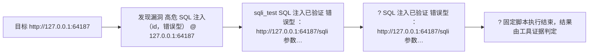
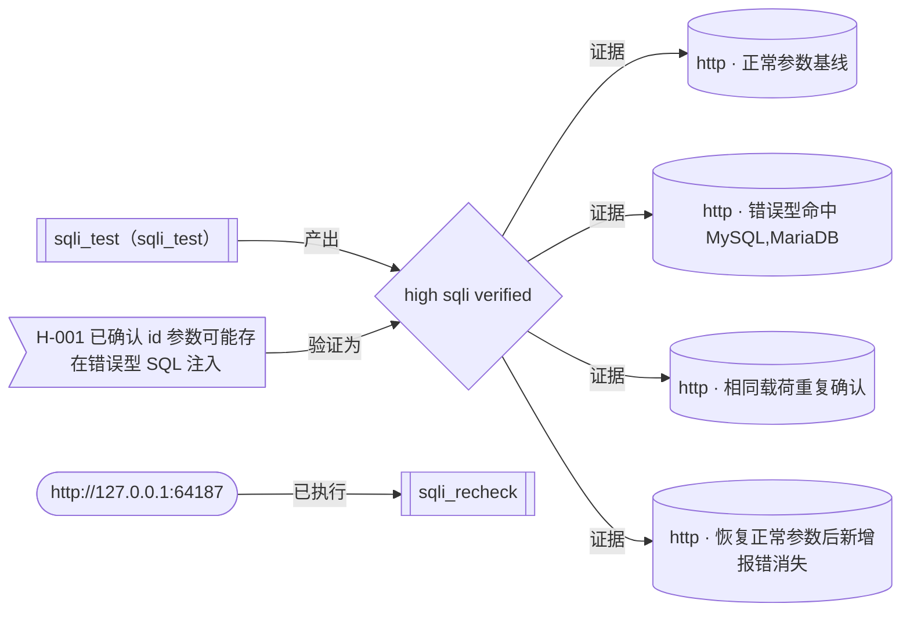

# Trina 自动渗透测试报告

| 项目 | 内容 |
| --- | --- |
| 报告标题 | Trina 自动渗透测试报告 |
| 目标 | http://127.0.0.1:64187 |
| 目标说明 | 确认 SQL 注入并给出证据 |
| Run ID | 20261021-144543-6bc995 |
| 运行模式 | auto |
| 开始时间 | 2026-10-21 14:45:43 |
| 结束时间 | 2026-10-21 14:45:44 |
| 耗时 | 0.2 秒 |
| 最终状态 | 成功 |
| Agent 后端 / 模型 | omp / replay |
| LLM 调用次数 | 3 |
| Token 用量 | 输入 0 / 输出 0 / 缓存读 0 |
| LLM 成本（美元） | 0.000000 |
| 报告生成时间 | 2026-10-21 14:45:44 |
| 生成器 | Trina 0.1.0 |


## 一、执行摘要

风险统计：

| 严重度 | 数量 | 占比 |
| --- | ---: | ---: |
| 严重 | 0 | 0.0% |
| 高危 | 1 | 100.0% |
| 中危 | 0 | 0.0% |
| 低危 | 0 | 0.0% |
| 信息 | 0 | 0.0% |
| 合计 | 1 | 100.0% |

| 项目 | 内容 |
| --- | ---: |
| 主机数 | 0 |
| 开放端口数 | 0 |
| 凭据数 | 0 |
| Flag 数 | 0 |
| 漏洞总数 | 1 |
| 总步数 | 3 |
| LLM 调用次数 | 2 |
| LLM 成本（美元） | 0.000000 |

## 二、授权与合规声明

本次测试仅针对下列授权范围内的目标执行；所有主动动作均由护栏（ScopeGuard）判定，
放行/拒绝结果写入审计哈希链，未授权目标不产生任何流量。

护栏判据（与运行时同源，取自 `cfg.scope`）：

```text
授权网段: 127.0.0.0/8, 10.0.0.0/8, 172.16.0.0/12, 192.168.0.0/16
额外授权主机: (无)
显式拒绝网段: (无)
允许公网目标: 否
当前最大动作等级: verify（detect 只读 / verify 可验证 / exploit 可执行命令）
破坏性动作: 关闭
全局速率上限: 20.0 req/s，单主机并发 8，爆破尝试上限 800
```

| 项目 | 内容 |
| --- | --- |
| 授权网段 | 127.0.0.0/8, 10.0.0.0/8, 172.16.0.0/12, 192.168.0.0/16 |
| 额外授权主机 | （无） |
| 显式拒绝网段 | （无） |
| 允许公网目标 | 否 |
| 允许回环地址 | 是 |
| 最大动作等级 | verify（detect 只读 / verify 可验证 / exploit 可执行命令） |
| 破坏性动作 | 否 |
| 速率与规模上限 | 20.0 req/s，单主机并发 8，爆破尝试上限 800 次 |
| 护栏拒绝次数（运行态） | 0 |
| 护栏拒绝次数（审计） | （未提供审计摘要） |

## 三、攻击路径



上图为 mermaid 流程图源码；Markdown/HTML 预览器需支持 mermaid 才能渲染（报告不引入任何外部 JS）。

| # | 时刻 | 类型 | 事件 |
| ---: | --- | --- | --- |
| 1 | 14:45:43 | 目标 | 目标 http://127.0.0.1:64187 |
| 2 | 14:45:44 | 漏洞 | 发现漏洞 高危 SQL 注入（id，错误型） @ 127.0.0.1:64187 |
| 3 | 14:45:44 | 工具 | sqli_test SQL 注入已验证 错误型 ：http://127.0.0.1:64187/sqli 参数… |
| 4 | 14:45:44 | 工具 | ? SQL 注入已验证 错误型 ：http://127.0.0.1:64187/sqli 参数… |
| 5 | 14:45:44 | 工具 | ? 固定脚本执行结束，结果由工具证据判定 |

## 四、资产清单

（未发现资产）

## 五、漏洞详情

| ID | 标题 | 严重度 | 置信度 | 状态 | 类型 | 位置 |
| --- | --- | --- | --- | --- | --- | --- |
| TRINA-001 | SQL 注入（id，错误型） | 高危 | 高 | 已验证 | sqli | http://127.0.0.1:64187/sqli |

### [TRINA-001] SQL 注入（id，错误型）

| 项目 | 内容 |
| --- | --- |
| ID | TRINA-001 |
| 严重度 | 高危（high） |
| 置信度 | 高（high） |
| 状态 | 已验证（verified） |
| 漏洞类型 | sqli（归一: sqli） |
| CVSS 向量 | 3.1 AV:N/AC:L/PR:N/UI:N/S:U/C:H/I:H/A:N（内置默认向量） |
| CWE | CWE-89（来自工具） |
| 目标 | http://127.0.0.1:64187 |
| URL | http://127.0.0.1:64187/sqli |
| 参数 / 方法 | id / GET |
| 发现工具 | sqli_test |
| 首次发现 | 2026-10-21 14:45:44 |
| 最近确认 | 2026-10-21 14:45:44 |

**描述**

注入 "'" 两次触发新增 DBMS 报错：MySQL, MariaDB；正常参数对照无该报错。

**影响**

（未提供影响说明）

**利用过程与证据**

1. [http] http://127.0.0.1:64187/sqli?id=1（-）
   - 说明: 正常参数基线
   - 载荷: `1`
   - 请求: GET http://127.0.0.1:64187/sqli?id=1 | 请求头: User-Agent: Trina/0.1 (+authorized-pentest; contact=lab), Accept-Encoding: gzip, deflate, br, zstd, Accept: */*, Connection: close
   - 响应: 状态 200，长度 71｜响应片段: <html><body><h2>用户查询结果</h2><p>用户名: admin</p><p>ID: 1</p></body></html>
2. [http] http://127.0.0.1:64187/sqli?id=%27（-）
   - 说明: 错误型命中 MySQL,MariaDB
   - 载荷: `'`
   - 请求: GET http://127.0.0.1:64187/sqli?id=%27 | 请求头: User-Agent: Trina/0.1 (+authorized-pentest; contact=lab), Accept-Encoding: gzip, deflate, br, zstd, Accept: */*, Connection: close
   - 响应: 状态 500，长度 223｜响应片段: Warning: mysqli_query(): (42000/1064): You have an error in your SQL syntax; check the manual that corresponds to your MySQL server version for the right syntax to use near ''' at line 1 in /var/www/…
3. [http] http://127.0.0.1:64187/sqli?id=%27（-）
   - 说明: 相同载荷重复确认
   - 载荷: `'`
   - 请求: GET http://127.0.0.1:64187/sqli?id=%27 | 请求头: User-Agent: Trina/0.1 (+authorized-pentest; contact=lab), Accept-Encoding: gzip, deflate, br, zstd, Accept: */*, Connection: close
   - 响应: 状态 500，长度 223｜响应片段: Warning: mysqli_query(): (42000/1064): You have an error in your SQL syntax; check the manual that corresponds to your MySQL server version for the right syntax to use near ''' at line 1 in /var/www/…
4. [http] http://127.0.0.1:64187/sqli?id=1（-）
   - 说明: 恢复正常参数后新增报错消失
   - 载荷: `1`
   - 请求: GET http://127.0.0.1:64187/sqli?id=1 | 请求头: User-Agent: Trina/0.1 (+authorized-pentest; contact=lab), Accept-Encoding: gzip, deflate, br, zstd, Accept: */*, Connection: close
   - 响应: 状态 200，长度 71｜响应片段: <html><body><h2>用户查询结果</h2><p>用户名: admin</p><p>ID: 1</p></body></html>

**修复建议**（内置默认建议）

使用参数化查询/预编译语句，禁止把外部输入拼接进 SQL；对参数做类型与白名单校验；数据库账号按最小权限授权并关闭多语句执行；接入 WAF 并对异常查询告警。


## 六、证据链与假设台账

假设台账:共 1 条（待验证 0、验证中 0、已确认 1、已否定 0、被阻断 0）

| ID | 状态 | 置信度 | 优先级 | 假设 | 下一步 | 证据数 |
| --- | --- | ---: | ---: | --- | --- | ---: |
| H-001 | 已确认 | 0.90 | 0.00 | id 参数可能存在错误型 SQL 注入 | - | 1 |

证据关系图（可用支持 mermaid 的 Markdown 查看器渲染）：



证据图：9 个节点（check 2，evidence 4，finding 1，hypothesis 1，target 1）、7 条关系

| 起点 | 关系 | 终点 |
| --- | --- | --- |
| finding:TRINA-001 | 证据 | evi:TRINA-001:1 |
| finding:TRINA-001 | 证据 | evi:TRINA-001:2 |
| finding:TRINA-001 | 证据 | evi:TRINA-001:3 |
| finding:TRINA-001 | 证据 | evi:TRINA-001:4 |
| check:sqli_test | 产出 | finding:TRINA-001 |
| target:http://127.0.0.1:64187 | 已执行 | check:sqli_recheck |
| hypo:H-001 | 验证为 | finding:TRINA-001 |

## 七、凭据与 Flag

### 有效凭据

（未获取凭据）

### Flag

（未夺取 flag）

## 八、附录

### 工具调用时间线

| 时刻 | 工具 | 参数 | 结果摘要 | 耗时 |
| --- | --- | --- | --- | --- |
| 14:45:44 | sqli_test | url=http://127.0.0.1:64187/sqli param=id method=GET technique=error | SQL 注入已验证[错误型]：http://127.0.0.1:64187/sqli 参数 id，DBMS≈MySQL,MariaDB，payload="'" | 0.19s |
| 14:45:44 | ? | url=http://127.0.0.1:64187/sqli param=id technique=error | SQL 注入已验证[错误型]：http://127.0.0.1:64187/sqli 参数 id，DBMS≈MySQL,MariaDB，payload="'" | 0.19s |
| 14:45:44 | ? | - | 固定脚本执行结束，结果由工具证据判定 | 0.00s |

### 指标

| 项目 | 内容 |
| --- | ---: |
| 运行耗时 | 0.2 秒 |
| 总步数 | 3 |
| 工具调用次数 | 1 |
| LLM 调用次数 | 2 |
| LLM 成本（美元） | 0.000000 |
| 护栏拒绝次数 | 0 |
| 错误计数 | 0 |
| 主机数 | 0 |
| 开放端口数 | 0 |
| 凭据数 | 0 |
| Flag 数 | 0 |
| 漏洞数 | 1 |
| HTTP 请求数 | 8（来源: evidence（受证据上限约束）） |

### 审计摘要

（未提供审计摘要）
