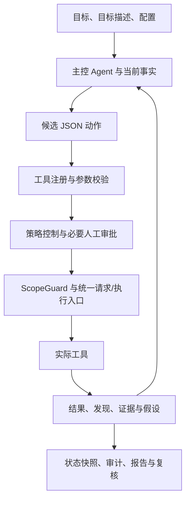

# Trina 项目开题报告与第一次汇报

> **课程检查主文档｜《AI 原生工程实践》章节 02｜2026 年 10 月 21 日｜规格版本 1.0**
>
> 项目仓库：<https://gitee.com/YHalo/Trina>
>
> 项目名称：Trina——面向授权实训靶场的证据驱动安全测试 Agent
>
> 当前阶段：已有工程基线的需求梳理、规格固化、机制验证与第一次汇报。教师可先阅读本文，再按文中链接抽查代码、测试和原始证据。

## 一、选题背景与问题定义

### 1.1 为什么选择这个题目

在网络安全实训中，一次完整的安全测试需要依次完成目标确认、信息收集、服务枚举、候选漏洞提出、验证、取证和报告整理。学生常常能够运行单个扫描命令，却难以说明下一步为什么执行、一个结果是否已经证明漏洞、测试是否超出授权范围、失败后如何调整。同一任务的命令输出、人工判断和报告又分散在终端、聊天及临时文件中，复核者很难从报告结论反向找到当时的输入与证据。

大模型可以解释输出并提出下一步动作，但生成的文字本身不能证明目标存在漏洞，也不能授予执行权限。如果把模型描述直接当作结果，系统可能把扫描器提示写成已确认漏洞，把拿到一个字符串写成任务成功，或者在工具失败后仍然生成确定性结论。因此，本项目关注的核心问题是：怎样让 Agent 在明确范围和预算内推进测试，并使每个结论都具有可以检查的事实来源。

### 1.2 需要解决的具体问题

| 问题 | 实训中的具体表现 | 对应工程处理 |
|---|---|---|
| 决策与执行混在一起 | 模型提出一个工具名和地址后直接执行，参数、范围和等级没有统一裁决 | 使用结构化动作协议，经注册表、控制器、审批与 ScopeGuard 逐层处理 |
| 有扫描结果但缺少证据 | 响应里出现报错或关键字，就在最终报告中认定漏洞成立 | 保存发现、证据和假设的关联；区分 suspected、verified、exploited 及最终 verdict |
| 任务过程难以复核 | 无法知道工具何时执行、为何拒绝、哪些检查尚未完成 | 生成审计、状态快照和报告，保留未决事项及失败原因 |
| Agent 重复尝试且缺少停止条件 | 同一动作反复返回相同结果，持续消耗调用和时间 | 设置步数、检查数、时长、无新信息和咨询次数等预算 |
| 仓库材料难以验收 | README 说明能做什么，却没有明确什么输入下必须出现什么结果 | 将需求编号，补齐 GWT 场景、验收矩阵、任务卡和可执行检查 |

### 1.3 项目对象与当前基线

本项目在已有 Trina 工程基础上开展，产品逻辑基线为 `24fb6371a18ed59c905de25bbf0ac69ba69ec256`。仓库已经具备 Python CLI、模型后端、工具封装、授权控制、审计、报告、靶场适配和自动化测试。本次汇报不将既有代码重新表述为从零开发成果，重点是把已实现的能力、实际边界和后续缺口整理为可验证的工程契约，并补齐课程要求的仓库交付物。

课程参考材料为用户提供的章节 02 V1.1 课件，共 94 页。本文采用其中“意图 → 问题定义 → 可验证规格 → 计划与任务 → Harness → 实现与证据”的工程链，业务对象始终是 Trina。课件的页码、文件摘要和逐项对应见[课程要求对照](docs/course/course-alignment.md)。

## 二、项目目标、使用对象与范围

### 2.1 总体目标与可观察成果

项目目标是在授权实训环境中，构建一条由任务输入到工具执行、证据保存和结果复核的闭环。给定目标地址、任务目标及配置后，系统应能提出并处理合法动作，拒绝范围或等级不符的动作，在预算耗尽或人工停止后结束推进，最终提供可追溯的状态、审计和 Markdown/HTML 报告。

目标是否达到，以可观察产物判断：动作被接受或拒绝的原因可见；已验证发现能对应证据和目标参数；不充分的证据不会被写为 CONFIRMED；两轮全新靶机运行能分别生成独立产物；仓库中的每条 MUST 都能找到场景、代码位置和验证入口。真实模型成功率、调用成本和时间收益需要单独的代表性任务实验，本轮不编造提升比例。

### 2.2 使用对象与职责

| 对象 | 需要完成的工作 | 决策与责任 |
|---|---|---|
| 实训操作者 | 选择靶场、输入目标、查看进度、提供提示、批准或拒绝动作 | 确认任务与授权范围，判断是否继续高风险或含糊任务 |
| 项目维护者 | 配置目标及检查项、维护工具契约、运行回归和修复缺陷 | 对产品权限、代码变更、依赖和发布内容负责 |
| Agent | 解释任务、提出候选动作及假设、汇总观察、生成结论草稿 | 动作必须接受宿主裁决；自身文字不能覆盖权限与证据规则 |
| 教师或同行复核者 | 从仓库抽查规格、运行命令、核对证据并记录问题 | 独立给出审查结果与课程评价；仓库不预填其签署 |

### 2.3 范围与非目标

当前范围包括 CLI 和对话运行、已封装目标分析工具、授权及范围校验、假设台账、有限预算、人工介入、状态持久化、审计、报告和内置 lab 的机制验证。模型支持不同后端，教学检查路径可以使用固定决策回放，不要求检查者配置收费模型账号。

当前非目标包括多租户 Web 平台、操作系统级隔离、自研漏洞扫描引擎、真实业务系统测试、自动扩大授权、无人工责任的自动发布，以及对所有网络环境给出统一成功率保证。课程资料整理也不替代尚未完成的产品缺陷修复。具体边界、事实、假设与约束见[问题框架](docs/course/problem-frame.md)和[Intent 记录](docs/course/intent.md)。

## 三、需求分析与典型业务流程

### 3.1 一次任务应怎样完成

1. **建立任务。** 操作者输入目标 URL 或地址、测试目标和预算；宿主加载配置、目标范围及检查注册项。目标描述不清或配置不合法时应反馈错误，不能静默补成授权。
2. **产生候选动作。** Agent 根据当前阶段、事实摘要和工具结果，生成包含动作名、参数及可选假设的 JSON。非法 JSON 进入反馈与有限重试流程，不能直接成为命令。
3. **裁决与执行。** 注册表检查工具和参数，控制器检查策略、注册项、撤权及预算，必要时请求人工批准，实际请求和外部执行经过统一护栏。拒绝时保存原因，不执行被拒动作。
4. **更新事实。** 工具返回结构化结果，系统关联目标、发现、证据和假设。模型可以提出解释，但不能仅凭 final 中的文字把发现升级为已验证。
5. **继续或停止。** 系统依据目标、剩余预算、是否有新信息及人工指令决定下一步。工具、网络和模型错误应可区分，停止后的在途执行限制也应明确记录。
6. **交付与复核。** 保存 `state.json`、审计和两种报告；复核者依据输入、证据与状态检查结论，并记录不能由自动化覆盖的部分。

### 3.2 核心需求清单

以下 20 条为本版本 MUST 级规格。表中给出业务含义与观察点；每条的前置条件、正常处理、失败处理和适用限制在[详细规格](docs/course/specification.md)逐项展开。

| 编号 | 具体需求 | 检查时应观察什么 |
|---|---|---|
| REQ-01 | 解析任务配置与结构化动作，非法协议有反馈 | 合法 JSON 可处理，非法 JSON 不触发目标工具，错误配置被拒绝 |
| REQ-02 | 在执行路径判断目标是否处于允许范围 | 越界目标被拒绝，拒绝分支不发生目标传输 |
| REQ-03 | strict 模式约束注册检查项，并支持撤权 | 未注册、已撤权或不匹配检查被拒绝；精确参数绑定缺口单列 |
| REQ-04 | 工具统一注册、校验参数并返回统一结果 | 未知工具、缺参和执行异常有明确结果，不旁路调用工具 |
| REQ-05 | 按实际参数判定动作风险等级 | 带高风险参数的动作不能借低等级工具名放行 |
| REQ-06 | HTTP 跳转和重试遵守范围及方法语义 | 新跳转目标重新校验，POST/重试处理符合已实现契约 |
| REQ-07 | 发现与证据、目标、参数和假设关联 | 无关目标、错误参数或无证据发现不能确认当前假设 |
| REQ-08 | 任务状态与漏洞结论分别判定 | 伪造 final、单独的 flag 或不充分证据不能替代验证 |
| REQ-09 | 审计记录能够检查内部链一致性 | 原样记录可校验，篡改后被检测；不声称具有外部时间锚 |
| REQ-10 | 支持批准、拒绝、提示、停止和撤权 | 超时或拒绝不放行；人工提示影响后续决策而不增加权限 |
| REQ-11 | 对步数、时间、检查和重复尝试设置预算 | 耗尽后停止新增推进，保留停止原因；在途强取消列为缺口 |
| REQ-12 | 状态写入与读取具有清晰契约 | 快照能读取，原子写入失败不损坏旧文件；读取不等于完整续跑 |
| REQ-13 | 假设排序和确定性调度可解释、可关闭 | 候选有评分与选择记录，不遵从调度可见；关闭后回到基线 |
| REQ-14 | 可选专职咨询只返回建议，受次数预算约束 | 子角色不能直接写入主控事实，采纳建议仍经过普通执行链 |
| REQ-15 | 在指定报告、字段和摘要位置执行脱敏 | 指定敏感字段被遮蔽，原始状态与任意正文的限制显式说明 |
| REQ-16 | 输出 Markdown/HTML 报告并支持只读复核 | 结论可追到事实，未解决项可见，复核不反向更改运行事实 |
| REQ-17 | 评测有明确口径和真值隔离 | 指标计算可检验，评测真值不注入主控规划输入 |
| REQ-18 | 使用两套新 lab 验证完整机制 | 独立端口与目录，实际 HTTP、证据、假设、审计及报告均可核对 |
| REQ-19 | 课程工件和追踪关系接受机械检查 | 缺文件、失效测试名称、断开的要求关系能使检查失败 |
| REQ-20 | 保存可继续工作的工程交接信息 | 版本、当前状态、失败、决策、人工问题和下一动作完整可读 |

### 3.3 非功能要求与约束

**可追溯性。** 要求使用稳定的 REQ 编号；正常、失败和对抗场景使用 SC 编号；任务使用 TASK 编号。验收矩阵连接这些编号、实际测试方法、实现位置、命令和证据。需求改名或测试移动时应同步清单，不能只改正文。

**可重复验证。** 基础检查不依赖真实模型付费调用。机制验证自动创建并回收回环靶机，使用新的运行目录，保留固定动作脚本和原始输出。已有环境验证与跨系统干净安装属于不同结论，当前没有跨平台安装完成的证据。

**可控制性。** 请求和外部执行必须走既有统一执行路径。预算按各层实际语义描述，不能把主循环时长误写为所有后台工作的硬截止；人工审批也不具备多人身份服务的持久化能力。

**可维护性与兼容性。** 本次不增加产品工具和外部依赖，不修改状态 Schema、CLI 接口及授权配置。新文档和检查脚本可以通过 Git 差异单独审查，回滚时保留既有运行证据。

## 四、可验证规格与验收设计

### 4.1 从需求到检查证据

规格不能停留在“系统应安全可靠”。例如范围要求应明确：给定只允许回环目标的配置，当动作参数指向不允许的地址时，系统返回拒绝及原因，目标请求函数没有被调用。证据要求应明确：给定只有 suspected 的发现，即使模型 final 声称成功，也不能将它升级为 verified 或输出缺乏支持的 CONFIRMED。

本版本编写了 **26 个 Given–When–Then 场景：11 个正向、8 个负向、7 个对抗**。场景分别说明前置事实、触发输入、可观察结果和限制；不是为满足数量而重复同一成功流程。完整内容见[验收场景](docs/course/scenarios.md)，每条 MUST 的测试名称及证据见[验收矩阵](docs/course/acceptance-matrix.md)。

| 类型 | 代表场景 | 必须成立的结果 |
|---|---|---|
| 正向 | SC-P02：升级确认；SC-P10：两轮全新机制验证 | 匹配发现有真实证据后才能升级；两轮分别留下独立产物 |
| 负向 | SC-N02：strict 未注册；SC-N07：原子写入失败 | 前者拒绝且不执行；后者保留旧状态且错误可定位 |
| 对抗 | SC-A03：跨范围跳转；SC-A04：模型伪造结论 | 跳转目标重新裁决；模型声明不能覆盖证据判定 |

### 4.2 状态与“完成”的含义

运行状态包含 running、success、partial、failed、blocked、stopped；它描述任务执行结果。漏洞结论使用 CONFIRMED、NOT_CONFIRMED、INCONCLUSIVE；它描述当前证据能支持什么。发现的验证等级、PTES 阶段和假设状态又各自有独立含义。把这些概念合并，会造成“运行结束就等于漏洞确认”的错误。

当前控制器的 `executed` 在策略允许时记录，发生于人工审批、护栏和工具完成之前。因此它不能直接证明工具执行成功或覆盖已经完成。此处保留实际实现并列为 OQ-01，没有通过改写术语隐藏问题。完整状态图和转换规则见[状态模型](docs/course/state-model.md)。

### 4.3 自动检查与人工判断的分工

结构检查可以验证文档存在、ID 一致、命令已登记、测试名称确实在源码中声明，以及本地链接指向文件。回归和机制验证可以证明本次环境中实际运行的行为。它们不能自动证明需求选得合理、所有未知漏洞都能发现，或真实模型具有稳定的自主规划能力。

人工复核应抽查至少三条 MUST，反向追到场景、代码和原始证据，并独立执行至少两条命令；发现记录应包括受影响要求、事实、严重程度、处理方式及复核结果。当前保存的是 AI 辅助自查记录，教师和独立同行的意见仍待真实记录，见[审查记录](review/20261021-course-pack-review.md)。

## 五、技术路线与双层 Harness 设计

### 5.1 产品执行路线

决策层的逐步技术说明已于 2026-10-26 展开为[《决策层设计说明》](docs/DECISION_LAYER.md)。该文按实际调用顺序解释每一步的输入、判断、设计依据、方案代价、失败分支及验证入口，并区分目标、阶段、假设、执行允许和最终结论的语义。



模型承担理解与候选决策，宿主程序承担权限、预算、工具装配、事实写入和审计。核心模块包括 `trina/brain/`、`trina/policy.py`、`trina/scope.py`、`trina/tools/`、`trina/hypotheses.py`、`trina/audit.py` 和 `trina/report/`。具体模块契约与受影响接口分别见[仓库地图](docs/course/repository-map.md)和[影响分析](docs/course/impact-map.md)。

### 5.2 Runtime Harness：控制一次产品运行

运行层加载工具能力、目标范围、动作等级、当前事实和模型配置，向 Agent 提供有限上下文；接收候选动作后进行确定性检查，执行结果再形成下一轮反馈。默认主控有 40 步和 1800 秒配置，控制器另有检查数及逻辑时间预算，可选专职咨询默认关闭。配置之间的层次、重试和停止边界在清单中分别解释。

数据可见性划分为 Raw、Derived、Masked、On-demand 和 Prohibited。指定报告、审计字段和子角色摘要有脱敏处理，但原始 state 中仍可能保存凭据口令，主控原始观察也不具备统一秘密检测。教学证据只采用模拟 lab 数据，原始资料与派生摘要分别保留。不能把局部脱敏测试通过写成全链路数据泄露防护完成。

### 5.3 Project Harness：控制仓库中的工程活动

工程层以根报告和 README 作为入口，以 Intent、规格、任务卡和仓库地图提供方向，以文档检查、unittest、机制验证、diff 和审查记录提供反馈。开发或复核中断后，接手者可从交接包找到已验证版本、失败、已作决策、人工问题和下一安全动作。

本项目采用同仓库 Markdown、JSON 追踪清单和标准库检查脚本。选择这一方案是因为代码、规格和证据可以一起版本化，教师无需访问外部系统即可核对；它的代价是关系变更需要同步维护，语义合理性仍需人工检查。替代方案和决策后果见[ADR-0019](design/adr/0019-course-contract-and-dual-harness.md)，具体命令、权限、预算和恢复见[双层 Harness 清单](docs/course/harness-manifest.md)。

## 六、实施计划与任务划分

本版本使用 8 张垂直任务卡，每张都包含输入、行为切片、产物、依赖、就绪条件、完成条件和 Stop / Ask / Rollback。TASK-01 至 07 对已有实现进行契约梳理和验收归档，TASK-08 完成本次文档、追踪检查、证据及仓库提交。没有以文件数量或文档字数代替任务完成条件。

| 任务 | 具体工作及交付 | 完成检查 |
|---|---|---|
| TASK-01 输入到受控动作 | 明确协议、目标范围、strict 策略与参数错误路径 | 正常解析及拒绝分支能追到代码和测试 |
| TASK-02 等级与传输边界 | 梳理动态等级、HTTP 跳转、重试和方法语义 | 高风险参数及跨范围跳转不会错误放行 |
| TASK-03 证据与结论 | 明确发现升级、假设关联、任务状态和 verdict | 伪造 final 和不匹配证据不能得到确认 |
| TASK-04 审计与可见性 | 核对哈希链、字段遮蔽和原始数据边界 | 篡改可检测，脱敏主张不超过实际覆盖 |
| TASK-05 人工介入与预算 | 核对批准、提示、停止、撤权及耗尽行为 | 超时、拒绝及预算限制有对应结果 |
| TASK-06 快照与调度 | 核对原子写入、读取、排序和调度开关 | 快照失败可定位，调度记录可解释 |
| TASK-07 咨询与报告 | 明确建议角色权限、咨询预算、报告及只读复核 | 子角色不能写事实，报告能追溯证据 |
| TASK-08 综合验证与交付 | 形成课程文档、关系清单、回归和两轮机制证据，提交 Gitee | 首页可发现，检查可运行，原始输出与摘要一致 |

里程碑按 M0 基线核对、M1 规格与影响、M2 切片验证、M3 双层 Harness、M4 综合证据、M5 仓库交付推进。未给出的课程截止时间不自行编造；后续时间安排应在教师或项目负责人明确后更新。依赖图、风险处理和 DoR/DoD 见[实施计划](docs/course/plan.md)，逐项执行信息见[任务卡](docs/course/tasks.md)。

## 七、第一次汇报的进展与验证

### 7.1 已形成的工程成果

已有产品基线具备工具执行、控制器与护栏、人工介入、假设及调度、状态与审计、报告及评测入口。本轮整理形成 20 条需求规格、26 个验收场景、8 张任务卡，以及状态模型、影响分析、ADR、仓库地图、双层 Harness、AI 披露、未决问题和交接包。主报告放在仓库根目录，README 开头提供教师检查入口，详细文件按业务和工程职责分开组织。

验证资料放在版本库的 `evidence/20261021-course-pack/`，不会要求教师到本机临时目录查找。自动化证据分别记录原始测试日志、逐测试结果、两轮状态和审计、报告、结构检查及隔离的失败实验。准确结果、环境、命令、时间和摘要见[验证事实索引](evidence/20261021-course-pack/README.md)。

### 7.2 验证路径及结果含义

| 验证 | 具体内容 | 能证明的范围 |
|---|---|---|
| 全量回归 | 运行现有 unittest discover，保存全部用例结果和原始输出 | 当前环境中用例覆盖的行为，失败和跳过数如实记录 |
| 两轮机制验证 | 每轮新端口、新 lab、新目录，固定动作触发实际 SQL 注入检查 | 执行、证据升级、假设关联、审计和报告闭环；不代表模型自主规划成绩 |
| 文档关系检查 | 检查文档、要求、场景、任务、代码位置、命令和实际测试名称 | 发现结构与引用漂移；不自动判断正文业务语义完整性 |
| 隔离失败实验 | 在临时仓库副本制造缺文件和无效测试引用 | 检查器能够拒绝这两类坏输入，原仓库不被破坏 |
| 审计及差异检查 | 对归档链运行 verify，并检查 Git 差异 | 样本内部链一致及差异的基础格式质量 |

现有固定机制运行得到两轮 success / CONFIRMED，假设为 confirmed，审计链通过，复核未发现结论冲突或无证据主张。完整测试的结果以同目录机器摘要和原始日志为准；旧报告中的历史测试数量和旧环境失败保留原版本背景，不覆盖本轮证据。

### 7.3 教师可直接执行的检查

在仓库根目录、安装了项目依赖的 Python 3.10 及以上环境中执行：

```bash
python -m scripts.verify_course_pack
python -m unittest discover -s tests
python -m trina audit verify evidence/20261021-course-pack/round-1/audit.jsonl
```

Windows 已有虚拟环境可将 `python` 替换为 `.venv\Scripts\python.exe`。如需重做机制验证，再运行 `python -m scripts.verify_decision_evidence --output artifacts/course-pack-demo`，使用尚不存在的输出目录；每轮结束自动回收 lab。安装说明、命令退出标准及副作用见 Harness 清单。

## 八、已发现的问题、风险与后续工作

| 问题 | 当前实际影响 | 后续关闭条件 |
|---|---|---|
| OQ-01 检查生命周期 | 控制器记录的 executed 早于实际工具完成，不能直接作为覆盖证明 | 区分允许、批准、开始、完成及失败，并测试拒绝与中断路径 |
| OQ-02 精确授权 | strict 注册尚未完整绑定参数；同主机匹配存在端口语义边界 | 明确 URL、端口和参数约束，加入越权变体及兼容回归 |
| OQ-03 在途取消 | 主循环停止或工具超时不代表所有线程及 I/O 已终止 | 提供可观察取消结果，验证停止后不再发生相关副作用 |
| OQ-04 调度粒度 | 当前选择能绑定的检查项，未形成完整的参数位置级调度 | 明确位置来源、去重、缺参和耗尽语义并形成证据 |
| OQ-05 原始秘密 | 指定位置脱敏无法覆盖原始 state 和任意响应正文 | 制定凭据引用与上下文策略，验证报告、审计、状态及模型输入 |
| OQ-06 真实模型收益 | 机制回放无法证明专职咨询或调度提升成功率与成本 | 同模型、同预算代表性任务对照，保留逐次数据及阴性结果 |
| OQ-07 人工复核 | AI 自查不能替代同行和教师判断 | 真实复核者独立运行、记录 Finding、确认处理并签署 |
| OQ-08 干净安装 | 当前环境可运行，不等于跨平台依赖已完全锁定 | 新环境安装和关键验证成功，记录依赖及平台差异 |
| OQ-09 独立漏洞复现 | 现有产品仍信任工具验证字段，通用的独立重放及修复复测链路尚未形成 | 先为 SQLi/LFI/RCE 建立独立重放与阴性样本，保留环境和复测结果 |

这些事项按阻塞范围管理：它们不阻塞教师阅读当前报告和复核已有机制，但会限制更强的产品完成声明。责任角色、优先级、最晚决策关卡及验收方式见[未决问题清单](docs/course/open-questions.md)。后续先处理生命周期、授权和敏感数据等影响事实与边界的问题，再评估模型效果，不以新增功能掩盖基础语义缺口。

## 九、AI 参与、成果归属与汇报边界

本轮使用 AI 辅助读取课件、分析仓库、起草和校对中文文档、建立追踪关系、执行测试、整理证据及提交变更。AI 对代码和输出的解释需要由实际文件与运行结果支持。未将 AI 自查写成教师审查，也没有虚构小组成员、实际分工、历史会议、人工驳回记录或课程成绩。

项目维护者负责确认需求、范围及最终内容；教师和同行对自己的复核结论负责。模型输出、课件内容和工具日志均属于待核对资料，不能自行成为授权。具体辅助活动、未采纳主张与人工责任见[AI 使用披露](docs/course/ai-disclosure.md)。

## 十、仓库提交材料与检查索引

| 材料 | 仓库入口 | 主要检查内容 |
|---|---|---|
| 开题与第一次汇报 | 本文 | 背景、目标、需求、设计、计划、进展、风险与后续工作 |
| 完整课程文档 | [课程文档目录](docs/course/README.md) | 课件 12 项交付物及 V1.1 补充要求 |
| 需求与规格 | [specification.md](docs/course/specification.md) | 20 条 MUST 的具体行为、输入输出、异常及边界 |
| 验收与追踪 | [验收矩阵](docs/course/acceptance-matrix.md)、[关系清单](docs/course/traceability.json) | 要求到场景、任务、代码、测试及证据的链路 |
| 实现与执行规则 | [架构](docs/ARCHITECTURE.md)、[护栏](docs/GUARDRAILS.md)、[双层 Harness](docs/course/harness-manifest.md) | 模块契约、宿主裁决、权限、反馈及恢复 |
| 本轮验证证据 | [证据索引](evidence/20261021-course-pack/README.md) | 原始输出、逐测试结果、两轮运行与文件摘要 |
| 审查与后续 | [审查记录](review/20261021-course-pack-review.md)、[未决问题](docs/course/open-questions.md)、[交接包](docs/course/continuity.md) | 自查事实、待人工事项和下一步工作 |

提交内容包含项目源码、上述 Markdown 与追踪清单、必要的模拟 lab 证据和可执行检查。课程原 PPT、课堂照片、本机无关 artifacts、真实密钥和个人资料不进入版本库。Git 提交与 Gitee 远端版本共同定位本次交付；后续修订应保留旧验证背景，并为行为变化生成新的验证记录。
