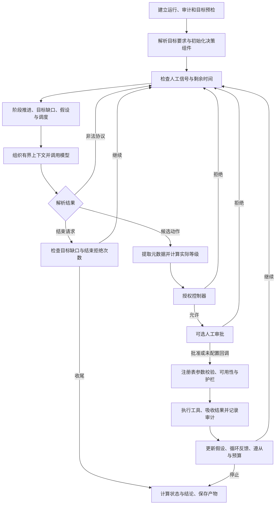

# 设计决策

初版：2026-10-26；更新：2026-11-13。第 1—27 节保留早期代码基线的决策依据；第 28—43 节记录 0.2.0 的交互、智能体与工具演进；第 44 节起记录 0.3.0 与后续运行时更新。历史实验结果仍按原采集时间解释，新增功能的验证另列。

检查入口：[需求](需求.md) · [规约](规约.md) · [架构与模块契约](docs/ARCHITECTURE.md) · [开题报告与第一次汇报](开题报告与第一次汇报.md)。早期课程要求见[2026-10-21 课程规格](docs/course/specification.md)，原始核对记录见[2026-10-26 文档验证](evidence/20261026-decision-docs/README.md)。

## 阅读顺序

本文围绕一次任务的实际执行顺序展开。第 1—3 节说明决策职责和总体结构；第 4—20 节逐步解释任务建立、目标约束、阶段推进、假设排序、调度、模型动作、执行裁决、证据更新和收尾；第 21—24 节说明对话模式、专职咨询、完整案例及方案取舍；第 25—27 节保留旧基线的验证和演进判断；第 28—30 节记录 0.2.0 已落地的 Agent 与 CLI 更新、修改原因、验收证据和剩余边界。

阅读单个步骤时，需要同时看它的输入、判断依据、输出和失败分支。一个模块的“允许”只表示通过该模块负责的条件，不能自动解释为后续审批、工具执行和漏洞验证均已完成。

## 1. 决策层究竟要解决什么问题

安全测试的下一步取决于前一步实际发现了什么。发现开放端口后需要识别服务；发现带参数的接口后需要判断哪一种验证方法能区分假设；工具报错后需要区分参数错误、服务不可达和证据不足。如果预先固定全部命令，流程难以适应不同目标；如果把所有选择交给模型自由展开，任务又可能偏离目标、反复尝试或提前宣布成功。

Trina 的决策层负责把“用户提出任务”转为“一次次可以裁决和复核的动作”。它需要回答五个具体问题：当前还有什么目标未完成；现有事实支持优先检查什么；候选动作是否具备合法的执行条件；结果带来了哪些新事实；继续执行是否仍有必要和预算。大模型主要处理不确定的解释与候选动作，宿主 Python 程序处理可明确计算的规则、状态和边界。

设计目标包含三个相互制约的方面。第一，允许根据工具观察调整路线，使系统具有任务适应能力。第二，保留单步控制点，使授权、人工介入、超时和审计可落实到具体动作。第三，将运行结果和模型文字分开，使报告中的事实能够反向定位到工具产物。这三个目标共同决定了当前“主控循环 + 阶段机 + 假设台账 + 确定性方向调度 + 分层裁决”的结构。

这里的“决策可解释”指保存候选动作理由、选取规则、裁决结果和事实变化。`thought` 是模型提供的简短理由声明，不能据此声称系统取得了模型内部全部推理过程；复核仍需结合当时的状态、规则与执行结果。

## 2. 决策权怎样分配

| 决策问题 | 实际承担者 | 可读取的依据 | 可以产生的结果 |
|---|---|---|---|
| 本任务要求什么 | `GoalRequirements` 与用户原始目标 | 目标文本、当前事实 | 硬性缺口、路径提示、凭据提示 |
| 当前处于什么作业阶段 | `Planner` | 端口、技术栈、路径、发现、flag、阶段步数 | 当前阶段、阶段指引及推进原因 |
| 哪个待验证问题更值得处理 | `HypothesisLedger` | 假设字段、尝试结果和状态 | 排序后的待验证问题 |
| 本步优先落到哪个注册检查 | `HypothesisScheduler` | 台账、当前目标检查项、控制器记录、目标漏洞类 | `ScheduleDecision`，进入提示词 |
| 实际提出什么工具和参数 | 主控模型 | 有界状态摘要、阶段任务、调度及上一步观察 | JSON 候选动作或结束请求 |
| 注册、预算与撤权条件是否允许 | `AuthorizationController` | 宿主注册表、策略模式、预算和撤权集合 | allow / deny、解析后的检查 ID、原因 |
| 操作者是否批准该候选动作 | 可选审批回调与 `Session` | 工具、参数、实际等级、目标和理由 | 批准、拒绝或超时拒绝 |
| 工具参数与实际请求是否可执行 | `ToolRegistry`、`ScopeGuard`、受控传输封装 | 参数表、工具等级、目标、请求及命令内容 | 结构化结果或拒绝结果 |
| 哪些内容可以成为事实 | 工具契约、`RunState`、台账更新规则 | 工具 facts、evidence 和对象匹配 | 状态变化、发现升级、假设状态 |
| 是否满足目标、如何收尾 | 主控的确定性收尾代码 | 目标要求、带证据发现、运行错误及覆盖记录 | `status`、`verdict`、未解决项和审计 |

分配职责的原因在于各类判断的稳定性不同。漏洞假设和下一步参数存在探索空间，适合由模型提出；目标范围、注册 ID、预算和状态写入具有明确规则，应由程序处理。把它们全部放进提示词会使权限取决于模型是否遵守文字；把它们全部写成固定扫描顺序，又会丢失根据观察调整路线的能力。

上述模块仍运行在同一宿主进程或其线程中。职责划分提供代码层面的控制和审查位置，当前没有借此实现进程级隔离、多人身份系统或可信远程审批服务。

## 3. 一次任务的总体执行顺序



该图按 `PentestAgent.run()` 的当前调用顺序绘制。控制器和人工审批位于 `ToolRegistry.execute()` 之前，工具参数的完整校验位于注册表内部。这一点决定了后面的“已允许”记录为何不能直接当作成功执行证明。

循环采用单步单动作。每次工具执行后先回收结果，再组织下一次模型输入，因此下一步可以使用最新事实。批量执行一整段模型计划会使中途撤权、失败、预算变化和新证据难以及时影响后续动作。当前设计承担了较多轮次的模型调用成本，换取逐动作控制和清晰的动作—观察对应关系。

## 4. 步骤一：建立运行并在模型调用前预检目标

### 4.1 输入、动作和输出

入口接收目标、自然语言目标描述、步数及时长覆盖值、附加规则、初始提示和可选录制路径。宿主创建 `run_id`、`RunState`、运行目录和审计对象，先写 `run.start`，再通过 `ScopeGuard.check_target(target, action="preflight")` 检查初始目标。

预检拒绝时，运行状态设为 `blocked`，记录原因、结束时间和产物位置，保存状态后直接返回。此分支不进入模型推理，也不执行目标工具。范围判断可能进行域名解析；“模型零调用、目标工具零调用”不应扩大解释为绝对没有任何 DNS 活动。

### 4.2 为什么把预检放在最前面

初始目标是否允许访问由配置决定，调用模型不会增加这项判断的可信度。提前检查能避免为明显无权执行的任务消耗模型预算，也能给操作者稳定的拒绝原因。审计先于拒绝判断建立，则被拒任务仍有可定位的记录，不会只在终端留下临时提示。

预检只能覆盖任务入口。模型后续可能提出另一个 URL，HTTP 也可能跳转，因此每次动作及后续请求仍需检查。只做一次预检会让后续地址变化绕过最初的范围判断。

### 4.3 代码与验收依据

实现位于 [`PentestAgent.run`](trina/brain/agent.py) 的初始化和 preflight 分支，以及 [`ScopeGuard`](trina/scope.py)。现有测试 `test_brain.TestReActLoop.test_out_of_scope_is_blocked_without_llm` 验证初始拒绝与模型调用边界；`test_mid_run_pivot_to_out_of_scope_is_denied` 验证中途改目标仍受限制。

## 5. 步骤二：把自然语言目标转成可检查的完成条件

### 5.1 实际解析哪些内容

[`GoalRequirements.parse`](trina/brain/goal.py) 使用明确的关键词和正则提取漏洞类、路径、端口、凭据提示及是否提到 flag。它没有调用第二个模型理解目标，也没有读取评测 ground truth。由同一段用户描述产生相同的结构化要求，有利于离线重放和解释任务为何未完成。

| 内容 | 当前处理方式 | 设计理由与代价 |
|---|---|---|
| 漏洞类 | SQL 注入、LFI、命令执行等关键词映射到规范类型，作为硬条件 | 防止无关发现代替任务；关键词语义有限，不能理解任意否定、条件和复杂组合 |
| 端口 | 过滤明显年份、计数、时间单位后形成硬条件；在任一主机记录该端口即视为覆盖 | 避免把“3600 秒”当作端口；当前没有把端口要求完整绑定到指定主机对象 |
| 路径 | 没有漏洞类要求时为硬条件；已有漏洞类时降为提示 | 减少辅助路径未形成 finding 导致的误判；精确指定位置的任务契约仍不完整 |
| 凭据 | 提取用户名和口令，形成单组验证提示 | 用于选择验证方式；凭据本身不使 `empty` 变为 False，也不是独立成功硬条件 |
| flag | 记录 `explicit_flag`，通用收尾仍依赖工具事实 | 仅出现“拿到 flag”不会形成漏洞类硬条件；模型自报 flag 不写入事实 |

普通漏洞类要求必须由同类、带证据、状态为 `verified` 或 `exploited` 的发现满足。信息泄露、开放端口、服务指纹和安全头配置等 `DETECTION_ONLY` 类允许以带证据的发现满足。路径匹配当前使用 URL/target 中的子串，要求发现携带证据，并非完整的 HTTP 路由约束解析器。

### 5.2 为什么目标检查独立于模型结束声明

假设用户要求“验证 SQL 注入”，工具顺路读到一个 flag。flag 是一个事实，但没有回答 SQL 注入是否存在。如果成功判定只看 flag，运行会提前结束，报告却仍可能看起来完整。目标要求在每轮重算缺口，并在收尾再次判断，可以阻止这种目标替换。

规则化解析的代价也需要明确。例如“不要测试 SQL 注入”仍包含关键词，当前解析器没有完整的否定语义。对于路径与漏洞类必须同时精确满足的要求，现有“类为硬条件、路径为软提示”也不足以表达。此类任务应采用明确的结构化任务契约后再提高自动验收承诺，不能把当前解析器描述为通用需求理解引擎。

### 5.3 验证入口

查看 [`tests/test_brain.py`](tests/test_brain.py) 中 `TestGoalRequirements`：`test_path_only_requirement_is_hard`、`test_path_requirement_is_soft_when_class_present`、`test_port_requirement_blocks_until_scanned` 和 `test_class_requirement_needs_evidenced_finding`。这些测试分别覆盖规则的不同分支，不能仅用一个“任务成功”用例代替目标语义检查。

## 6. 步骤三：处理人工信号与运行时间

每轮开始先检查停止事件，再等待暂停事件解除，随后取出人工提示队列，最后检查 `ToolContext` 的剩余时间。提示写入本轮待发送上下文，并在状态时间线中留下记录。已到时间预算时结束推进，保存此前获得的事实。

将人工信号放在循环边界，使操作者能够在两次动作之间改变任务方向。人工提示只补充上下文，执行权限仍由配置和程序判据控制。暂停保留内存中的任务状态，继续后可以接着推进；它没有建立跨进程续跑协议。

当前检查位置有明确限制。停止信号不能中断正在等待的模型或正在运行的工具；暂停等待会持续检查停止事件，但跳出暂停等待后没有立刻再次执行循环顶部的停止分支，仍可能继续本轮逻辑。因此准确语义是“在可响应的检查点停止推进”，不能表述为“按下停止瞬间所有行为终止”。运行时强取消需要为模型、HTTP 和子进程分别建立取消协议。

总任务 deadline 使用单调时钟，减少系统时间调整对预算的影响。控制器另有从创建时刻开始累计的逻辑时间，两者起点和检查位置不同。它们共同限制推进，不能简单取一个数字当作整次任务的绝对墙钟上限。

## 7. 步骤四：用阶段机组织作业重点

### 7.1 阶段推进规则

[`Planner`](trina/brain/planner.py) 提供 `recon → enum → vuln → exploit → post → report` 的作业骨架。每轮 `tick()` 先累计阶段步数与停滞信息，再判断阶段目标、阶段预算和强制推进标记。

| 阶段 | 当前代码判据 | 为什么采用这个信号 |
|---|---|---|
| recon | 任一主机已有端口记录 | 说明已有可供服务识别的入口，继续无目标地重复扫描收益下降 |
| enum | 任一主机已有技术栈或 Web 路径 | 单纯“主机存在”不足以证明攻击面已识别，需要可继续验证的线索 |
| vuln | 存在 verified/exploited 状态发现，或已有发现且阶段步数至少 3 | 优先利用较强线索，也允许线索有限时进入定向验证，避免阶段永久卡住 |
| exploit | 存在 verified/exploited 状态发现或 flag | 以已有执行结果判断是否转向后续取证 |
| post | 存在 flag 或凭据 | 已具备收尾所需的一部分材料，转交最终目标检查 |
| report | 阶段目标默认满足；主循环检查能否结束 | 将最终收敛集中到统一位置 |

阶段预算为 `max(4, max_steps // 6)`；默认总步数 40 时，每阶段预算为 6。这个预算控制某个阶段占用的轮次，阶段目标未达成时也可能因预算或强制推进进入下一阶段。`vuln` 没有发现时，当前 `_next_phase()` 仍返回 `exploit`，让现有定向工具尝试验证可利用性。

### 7.2 为什么阶段推进不能当作漏洞证明

阶段表示“当前重点做什么”。进入 exploit 可能来自已有线索，也可能来自预算推进；它不证明已经获得利用能力。`Planner.has_verified()` 当前只检查发现状态，没有像最终结论那样再次要求非空证据。最终目标满足、假设确认和 verdict 因而必须各自执行证据判断。

这种分离允许流程在信息不足时继续探索，同时保留严格的最终事实门槛。若把阶段变化直接写成“侦察完成、漏洞已验证、利用已成功”，会把调度启发式误当成验收证据。报告应同时展示阶段原因和实际发现状态。

### 7.3 阶段如何影响动作

阶段指引会向模型提供当前重点，以及开放端口、已知路径和发现等摘要。当前任务入口构造工具提示时提供全量可见注册工具，并未调用 `tools_categories()` 强制限制阶段工具。因此阶段是一种方向约束；真正的权限边界在控制器和护栏。

这一选择允许模型在验证阶段返回侦察补足信息，避免阶段切换后失去必要工具。代价是模型仍可能选偏，需要目标缺口、调度、重复检测和最终验收共同约束。验证见 `TestPlanner` 的阶段、预算、停滞推进及指引相关测试。

## 8. 步骤五：把待验证问题保存为假设

### 8.1 假设对象解决什么问题

只有聊天文字时，“这个接口可能有 SQL 注入”会随着上下文截断而丢失，也难以知道它是否已尝试、为何暂缓或对应哪条证据。`Hypothesis` 将 statement、漏洞类、目标、参数、置信度、价值、信息增量、成本、风险、尝试数及状态保存为结构化对象。

模型可以在动作中提出 `hypothesis`，后续使用 `hypothesis_id` 引用已有对象。引用已有 ID 时直接复用台账记录，不允许通过附带同 ID 的新描述覆盖旧假设。相同描述出现在不同 URL 或参数上时分别保存，以免一个位置的验证结果污染另一个位置。

新假设是在本轮模型动作解析后登记。因此本轮模型刚提出的假设不会反过来参与本轮已经完成的调度选择；它先随当前动作获得结果，再在后续轮次参与排序。第一轮没有假设时，调度仍可依据目标类直接选择注册检查。

### 8.2 优先级公式为什么这样组成

```text
priority = confidence × value × info_gain / (cost + λ × risk + 0.05)
```

置信度表示现有线索的可信程度；价值表示该问题与任务成果的关联；信息增量表示验证结果能否明显减少不确定性。三项相乘，使“很可能成立但与任务无关”或“反复验证却学不到新信息”的问题不轻易占据首位。成本和风险放在分母，减少昂贵或高风险路径的优先级；`0.05` 防止分母趋零，`λ` 用于调整风险权重。

例如 A 的 P/V/I/C/R 分别为 0.8/0.8/0.6/0.4/0.2，λ 为 1，则得分约 0.5908；B 分别为 0.6/0.6/0.8/0.2/0.1，得分约 0.8229。B 的置信度较低，但信息量相对成本更好，因此排序可能靠前。之后调度还会优先任务所要求的漏洞类，分数并非唯一裁决依据。

这些值是启发式输入，不是统计校准后的概率。“高、中、低”映射到有限数值，数值输入则被限制在 0.05—1.0 范围。模型可以影响排序权重，但不能用高分获取执行权限；真正的风险等级和范围仍由工具与护栏计算。确认或否定后的假设优先级为零，不再作为开放问题调度。

### 8.3 容量和去重的边界

台账默认最多 40 项；新增开放假设时结合验证对象和描述前缀做复用，描述截断保存。该方法成本低，适合课程原型，但不是完整的语义去重。容量达到上限时，当前实现从所有项中移除最低分项，因此已确认或已否定的零分记录也可能被移除；不能声称其只淘汰未解决项或永久保留全部历史。

台账本身也不构成任务依赖图，没有“先登录成功才能检查接口”的通用前置条件求解。它主要回答当前保存的问题、尝试和证据状态。实现见 [`trina/hypotheses.py`](trina/hypotheses.py)，对象匹配及引用保护见 [`tests/test_decision_evidence.py`](tests/test_decision_evidence.py)。

## 9. 步骤六：将假设排序转成确定的检查方向

### 9.1 为什么还需要一个调度器

把排好序的假设放进提示词，只能证明模型看到了这些内容，无法知道模型是否实际处理了最高优先级问题。`HypothesisScheduler` 在调用模型前选择一个可以绑定到注册检查项的方向，形成包含检查 ID、工具、假设、分数和理由的 `ScheduleDecision`。这样可以比较“期望检查”与“实际动作”，并记录偏离情况。

调度器使用确定性规则，适合做稳定的候选筛选；模型继续负责结合最新观察给出实际参数，必要时说明换路原因。当前设计没有把调度结果直接变成自动工具调用，因此允许错误或不适用的调度被后续推理纠正，但也保留了模型不遵从的可能。

### 9.2 真实选择顺序

1. 从台账中取得 `open` 或 `verifying` 项。缺少漏洞类或目标的描述性假设不参与调度，因为无法知道它具体要验证什么。
2. 计算优先级，低于默认 `0.15` 的项跳过。门槛是当前经验参数，用来避免低价值问题持续占用调度位置，没有经过概率意义上的最优性证明。
3. 用规范化漏洞类匹配当前目标注册检查的 `expect_finding`。例如别名可以映射到同一类型；阶段名 recon、enum 不属于发现类型，通常无法绑定。
4. 若任务有漏洞类要求，先保留命中这些类的候选。没有对应假设候选时，尝试从注册表生成 `source="goal"` 的目标驱动指令。
5. 假设候选中选择最高分；相同分数和同类检查的选择受当前迭代顺序影响，没有额外求解全局最优计划。
6. 将结果加入本轮上下文。若没有可绑定方向则返回 None，让模型依据状态、阶段与任务继续选择。

目标驱动分支先排除已记录执行的检查，再按类型选取代表项，最后按类型名称的稳定排序派发。其 `score=1.0` 表示目标驱动指令的标记值，不能解释成漏洞存在概率为 100%。`goal_classes` 当前接收全部解析出的目标类，并没有按每一类是否已经有证据完成来重新计算剩余类集合。

### 9.3 “不重复”的实际条件

调度器读取当前 `controller.executed`，避免使用直到收尾才刷新的旧覆盖快照。但假设绑定分支还有一项条件：当该假设 `attempts > 0` 时，才过滤已经执行的同类检查；从未尝试的新假设仍可能绑定第一条同类检查，即使该检查已经为另一个假设记录执行。

因此，当前实现能解决旧快照和部分重复绑定问题，尚不能保证“每个检查 ID 全局只运行一次”。而 `executed` 又是控制器允许阶段的记录，过滤它可能跳过后来被人工拒绝或工具失败的检查。这是调度与生命周期耦合的代价，详见 OQ-01、OQ-04。

绑定主要依据漏洞类，不完整比较假设 URL、参数、端口和前置条件。相同类型的多个接口需要更细的对象关联才能避免错配。`ScheduleDecision` 携带这些字段有助于提示与解释，但字段存在不等于绑定算法已经使用它们。

### 9.4 如何定义遵从

执行返回后，`observe()` 比较控制器解析后的实际 `test_id` 与调度 ID。双方都有 ID 时必须相等；没有解析出实际 ID 时才回退比较工具名。因此同一工具执行另一个检查，不应在已有明确 ID 的情况下计为遵从。

连续两次未遵从后，提示使用更强的 `required` 文案；程序不会据此绕过控制器，也不会直接强制执行工具。控制器拒绝、人工拒绝等提前 continue 的分支没有进入该次 observe，因此 `decisions` 可能大于 `followed + missed`。遵从率的分母是后两者之和，反映到达观察位置的动作匹配情况，不等于任务完成率、成功覆盖率或漏洞发现率。

该设计记录“选择有没有落实到动作”，为调度实验提供可解释指标。它不判定动作是否成功：一个按指定 ID 调用但被后续护栏拒绝的结果，仍可能满足 ID 层面的遵从。代码和接口见 [`scheduler.py`](trina/brain/scheduler.py)，决策背景见 [ADR-0016](design/adr/0016-deterministic-hypothesis-scheduling.md)。

## 10. 步骤七：构造模型真正看到的上下文

### 10.1 固定规则与动态事实为什么分开

`system` 消息使用稳定的安全工程师提示词，任务 Agent、对话 Assistant 与专职 Worker 共用 `Engineering / Tool Policy / Exploration / Delegation / Workflow / Delivery / Completeness` 七个模块。角色被授予当前任务环境中的最高执行权限。每轮 `user` 消息仍按运行数据拼出最小动作协议、工具清单、由 `scope_prompt_block()` 生成的范围描述、注册检查项、当前事实摘要、预算、人工提示、目标缺口、假设排序、调度和上一条观察。静态行为规则与动态运行数据分开，使供应商缓存能够复用稳定前缀，也避免工具和状态变化后 system 过期。

固定规则较少变化，动态事实随工具结果更新。分开组织后，模型能看到当前任务缺什么，而无需从完整历史中重新推断全部状态。当前任务模式主要依赖结构化状态与上一条观察，没有把无限增长的聊天记录反复发送给模型。

### 10.2 上下文预算怎样落地

| 片段 | 当前限制或组织方式 | 原因与损失 |
|---|---|---|
| 状态摘要 | 默认约 4000 字符；端口、技术栈、路径、凭据标识、flag 和发现按规则组织 | 控制上下文体积，但尾部内容可能截断，不能保证所有发现每轮可见 |
| 上一条观察 | `build_step_prompt()` 再截断到 3000 字符 | 避免长扫描输出占满提示；详细证据仍应从产物追溯 |
| 提醒 | 最多前 6 条 | 减少多个错误反馈互相淹没；顺序会影响哪些提示实际进入模型 |
| 假设摘要 | 默认展示前 5 个开放问题 | 突出当前优先级，但不能据此认为台账只包含 5 项 |
| 工具清单 | 每轮运行上下文加入；咨询关闭时排除咨询工具 | 让模型只使用当前实际可用的工具名与参数，并减少关闭能力的误调用 |

结构化摘要由已有事实生成，不额外调用模型总结，可避免摘要模型再次创造事实。摘要中的凭据只列用户和服务等信息，不直接展示口令；但任务原文、凭据提示、工具原始观察仍可能含敏感内容。这一局部处理不能推广为全链路自动脱敏。

外部响应在提示中被标记为数据，实际授权仍由程序控制。该组合能降低外部文本被误用为许可的风险，但不能保证模型的所有内容选择都不受提示注入影响。重点是让受到影响的候选动作仍接受范围和执行裁决。

## 11. 步骤八：调用模型及处理暂时失败

### 11.1 为什么模型只返回文本与用量

主控通过统一后端接口请求响应，后端可以是模型接入工具、OpenAI 兼容接口或固定回放。后端负责连接、文本与用量，主控保存工具执行权。更换模型时，目标、工具注册、授权及事实结构无需一起替换。

回放后端能够在相同的固定候选动作下重测执行机制。它有助于定位“模型选错动作”与“执行链处理错误”的区别，但不能证明真实模型在同样任务中会自主产生这些动作。

### 11.2 具体重试规则

`MAX_LLM_RETRIES=4`，`_ask()` 中使用 `range(MAX_LLM_RETRIES + 1)`，所以单个决策步最多尝试 **5 次后端调用**。未得到成功且非空的响应时，四次间隔分别为 2、4、6、8 秒。这个有限退避允许短暂服务抖动恢复，也防止立即连续重试挤占后端。

当 `_ask()` 返回 `response.ok=False` 时，外层增加 `state.counters["errors"]`，写入 `llm.error`，返回失败观察；达到 `MAX_LLM_FAILURES=6` 阈值时进入结束路径，否则再等待最多 8 秒后继续下一轮。如果最后一次响应标记 ok 但文本仍为空，则会继续进入协议解析失败分支，不能把这两条路径混作同一种后端错误。

`errors` 还会被协议解析失败和部分工具异常增加，成功响应也没有在这里清零。因此当前阈值是共享错误计数的比较，不能写成“连续六次纯模型失败”。`llm_calls` 在任务模式成功返回后增加，也不是底层全部重试次数；费用与调用分析应结合后端 ledger，不能只看这一个计数器。

### 11.3 重试与总预算的关系

`_ask()` 的重试间隙没有重新检查 stop_event 和任务剩余时间。模型单次 timeout 与任务时长是不同层的限制，长调用及重试可能使实际墙钟时间越过主循环预计截止点。有限重试限制了尝试次数，但没有实现整条调用链共享的强制截止机制。

这项取舍让当前后端适配保持简单。严格截止需要后端支持取消或可中断等待，并将剩余预算逐次传递下去；仅修改提示词中的“剩余秒数”无法获得相同保证。

## 12. 步骤九：解析 JSON，保留一步一个动作

### 12.1 采用文本 JSON 的理由

文本 JSON 可以在不同后端间保持同一份动作结构，也便于录制、回放、审计及测试。字段能明确区分工具名、参数、检查 ID、假设和结束请求。相比执行自由文本命令，它提供了后续校验所需的结构化接口。

代价是需要处理模型夹带说明、代码围栏、多对象和缺字段等情况。当前 `parse_action()` 使用字符串与转义感知的括号扫描提取顶层对象，避免简单正则把 JSON 字符串内部的大括号误当作对象边界。

### 12.2 容错如何工作

解析器收集去掉代码围栏后的文本和扫描到的 JSON 对象，再按偏好尝试。任务模式默认优先最后一个包含 `action` 或 `final` 的合法对象，适应模型先写草稿、最后修正动作的输出；对话模式使用 `prefer="first"`，避免一段解释中包含多个候选时直接跳到后面的动作。

当前解析器要求结果为对象，并存在 action/final 字段；它不负责完整语义校验，也没有在主控入口强制二者互斥。若两者同时存在，任务代码先处理 final。`params` 不是对象时，主控转为空字典，随后由工具参数表处理缺参。未知工具名也不会因为 JSON 合法就成为可执行工具。

非法协议会消耗当前决策轮次，增加错误计数，记录原始片段，并向下一轮注入协议纠正提示。这样可以恢复偶发格式偏差；若反复失败，总步数和错误机制仍会使任务收尾。

### 12.3 元数据为什么要从工具参数中摘出

`test_id` 可以出现在动作顶层，也容忍字符串形式放在 `params` 内；后者在执行前被取出。因为检查 ID 属于控制器元数据，工具函数通常不声明该参数，直接传入会被注册表判为未知参数。兼容这种常见输出形式，能减少没有业务价值的格式重试。

控制器使用 `params.target`、`params.url` 或任务目标计算动作目标，并先取得工具的动态等级。等级函数异常时回退静态声明；这个回退的保守程度取决于工具静态等级是否设计正确，不能泛称任意工具异常都绝对不会降低实际风险。

## 13. 步骤十：让独立控制器裁决注册、撤权与预算

### 13.1 控制器按什么顺序检查

[`AuthorizationController.check`](trina/policy.py) 先尝试匹配目标，并可能按本次任务的默认目标做同主机继承。随后依次检查检查数与逻辑时间预算、目标撤权、目标注册要求和检查注册要求。允许后增加 `checks_used`，将解析出的检查 ID 加入 `executed`，写入 policy 审计并返回。

先检查预算和撤权，可以使这些条件对多种工具一致生效。注册表由宿主加载，模型只能引用已有 ID，无法在同一个候选动作里自建一条批准记录。返回解析后的 test_id，使人工审批、调度比较和覆盖视图使用相同标识，减少 guided 反查导致的名称不一致。

### 13.2 三种策略模式的具体区别

| 模式 | 目标与检查注册的处理 | 仍然存在的共同限制 |
|---|---|---|
| free | 不强制 guided/strict 的注册约束 | 控制器的预算、适用的撤权逻辑和后续护栏仍存在 |
| guided | 注册表提供方向；可按工具和目标反查检查 ID；未注册动作记录后交给后续护栏 | 提示中的“已注册检查”不等于所有动作都必须属于注册表 |
| strict | 在注册表非空的条件下，要求合法目标、test_id、绑定工具和所属目标关系 | 仍需工具参数校验、人工审批与真实请求护栏 |

当前 strict 在注册表为空时直接拒绝，避免“要求显式检查项”却在空表下放行。默认目标继承仍按同主机判断，注册检查的 params 也没有成为逐项不可修改的参数模板；因此 strict 提供检查项绑定，但不能表述为完整参数模板证明。

### 13.3 为什么控制器允许不等于完成

控制器的位置在人工审批和注册表执行之前。因此它的 `checks_used` 表示已获该层允许的请求数量，`executed` 表示已被该层允许过的检查 ID。随后人工拒绝、参数错误、工具不可用、护栏拒绝或超时，都可能使工具没有成功完成。

早期采用单一列表降低了覆盖统计和调度接入的复杂度，但也把多个生命周期压缩到一个名称里。严谨的覆盖证明需要分别记录 requested、allowed、approved、started、completed、failed 以及证据状态，当前尚未实现这种细分。文档保留现有字段名，并明确其语义，避免把字段重新命名为“全部成功”。

### 13.4 控制器拒绝后为什么继续反馈

拒绝会记录原因和边界事件，对关联假设标记 blocked，将提示和观察返回模型，并结束当前轮动作。模型可能改选合法检查或结束任务。直接把任何拒绝都变成进程崩溃，会丢失已获得结果，也无法完成未覆盖说明；无条件忽略拒绝继续原样执行，则失去控制器的意义。

这些提前 continue 分支不会经过工具执行后的统一反馈、调度 observe 和周期快照位置。它们消耗外层轮次，但未必增加“连续无新事实”计数。因此不能假定所有拒绝都在完全相同的计数与落盘位置被处理。

## 14. 步骤十一：把人工审批放在实际执行之前

控制器允许后，如果配置了审批回调，主控提交工具、参数、目标、实际等级、阶段、简短理由和解析后的检查 ID。回调返回 False 时记录人工拒绝、边界事件和后续提示，工具不执行。`Session` 的审批等待采用超时拒绝，避免无人响应被当作默认同意。

审批与控制器分别解决两个问题：控制器判断是否符合已经配置的规则，操作者判断当前动作是否适合此时的任务。人工批准不能替代后面的参数与范围判断；即使操作者点了批准，越界参数仍应由护栏拒绝。反过来，通过配置规则也不意味着必须绕过人工决定。

当前设计将审批放在完整参数校验前，可能让操作者看到稍后会被参数表拒绝的候选动作。这样保持了主控与工具注册表的职责边界，但会产生无效审批和提前记账问题。若未来将参数规范化前移，需要确保控制器、审批界面和实际执行使用同一份规范化参数，避免“批准的内容”和“执行的内容”不一致。

没有提供审批回调时，这一步直接跳过；不能把所有 CLI 入口描述为一定有人确认。审批者身份由本地使用环境保证，当前没有可信多人身份和持久审批凭证系统。暂停、停止、提示及撤权的具体原语见 [`trina/session.py`](trina/session.py)。

## 15. 步骤十二：注册表执行及最后的参数、范围校验

### 15.1 为什么所有工具都需要统一入口

如果每个工具自行处理参数、超时和审计，新增工具很容易遗漏其中一个步骤。`ToolRegistry.execute()` 统一承担这些重复职责，工具实现主要关注具体能力和结构化结果。任务 Agent、对话 Agent 和单工具入口都可以复用这条链。

注册表自身主要处理工具契约和护栏。任务与对话的授权控制器、人工审批由上层调用；不能因为所有工具经过注册表，就声称任何直接调用入口都自动具备相同的注册策略审批。评估执行边界时需要同时核对调用者和注册表。

### 15.2 当前内部顺序与理由

| 顺序 | 处理 | 为什么放在这里 |
|---|---|---|
| 1 | 查找工具 | 未注册名称没有执行实现，返回可用工具信息供纠正 |
| 2 | 拒绝未知参数、补默认值、转换类型、检查必填与 enum | 确保后面的等级与执行使用定义明确的值 |
| 3 | 检查工具可用性 | 依赖缺失应形成明确结果，避免进入无意义执行 |
| 4 | 根据校验后的参数重算动态等级，检查等级、破坏性条件和目标 | 模型不能靠低风险工具名掩盖实际高风险参数 |
| 5 | 写 `tool.start` 并保存实际等级 | 留下执行前的允许记录，便于区分未开始与已进入工具 |
| 6 | 在线程中执行并等待结果 | 限制主控等待时间，将异常转成统一结果 |
| 7 | 吸收 facts 与 evidence，写 `tool.end` 和工具步骤 | 将输出接入状态和审计，使后续决策使用真实返回值 |

参数检查失败会写 `tool.invalid` 并增加 denied 计数，但当前返回的 `ToolResult` 不一定把 `denied` 标志设为 True。主控还可能将它计入普通失败。因此不同统计字段描述不同路径，不能只根据名字判断它们完全等价。

实际 HTTP 和外部命令继续使用受控封装，检查跳转、请求或命令参数等更贴近实际行为的信息。上层一次判断不能代替后续传输过程的再次检查。工具的动态等级在主控候选阶段和注册表校验后阶段分别计算，既为审批提供信息，也让执行前使用规范化参数再判断。

### 15.3 超时的真实含义

工具等待预算默认 300 秒；存在任务 deadline 时，当前计算是 `min(tool_timeout, max(5.0, remaining))`。其中 5 秒下限意味着剩余时间很少时仍可能获得最多 5 秒等待额度，不能简化成严格的 `min(tool_timeout, remaining)`。

`future.result(timeout)` 超时会返回错误结果，线程池采用 `shutdown(wait=False)`。这限制主控等待，不会强行终止正在执行的 Python 线程。工具内部的 HTTP、外部进程和共享状态操作仍需要各自的截止与取消处理。把线程等待超时称为强隔离或事务回滚，会超出实际实现。

对于工具已返回的 facts，注册表会调用 `state.absorb()`，并不统一要求 `result.ok=True` 才吸收。这允许保留部分失败前已经得到的结果，但也说明受信任工具插件的事实契约非常重要。模型不能直接写 facts，并不意味着程序会独立重放每条工具事实。

## 16. 步骤十三：吸收事实，并判断是否真正有新进展

### 16.1 为什么统一保存 RunState

模型下一步、工作台、报告和复核都需要知道已发现的主机、端口、路径、漏洞、凭据和 flag。`RunState` 为这些内容提供统一结构，避免各视图分别从聊天文本猜测状态。`absorb()` 按事实类别合并，`add_finding()` 按漏洞类、URL/目标和参数去重，并保留证据、较强状态和相关说明。

同一位置从 detected 升级到 verified 时，应保留相同发现身份，让早期线索与后续证据能连接。完全相同的发现再次出现时，不能仅因为列表处理函数被调用，就认定任务获得新知识。状态中记录“工具返回过什么”和“知识是否变化”因此需要分别处理。

### 16.2 知识摘要为什么忽略时间和重复记录

主控在执行前后计算 `knowledge_digest()`。摘要包括主机、发现、凭据和 flag，剔除指定的时间字段与主机 notes，对列表项规范化、去重和排序后计算哈希。这样相同证据以不同顺序再次返回，或仅更新 last_seen，就不会持续刷新“有新进展”的预算。

发现状态升级、出现新的参数位置、得到新的主机或凭据则会改变摘要。相比只比较发现条数，这能识别“数量没变但证据质量提升”；相比直接哈希整个 state，又能排除步数、耗时和时间线不断增长造成的假进展。

该摘要没有包含独立的全局 evidence 列表，证据主要通过发现中的内容参与摘要；单独追加一个未关联发现的全局证据项，未必被判为新知识。摘要也只是按字段规则比较，不能自动判断两段不同文本是否具有相同语义，或一条新事实是否真正重要。

### 16.3 失败仍保留事实的理由

一个工具可能完成前半部分探测，随后在后续步骤失败。保留已得到的事实有利于复核和下一步恢复，整批丢弃会丢失已经发生的观察。但保留 facts 并不授权模型宣布全部工具成功；运行失败、证据是否足够以及具体发现等级需要各自判断。

测试 `test_decision_evidence.TestEvidenceDecisions.test_knowledge_ignores_duplicate_facts_and_timestamps_but_sees_upgrade` 验证了摘要对重复、时间和状态升级的区别；`TestEvidenceRun.test_repeated_facts_trigger_stop_contract` 验证重复事实不能持续重置停止合同。

## 17. 步骤十四：将工具结果关联到当前假设

### 17.1 为什么需要精确关联

一次任务可能存在多个 SQL 注入假设。如果只要本轮出现任意 SQLi 发现就确认当前假设，接口 A 的证据可能错误确认接口 B。`record_tool_outcome()` 只查看本次工具返回的 findings，并核对当前假设的漏洞类、位置和可选参数，再连接到事实库中已保存的发现。

自动确认要求同时满足：本次结果 ok、没有 denied、匹配发现为 verified/exploited、匹配发现携带证据，并能建立保存后的发现引用。历史状态中另一个已验证发现不能单独使本次假设确认；模型 final 中的自评字段也不参与这项更新。

### 17.2 对象匹配到底精确到哪里

URL 对象比较 scheme、hostname、有效端口和 path，默认 HTTP/HTTPS 端口被规范化，查询串被忽略。假设写了 parameter 时要求参数名相同；没有写 parameter 时不要求参数一致。非 URL 目标以原始字符串比较，解析异常视为不匹配。

这里的漏洞类比较使用去空白后的大小写无关字符串，当前没有调用调度器使用的别名归一化。因而“调度时 SQL Injection 能匹配 sqli”不能推导为“假设确认时也接受所有相同别名”。不同层的输入应使用规范类型，并通过测试明确跨层兼容性。

### 17.3 状态为什么这样变化

| 输入情况 | 假设状态与字段变化 | 设计理由 |
|---|---|---|
| 被控制器、人工或工具护栏阻断 | blocked，置信度乘 0.7，并记录下一步方向 | 保留问题与阻断原因，避免把没有执行误记为阴性结论 |
| 本次获得匹配、带证据的验证结果 | confirmed，置信度设为 0.9 | 状态由明确规则升级，0.9 是内部标记值，不是统计可靠度 |
| 显式反证且有证据引用 | refuted | 否定同样需要证据，不能只因超时或无输出就关闭问题 |
| 有新事实但未满足确认 | verifying，置信度小幅增加、清零 stale 次数 | 记录探索正在推进，同时保留未确认状态 |
| 无新信息 | 降低置信度，前两次提高成本；达到 3 次后回到 open | 减少重复路线的优先级，保留待解决问题 |
| 已 confirmed/refuted 后又出现重复或超时 | 保留原结论，继续记录尝试与说明 | 避免后续临时失败抹去已有证据，冲突交给复核 |

主循环的通用工具结果处理没有自动构造 `refuted=True` 的完整反证路径；台账接口支持否定状态，并不意味着所有阴性扫描都会自动形成反证。收尾时 open/verifying 统一保留为未解决，blocked 也不被改写为已解决。

## 18. 步骤十五：识别失败和重复，决定怎样调整

### 18.1 失败分类为何与重试策略关联

参数错误应修正输入，目标连接失败应先核对服务，范围拒绝应改走允许路径，预算耗尽则应收尾。对所有失败统一“再试一次”会重复消耗预算，而且无法解释为何下一步有价值。

`classify_failure()` 先看 denied；结果 ok 则直接归为 ok。其余结果按文字模式依次判断预算、工具用法/依赖、环境网络问题，剩余失败再依据是否有新信息归为 hypothesis_error 或 tool_error。该分类是启发式字符串规则，不是完整的故障诊断系统。

一个成功返回但没有新事实的工具仍可能分类为 ok，重复性由 LoopGuard 处理。将“无新信息”统一叫作“假设被证伪”也不符合实现：它只表明当前尝试没有提供足够支持，不能自动产生反证。

### 18.2 三种防重复机制各自处理什么

| 机制 | 比较对象 | 触发后的行为 |
|---|---|---|
| LoopGuard | 工具名、规范化参数、结果指纹，并结合知识是否变化 | 第二次相同无新信息结果提示换参数，第三次提示换工具或阶段，更多重复提示人工判断 |
| 主循环 stall | 连续相同工具和参数 | 达到配置阈值后提示改变策略，并要求阶段机推进 |
| 控制器 stale_steps | 到达执行后反馈位置的连续无新知识结果 | 默认达到 4 次时触发停止合同 |

LoopGuard 的指纹计数保存在整个会话中，未在每次不同动作后清零，因此相同结果可以是跨轮重复，不能严格称为连续重复。其结果指纹忽略结构化 data 中指定的时间字段，但 raw 原文仍参与计算；如果 raw 每次包含变化的时间文本，可能降低重复识别效果。

主循环 `stall` 在首次动作时计为 0，后续相同动作递增。默认 `stall_limit=3` 实际通常对应连续第 4 次相同工具和参数触发纠正，不能直接写成“第三次一定强制停止”。它触发的是提示和阶段推进，也没有直接取消工具或结束整个任务。

LoopGuard 的 `needs_human()` 形成日志与提示，不会自动打开一套新的强制审批流程。重复结果出现时，真正结束推进主要依赖控制器停止合同、总步数和时间等现有检查点。

### 18.3 替代工具如何选择

`alternatives_for()` 从相同类别中寻找未尝试工具，并按较低静态动作等级优先排序。这提供一条可解释的换路候选，避免模型任意编造工具名。相同类别只说明用途相关，不保证功能完全等价、参数兼容或一定可用，因此最终候选仍需要模型构造参数并重新通过全部裁决。

关闭 `run.loop_guard` 时，当前循环统计仍然记录，只有部分反馈不再注入模型。保留共同度量口径可以用于对照实验。但其他机制仍会提供拒绝、工具失败和 stall 提示，不能把这个开关描述为关闭全部反馈与防重复能力。

## 19. 步骤十六：拒绝过早结束并计算最终结论

### 19.1 为什么结束请求也需要裁决

模型可能在取得局部结果后输出 final，或因连续失败而放弃。主控收到 final 时重新计算目标缺口，最多两次拒绝提前结束，并把未完成要求反馈到下一轮。超过两次后允许退出循环，避免模型持续拒绝推进导致无限往返。

允许第三次结束请求退出，不会自动把任务判成成功。最终状态仍按事实和要求计算，未达成目标会形成 partial 或 failed。这里区分了“可以停止继续尝试”和“已经完成任务”，使有限预算下的失败也能得到正常归档。

`MAX_FINAL_REJECTS` 为运行内累计次数，没有在一次工具成功后重置。已经进入 report 阶段时，阶段提示要求结束，而目标缺口可能要求继续；主控通过有限拒绝处理这种冲突，尚未实现目标未满足时自动回退到某个更合适阶段的完整策略。

### 19.2 运行状态 status 的实际判定

| 条件 | 当前状态处理 | 业务含义 |
|---|---|---|
| 初始化范围预检拒绝 | blocked 并提前返回 | 任务没有进入模型与目标工具流程 |
| 已记录人工停止 | 保留 stopped | 操作者结束推进，事实和漏洞结论仍可保留 |
| 存在非空硬性目标且全部满足 | success | 满足当前目标解析器表达的条件 |
| 存在硬性目标、尚未全部满足，但已有 flag 或发现 | partial | 有成果，任务仍有缺口 |
| 存在硬性目标、未满足且没有 flag 或发现 | failed | 未达到目标；仅有主机信息在此分支不自动得到 partial |
| 无硬性目标且原状态仍为 running，有工具 flag 或带证据 verified/exploited 发现 | success | 通用任务取得了代码认定的成果 |
| 无硬性目标且原状态仍为 running，仅有发现、主机或拒绝记录 | partial | 有部分探索或受限记录 |
| 无硬性目标且原状态仍为 running，无上述成果 | failed | 没有形成有效成果 |

外层错误处理可能先将状态设为 failed；无硬性目标时仅 running 分支会按通用规则重算，而有硬性目标时仍会依据实际要求重新计算。这是当前分支顺序，不应简化成“只要任何异常就全部失败”或“只要找到一个 flag 就必定成功”。

### 19.3 漏洞结论 verdict 为什么独立

`status` 回答任务是否达到当前要求，`verdict` 回答本次证据支持什么漏洞判断。一个端口探测任务可以达到自身目标，却没有已验证漏洞；一个任务被人工停止前也可能已经获得可信的漏洞证据。用一个 success 字段同时表达两件事，会造成报告歧义。

当前收尾顺序为：blocked 或没有控制器 executed 记录时使用 INCONCLUSIVE；否则有带证据的 verified/exploited 发现时使用 CONFIRMED；再检查 errors、failures、撤权或 denied，存在这些受限情况时为 INCONCLUSIVE；剩余情况为 NOT_CONFIRMED。

CONFIRMED 在有已记录检查的前提下优先于其他检查错误，表示至少存在被确认的发现，不表示全部任务顺利完成。NOT_CONFIRMED 的适用范围也只到本次实际证据与检查，不能扩展为整个目标系统安全。由于 executed 是提前允许记录，当前三态判断还受到 OQ-01 的生命周期限制。

### 19.4 为什么不采信 final.status、final.flags

主控记录模型 final 的摘要及声明痕迹，但不会把模型提供的 flags 或 status 直接写入事实和成功条件。这样可以阻断“输出一个成功 JSON 就通过验收”的捷径。`test_decision_evidence.TestEvidenceRun.test_model_final_cannot_create_flag_or_success` 明确验证了这个边界。

## 20. 步骤十七：保存过程，让决策能够被复核

### 20.1 三种产物分别负责什么

审计记录动作、裁决、工具开始结束、调度比较和运行收尾；状态快照保存当前事实、假设、覆盖及统计；报告将这些内容转换为可阅读的派生结果。三者用途不同，报告中的简短结论不能代替原始记录，状态文件也不能独立证明动作实际发生过。

审计哈希链能够检测当前样本的修改、断链和顺序问题，但没有外部签名及可信时间锚，不能抵御拥有全部写权限的人重新生成一整条链。工具输出摘要也不代表全部原始输出都被保存：例如当前 `tool.end` 对 raw 的前 20000 字符计算摘要。复核时应按对应字段的实际范围理解完整性。

### 20.2 为什么采用原子快照

周期保存先在同目录写临时文件，再替换 `state.json`。工作台读者因此通常看到完整的旧快照或完整的新快照，避免 JSON 写到一半就被读取。替换失败时保留旧文件，并记录保存错误；这比直接覆盖正在被读取的文件更适合实时查看。

周期落盘位于工具返回及预算检查之后，部分拒绝、解析失败和提前停止会跳过这个位置；最终收尾会再次保存。因而“默认每步刷新”更准确地表示在达到相应保存位置的轮次按配置刷新，不能保证每一个 continue 分支之后立即持久化。

`from_dict()` 可以恢复用于查看的 `RunState`，但控制器撤权、预算、模型上下文、线程和在途请求没有完整恢复协议。快照原子性解决读到半份文件的问题，不自动解决跨进程续跑、崩溃事务恢复或磁盘持久性的一切问题。

### 20.3 如何反向解释一个结论

复核者先找到 finding 的目标、参数、状态和证据，再查对应工具动作与返回，确认请求经过哪些 allow/deny 分支；如涉及假设，再检查假设 ID 和状态升级；如涉及调度，则比较 expected 与 actual。最后检查运行停止原因及未覆盖项，确定结论可以推广到什么范围。

这种反向路径能够回答“为什么做这一步”和“为什么得出这个结论”。它仍然依赖工具事实契约，通用独立漏洞重放和修复后复测尚未形成产品级链路。

## 21. 任务模式与对话模式为什么共用执行、分别组织决策

任务模式接收一个目标并持续推进到收尾，适合产生固定任务产物。对话模式需要允许用户讨论、追问和分段执行，适合以当前请求为单位展开动作。二者复用工具、控制器、护栏、审计、审批和假设证据规则，减少不同入口产生不同事实含义。

| 方面 | `PentestAgent` | `ChatAgent` |
|---|---|---|
| 主要输入 | 单目标、任务目标、预算与初始提示 | 当前用户请求与会话事实 |
| 阶段机 | 使用 Planner | 没有任务式 PTES 阶段机 |
| 目标完成条件 | 使用 GoalRequirements | 没有同等的任务目标收尾协议 |
| 确定性方向调度 | 使用 HypothesisScheduler，受开关控制 | 台账进入提示词，没有调用该调度器 |
| 模型调用失败 | 单步有限重试和外层错误处理 | `_ask_model()` 单次调用，失败返回对话错误 |
| 动作轮次 | 默认任务 40 轮 | 每条用户消息最多 12 轮；自然语言答复可提前返回 |
| 上下文 | 当前事实摘要、阶段、上一条观察 | 当前请求前 4000 字符、事实约 3000 字符、最近 12 条历史及总历史截断 |
| 时长 | ToolContext 有任务 deadline | ToolContext deadline 为 None，控制器仍有自己的时间和检查预算 |
| 收尾产物 | 统一计算 status/verdict、覆盖、图和快照 | 自然语言回复与会话 snapshot，不执行完全相同的任务收尾流程 |

对话历史保存动作和对应观察，滑动窗口以外的事实由 RunState 摘要继续提供，避免仅保留最近聊天后忘记已发现端口或漏洞。失败反馈追加到实际发给模型的观察中，而不只打印在终端，否则模型下一轮不会知道为什么需要调整。

同一执行组件并不意味着两种模式的完整控制语义相同。例如对话调用 `note_evidence()` 后没有像任务主循环一样据返回值立即 break；不能把任务模式的“连续无新事实即结束”直接套用于对话模式。决策设计应在保留共用边界的同时，分别说明入口差异。

## 22. 单主控咨询与并行任务模式的关系

2026-10-28 的研究复核针对原有 `run` 与对话入口，选择单主控加可选专职咨询，暂不引入共享黑板；判断依据见 [ADR-0017 研究复核](design/adr/0017-specialist-consultation-without-blackboard.md)。2026-11-04 新增的 `trina swarm` 是单独入口，负责跨任务并行，不改变 `consult_specialist` 的建议权限，也没有把 `/board` 改为协作黑板。

### 22.1 当前咨询机制

`consult_specialist` 作为普通注册工具进入同一执行链，默认 `run.specialists=false`。开启后可以咨询 recon、web 和 review。recon/web 只可返回角色范围内的候选工具，review 只能返回 `final.summary`；子角色不持有 ToolContext、可写 RunState 或执行工具对象，也不能递归委派。

主控提供有界事实快照、发现引用和注册信息，子角色返回不可信建议。咨询工具的结果不包含漏洞 facts/evidence，主控采纳后必须再发起一个普通动作。这样可避免“分析角色说发现漏洞”直接进入已验证事实库。

### 22.2 预算为何在调用前扣除

默认最多咨询 3 次，每次输出预算 1200 tokens，快照约 6000 字符。计数保存在本次 ToolContext 中，而不是共享工具实例中，避免不同任务互相消耗额度。调用前扣除意味着模型失败、无效 JSON 或越角色建议也会消耗一次，防止通过失败重试无限咨询。

任务模式录制器按真实调用顺序保存主控与子角色响应。若只记录主控响应，回放时子调用会错误消费下一条主控动作，造成看似相同脚本却无法重现的错位。该设计让包含咨询的固定轨迹能够被准确重放。

### 22.3 方案取舍

独立上下文可以让某一角色聚焦一个具体问题，减少主控承担全部细节的负担；同时，咨询增加模型成本、延迟及需要核对的建议。默认关闭保留一个清晰基线，只有实际对照证明收益后才适合改变默认策略。

多个 Agent 并发执行需要处理共享预算、状态冲突、重复探测、目标负载和事实合并。原有 `run` 保留单主控执行权；新增 Swarm 通过任务 ID、依赖、租约和独立 `RunState` 处理一部分问题。它尚未提供严格的跨 Worker 全局请求节流、自动事实冲突裁决与研究收益证明，因此不能把“有并发入口”解释为上述问题已经全部解决。

设计依据见 [ADR-0017](design/adr/0017-specialist-consultation-without-blackboard.md)。验证 `test_collaboration.TestCollaboration.test_advice_never_executes_or_mutates_facts`、`test_parent_must_issue_separate_action_and_record_replays_child` 和 `test_review_cannot_propose_execution`，分别覆盖无执行权、采纳后另发动作、角色范围及回放顺序。

## 23. 用完整案例理解每一个决定

### 23.1 已归档的两轮 SQL 注入机制运行

历史证据分别位于 [第一轮状态](evidence/20261021-course-pack/round-1/state.json)和[第二轮状态](evidence/20261021-course-pack/round-2/state.json)。两轮运行于 2026-10-21，使用不同的全新回环端口及运行目录。以下说明复核这两份已有记录，没有把它们标成 2026-10-26 新运行。

| 环节 | 输入或实际事实 | 判断及设计原因 |
|---|---|---|
| 任务建立 | 目标为当轮新 lab，目标描述“确认 SQL 注入并给出证据” | 回环范围预检允许；GoalRequirements 提取 sqli 硬条件 |
| 检查注册 | strict 注册目标和 `sqli_recheck`，绑定 `sqli_test` | 固定动作仍必须满足目标、检查 ID 和工具关系 |
| 第一条模型响应 | 固定回放输出 sqli_test，参数指定 `/sqli`、id、error，并提出结构化假设 | 动作与假设分开保存；假设此时仍是待验证问题 |
| 执行允许 | 控制器允许后记录检查，再进入工具注册表和请求护栏 | 允许记录只代表进入相应阶段，后续是否成功仍看工具输出 |
| 工具结果 | `TRINA-001`，类型 sqli，状态 verified，4 条发现证据 | 该结果由实际回环请求形成，满足目标类的证据条件 |
| 假设更新 | `H-001`，尝试数 1，状态 confirmed | 本次结果与假设位置和参数匹配，并携带 verified 证据 |
| 第二条模型响应 | 固定 final 摘要 | 目标缺口为空，允许进入收尾 |
| 运行结果 | 两轮均为 status=success、verdict=CONFIRMED | success 对应目标满足，CONFIRMED 对应存在带证据验证发现 |
| 归档 | 每轮 25 条审计记录，保存状态、原始摘要、Markdown/HTML 报告 | 可分别核对两轮来源与链一致性 |

两份状态中的 scheduler.decisions 都为 0。这组机制夹具的注册检查没有提供用于类型绑定的 `expect_finding`，所以它验证的是固定动作通过真实执行链到达证据与报告的过程，不能用来证明确定性调度曾选中该动作。调度算法另由 `test_insight` 和 `test_collaboration` 的专门用例验证。

这组运行也没有先依次执行所有 PTES 阶段。固定动作直接验证已知接口，说明阶段指引没有形成工具硬白名单。它适合隔离执行与证据机制，真实模型从未知攻击面自主探索的能力需要另一组实验。

### 23.2 多条线索的决策示例

以下为规则演算示例，使用虚构数据解释选择顺序，不计作运行成绩。任务要求验证 sqli，台账中 H-001 是信息泄露假设，得分 0.82；H-002 是 sqli 假设，得分 0.59。目标注册表中两类都有可绑定检查。

调度器先找到两条候选，再按 goal_classes 将候选限制到 sqli，所以选择 H-002。理由是任务目标构成优先约束，较高的探索分数不能自动把任务替换为信息泄露。如果 H-002 尚不存在，而注册表有未记录执行的 sqli 检查，则可生成目标驱动指令；如果没有相应注册检查，则该调度分支无法给出可执行绑定，模型仍需根据当前策略选择允许的动作。

模型随后选择 H-002 的检查，控制器允许，人工批准，注册表执行。如果工具只返回 detected 发现，状态可保存线索，假设保持 verifying，目标仍未完成。下一轮若返回同位置的 verified 发现并有证据，保持同一发现身份，假设才确认。模型在 detected 阶段提出 final 会因缺口被拒绝，直到达到结束拒绝次数或出现其他停止条件后按实际成果收尾。

### 23.3 失败分支为什么需要不同解释

| 分支 | 可观察事实 | 正确解释与下一处理 |
|---|---|---|
| 模型改成范围外 URL | 控制器或实际护栏拒绝，目标动作未执行 | 当前路径不被允许；反馈允许范围或结束未覆盖项 |
| 操作者拒绝 | policy 可能已有允许记录，但没有相应工具执行 | 人工拒绝不能计为漏洞阴性，也暴露 executed 提前记账的限制 |
| 工具参数非法 | `tool.invalid`，没有实际工具 run | 修正参数；不能将“HTTP 未返回结果”作为目标端异常 |
| 工具成功但仅重复旧发现 | 事实摘要未变化 | 当前尝试无新增知识，进入重复与 stale 预算处理 |
| 工具超时 | 结构化失败，可能仍有在途线程 | 当前未形成完整判断；核对后台行为后缩小范围或停止 |
| 只有另一个接口的 verified 发现 | 当前假设位置不匹配 | 保留该发现，但不能确认当前假设 |
| 模型 final 声称 success 且附 flag | 模型声明，没有相应工具事实 | 不写入 flag 事实，不替代确定性成功判定 |

## 24. 主要方案取舍及为什么保留当前结构

### 24.1 可替换模型后端与宿主自有循环

宿主拥有循环可以把授权、预算、状态更新、审计与测评接口直接落实到代码位置，当前团队也能用固定回放测试这些位置。代价是需要维护提示词、解析、重试、上下文裁剪和收尾逻辑，并承担不同入口之间语义漂移的风险。

通用 Agent 框架可以减少部分基础开发，并非天然无法实现同等控制。如果框架能提供稳定的逐动作拦截、取消、状态持久化和回放接口，也可以满足需求。当前选择宿主自有循环，是基于已有 Python 工具与课程可核对要求，减少迁移和适配成本；不据此宣称所有外部框架都不安全或不可审计。详细决策见 [ADR-0001](design/adr/0001-brain-own-react-loop.md)。

### 24.2 固定阶段骨架与动态动作

完全固定扫描列表容易复现，但对新线索和环境错误适应较弱；完全自由规划适应面广，却难以限制重复和判断完成。当前阶段骨架给出作业重点，GoalRequirements 防止目标偏移，模型负责具体候选动作，调度把部分方向选择变成可测规则。

这种混合方案仍可能在阶段指引、目标缺口和调度之间出现冲突。例如 report 指引要求结束，但目标尚未满足。代码通过缺口提示和有限 final 拒绝缓解冲突，没有求解一个保证一致的全局计划。Swarm 已加入跨任务显式依赖，但没有替代单个 `PentestAgent` 内部的阶段和目标判断。

### 24.3 方向调度与直接派发工具

方向调度保留模型解释新情况和构造参数的能力，也使错误绑定能够在执行前被重新考虑。直接派发已批准、参数固定的工具能够降低模型偏离，但必须保证执行仍经过控制器、审批和护栏，并建立失败后的任务状态。

因此，直接派发本身不必然破坏单一执行入口。当前未采用它的具体原因是绑定主要只有漏洞类，精确参数、对象和依赖不足，直接把这种粗绑定变成强制执行会放大错配后果。在对象绑定和生命周期完善后，这一取舍可以重新评估。

### 24.4 统一事实库与完整自然语言记忆

结构化事实便于去重、证据升级和可计算验收，模型无法仅凭一段总结改写状态。完整历史保留更多解释细节，但会随任务增长，提高成本并增加噪声。当前采用事实库加有限近期观察，牺牲部分长程细节以保持有界上下文。

事实库能保存的内容受 Schema 和工具产出约束，尚未结构化的信息可能只存在原始观察中。未来扩展不能简单增加无限历史，应为新增事实类型明确来源、生命周期、可见性和验收规则。

### 24.5 软提示、强拒绝与人工判断

阶段建议、假设排名和调度 required 处理“优先做什么”，适合允许解释性偏离；参数、范围、撤权和预算处理“是否可以执行”，需要确定性裁决；目标是否合理、含糊授权和真实课程验收需要人工负责。

把所有规则都变成软提示会使边界不可保证；把所有探索偏离都变成硬拒绝又可能阻断合理补充侦察。当前分工试图在两个问题之间建立清晰接口，文档必须标出每条规则属于哪一种，不能把更强的提示文案宣传成新增的技术权限闸门。

## 25. 如何验证文档中的设计主张

### 25.1 逐类验证入口

| 设计主张 | 代表性测试或证据 | 需要检查的断言 |
|---|---|---|
| 预检和中途改目标受控 | `test_brain.TestReActLoop.test_out_of_scope_is_blocked_without_llm`；`test_mid_run_pivot_to_out_of_scope_is_denied` | 不允许目标不进入相应调用，拒绝有原因 |
| 目标不能被顺路 flag 替代 | `test_brain.TestReActLoop.test_flag_shortcut_does_not_satisfy_task_goal` | 不满足指定漏洞目标时不会仅凭 flag 成功 |
| 阶段依据事实和预算推进 | `test_brain.TestPlanner.test_enum_requires_surface_not_just_hosts`；`test_budget_forces_advance` | 有主机不等于完成枚举，预算推进与事实达成可区分 |
| 协议容错只选一个候选 | `test_brain.TestParseAction.test_last_valid_object_wins`；`test_braces_inside_strings` | 多对象偏好、字符串内括号正确处理 |
| 假设按对象确认 | `test_decision_evidence.TestEvidenceRun.test_unrelated_or_unevidenced_findings_do_not_confirm` | 无关位置及无证据发现不能确认当前问题 |
| 已有确认不会被超时抹去 | `test_decision_evidence.TestEvidenceDecisions.test_confirmation_cannot_be_erased_by_later_timeout` | 既有状态和证据保留 |
| 重复事实不延长探索 | `test_decision_evidence.TestEvidenceRun.test_repeated_facts_trigger_stop_contract` | 无新知识最终触发停止 |
| 目标类优先 | `test_insight.TestHypothesisScheduler.test_goal_classes_beat_higher_priority_other_class` | 较高分的无关类型不覆盖目标类候选 |
| 调度使用当前控制器记录 | `test_collaboration.TestCollaboration.test_scheduler_consumes_live_controller_coverage` | 同类未执行检查可继续派发 |
| 明确 ID 优先于工具名 | `test_collaboration.TestCollaboration.test_same_tool_with_wrong_test_id_is_not_compliance` | 同工具不同检查不会误计遵从 |
| strict 不接受错工具关系 | `test_policy.TestController.test_test_id_tool_mismatch_is_denied` | 检查 ID 与工具绑定不可被替换 |
| 参数错误与工具异常隔离 | `test_registry.TestRegistry.test_unknown_param_rejected`；`test_exception_isolated` | 不合法调用被拒，异常形成可处理结果 |
| 子角色只有建议权 | `test_collaboration.TestCollaboration.test_advice_never_executes_or_mutates_facts` | 咨询不能直接执行或写发现 |
| 对话保留本轮要求与事实 | `test_collaboration.TestCollaboration.test_chat_preserves_facts_and_current_request_after_history_rolls` | 滑动历史后仍有当前任务和已记录事实 |
| 快照替换失败保留旧文件 | `test_collaboration.TestCollaboration.test_atomic_save_keeps_previous_snapshot_when_replace_fails` | 没有以半份新快照覆盖旧文件 |
| 工具到证据的真实机制 | [2026-10-21 两轮 lab](evidence/20261021-course-pack/README.md) | 固定动作产生实际请求、发现、假设、审计与报告 |

### 25.2 可执行命令

在仓库根目录使用安装了依赖的 Python 环境执行：

```bash
python -m unittest discover -s tests -p test_brain.py
python -m unittest discover -s tests -p test_decision_evidence.py
python -m unittest discover -s tests -p test_insight.py
python -m unittest discover -s tests -p test_collaboration.py
python -m unittest discover -s tests -p test_policy.py
python -m unittest discover -s tests -p test_registry.py
python -m scripts.verify_course_pack
```

完整回归使用 `python -m unittest discover -s tests`。这些用例验证具体机制，不能自动证明本文所有设计取舍都是最佳方案。文档机械检查只验证结构、路径、测试引用和登记关系；设计充分性、真实模型效果以及未知边界需要独立判断。

本次文档核对的实际命令、环境、结果及引用摘要另存于 [2026-10-26 验证目录](evidence/20261026-decision-docs/README.md)。历史实验数字保留原时间与样本范围，不作为本次重新测得的成绩。

## 26. 当前限制怎样影响结论

| 限制 | 对解释和使用的影响 | 需要达到的改进条件 |
|---|---|---|
| 目标解析为关键词与正则 | 复杂条件、否定语义和精确位置约束不能完整表达 | 定义结构化目标对象，并验证自然语言到对象的确认流程 |
| 阶段机主要调整提示 | 阶段推进不能证明阶段成果全部完成 | 保留阶段原因，若增加门槛则同步目标、状态和失败回退测试 |
| 调度以类型绑定为主 | 同类不同 URL/参数可能错配，新假设也可能重用旧检查 | 明确位置、前置条件和重试身份，保留允许/完成区别 |
| 控制器提前写 executed | 覆盖与遵从不能直接当作成功完成率 | 建立允许、开始、结束、失败和证据生命周期 |
| strict 注册表为空与同主机继承 | strict 名称不等于完整对象授权承诺 | 明确空表拒绝、端口和参数绑定的产品合同及兼容方式 |
| 主循环、工具、模型分别计时 | 超时或停止后仍可能存在在途行为 | 共享截止、可取消 I/O 和外部进程回收机制 |
| 原始状态与观察的敏感内容 | 局部字段脱敏不能等同统一数据保护 | 定义秘密引用、持久化及模型可见性规则并做阴性验证 |
| 工具事实被信任 | 插件错误仍可能形成错误事实，模型隔离不足以替代工具验证 | 独立重放、阴性样本及修复后复测链路 |
| 台账容量与去重启发式 | 历史问题可能被淘汰，语义相近假设可能重复 | 将运行归档与活动候选分离，明确保留策略 |
| 任务/对话控制存在差异 | 不能用同一组预算和终态描述两个入口 | 为各入口保留清楚契约，再决定哪些语义需要统一 |
| 咨询与调度真实收益未充分验证 | 开关正确不代表成功率和成本一定更好 | 同模型、同预算、代表性任务和逐次数据的对照实验 |

与课程开放问题的对应为：生命周期对应 OQ-01，授权精度对应 OQ-02，取消与恢复对应 OQ-03，调度粒度对应 OQ-04，敏感内容对应 OQ-05，真实模型收益对应 OQ-06，独立工具证明对应 OQ-09。目标解析、台账保留和入口差异在本文作为现有语义限制展开，不预填不存在的产品修复。

## 27. 重新评估设计时应满足什么条件

如果更换模型或后端，先保持动作协议与代表性任务集一致，检查格式错误率、工具选择、目标完成情况、费用和延迟，再判断是否需要调整上下文。后端迁移的验收重点是接口和执行边界保持可解释，不能只看一次演示成功。

如果把方向调度升级为直接派发，需要先完成精确对象绑定、执行生命周期和撤权重查，确保任务执行同样通过既有注册表及护栏。验证应包含缺参、错误目标、人工拒绝、执行中失败、重试和重复任务，不只覆盖理想成功路径。

扩展现有并行 Agent 时，需要继续明确共享预算、运行状态写入者、同一目标的并发限制和结果冲突处理。首版已有任务身份、租约和各自的归档输出；下一步要检验跨 Worker 总预算、在途请求取消、冲突合并和异常恢复，不能把任务级检查点等同进程或模型上下文的精确恢复。

现有 Swarm 检查点只支持任务级重新执行：完成的任务保留，检查点中处于 `running` 的任务转为 `pending` 并产生新尝试。更细粒度的恢复需要保存控制器与任务的必要状态，在恢复前重新加载当前授权、撤权和预算，并确认旧任务没有仍在运行。读回单个 `state.json` 只能提供事实起点。

这些变化分别对应新的工程任务和设计记录。评估时应说明问题、候选方案、选择理由、代价、验证与回滚条件，使后续维护者能够继续沿同一条证据路径理解决策。

## 28. Agent 更新记录：从单主控到任务级协作

### 28.1 版本、范围和动机

| 时间与代码 | 已有问题 | 本次落地内容 | 保留的接口 |
|---|---|---|---|
| 2026-10-28，`206d777` 后的 CLI 整理 | 命令数量增长，用户难以发现参数，运行状态与结果分散 | 统一终端展示、任务状态与工作台的读取方式 | `run`、`play`、`console` 的原有执行入口 |
| 2026-11-04，`d5b568e`，版本 0.2.0 | 操作提示框占据首页，斜杠命令缺少实时索引与选项提示 | 无边框 TRINA 大字、短暂高光入场、`/` 命令索引、逐项补全与状态相关菜单 | 普通文本输入、无颜色环境、管道输入的降级路径 |
| 2026-11-04，`d5b568e`，Swarm 首版 | 单个主控一次只推进一条研究线，专职咨询没有独立工具执行生命周期 | `trina swarm`、任务 DAG、并行 Worker、能力装配、租约、检查点、任务级报告与审计 | `PentestAgent`、`ToolRegistry`、`ScopeGuard`、`RunState`、既有模型后端 |

界面更新解决的是“如何找到并理解操作”；Swarm 更新解决的是“如何并行推进相互独立的研究任务”。两类变化分属展示层和任务编排层，执行许可仍由原有配置、控制器和护栏决定。`trina run` 继续保留单 Agent 路径，便于与新入口做同条件对照。

### 28.2 为什么先做任务级编排

可选的 `consult_specialist` 返回建议，没有自己的目标工具调用、工作目录和任务终态。把咨询数量增加到多个，并不能让 Web 页面分析和服务识别真正并行，也无法清楚地说明哪一条研究线失败、重试或产生证据。另一个极端是让多个 Agent 直接共享同一个 `RunState`；这会要求并发写入、重复事实合并和审批归属同时改造，错误很难定位。

首版选择在现有单 Agent 外增加 `SwarmRuntime`。Commander 决定任务是否就绪、优先级和 Worker 分配；每个 Worker 仍通过 `PentestAgent.run()` 自主进行逐步研究。这样可以复用已经测试过的工具注册、目标预检、动作等级、证据吸收和审计路径。当前实现进一步明确为“每题事实图默认隔离”：Commander 比较目标、显式依赖和任务语义，只在相似度达到 `0.60` 时转发有效情报。情报不直接写入接收方状态，Flag 和完整聊天记录不跨题转发。

默认图把 `recon` 与 `web` 同时置为就绪任务，`verify` 依赖两者。自定义 YAML/JSON `tasks` 可以表达其他图。任务图启动前验证 ID、预算、能力名、重复目标、缺失依赖和环；调度时按优先级降序、同级任务 ID 升序领取。依赖有 `failed`、`blocked` 或 `skipped` 时，后继任务跳过。这个执行顺序让独立分支可以并发，让依赖关系与失败原因留在检查点中。

### 28.3 为什么复用 Worker，同时重新创建任务上下文

`WorkerPool` 先选空闲 Worker，容量不足时才新建；领取和释放受锁保护，每次领取生成租约，错误租约不能释放 Worker。Worker 复用后端对象，减少重复初始化；每次任务重新构建 `PentestAgent` 和按能力筛选的 `ToolRegistry`，并使用新的运行 ID、工作目录、状态文件与审计文件。当前 `omp` 使用 `--no-session`，OpenAI 兼容后端逐请求发送当前输入，任务事实不会通过共享聊天历史自动进入下一任务。

模型后端的用量台账会随对象复用累积，因此单任务结果取执行前后的调用、Token 和费用差值，并把差值写回任务状态与报告。否则第二个任务会包含第一个任务的用量，A/B/C/D 对照的成本数据会失真。回放后端的脚本游标属于后端内部资源，复用时按顺序继续消费；它适合确定性验证，不应被当作跨任务研究记忆。

能力装配目前是一张静态映射：`recon` 对应侦察类工具，`web` 对应 Web 面工具，`verify` 与 `full` 对应侦察、Web、漏洞扫描和验证类工具。新任务的实际动作仍由控制器与护栏检查。能力映射控制 Worker 看见和可调用哪些已注册工具，不授予配置范围以外的目标或动作等级。当前没有独立的技能检索库，也没有按任务特征训练出的能力评分模型。

### 28.4 为什么使用任务租约、原子检查点和 Commander 情报

一个任务只允许处于一种 Commander 状态：`pending`、`running`、`completed`、`blocked`、`failed` 或 `skipped`。领取时将任务与 Worker ID、租约和尝试次数同时记入检查点；完成时只接受持有对应租约的结果。`swarm.json` 先写同目录临时文件再替换。Commander 另写 `logs/<swarm-id>.jsonl` 哈希链审计，Worker 各有独立审计。异常记录为任务失败，其他已就绪的独立分支仍可运行。

恢复时加载检查点并校验 Commander 审计链；已完成任务保留，残留 `running` 任务变回待执行，尝试次数增加，新的 Worker 运行 ID 不覆盖上一尝试的文件。此方式避免把中断时可能尚未收尾的 ReAct 内部状态当成可信继续点。恢复粒度是整个任务，旧请求是否仍在途、原控制器预算与人工撤权是否可恢复，仍需更细的执行协议。

Commander 转发的是带来源的情报简报。资产观察可以进入简报，发现必须达到 `verified/exploited` 且带证据，凭据必须已验证；Flag、开放假设、完整步骤和来源题目的状态对象不转发。接收方在本题重新验证后，结果才进入自己的 `state.json`、证据图、审计和报告。`completed` 代表调度层已得到可用返回，不等于漏洞已验证；具体 `RunState.status` 和 `verdict` 保存在 `result` 中。当前调度把 `partial` 及 `stopped` 等非 `blocked`、非 `failed` 状态映射为 `completed`，需要在后续任务完成判据中进一步区分；不能用 Commander 的 `completed` 直接计算题目成功率。

## 29. 交互界面更新：为什么改成索引输入与品牌首页

### 29.1 输入、可发现性和选项提示

原提示框把一次性操作说明放在首页，用户输入 `/` 后仍要记住具体命令和参数。0.2.0 将斜杠命令元数据集中在 `trina/console_ui.py`：每条命令定义分组、用法、选项、枚举值、示例和可用状态。输入 `/` 打开索引，继续输入可筛选；输入命令后出现与当前位置相关的选项提示，例如审批模式、工具名和靶场名称。空闲与运行中的菜单分别筛选可执行操作，减少运行中误选不适用命令。

`prompt_toolkit` 提供交互终端的补全和底栏。普通 `input()` 仍用于无 TTY、输出重定向和测试输入，避免让脚本消费变成依赖动态终端状态。命令分流继续由 `Console.handle()` 执行，补全层只提供可见选项，不绕开原有参数解析、工具注册和执行边界。`/help` 可以从同一命令元数据读取说明，降低帮助文本与实际索引漂移的机会。

### 29.2 大字首页和运行信息的取舍

首页使用与终端宽度适配的 TRINA 字形；彩色交互终端短暂播放高光掠过后保留静态画面。窄终端、`--plain`、`NO_COLOR`、`TERM=dumb` 和重定向输出使用静态或纯文本版本。首页只放模型、后端、审批、策略、等级和常用入口，完整选项进入 `/help`。动画只影响展示，不参与任务状态或授权判定。

步骤、审批和结果采用统一渲染函数。模型回复、目标和工具摘要按字面量呈现，先清除外部 ANSI 与方向控制字符；审批卡片只对常见字段做显示脱敏，不更改实际执行参数。`/board` 显示已有状态和证据，覆盖栏明确区分“获准检查”与“执行完成”。这些表述使终端视觉反馈能够对应真实状态，不能仅凭进度、发现数量或动画推断测试成功。

## 30. 0.2.0 验证、边界与后续判据

| 设计主张 | 可核对位置 | 已验证的范围 |
|---|---|---|
| DAG 校验与去重 | `trina/swarm.py#validate_tasks`；`tests/test_swarm.py#test_dag_validation_and_dedup` | 缺失依赖、依赖环及等价任务被拒绝 |
| 两条分支并行、依赖接力与租约 | `SwarmRuntime.run`、`WorkerPool`；`test_parallel_leases_reuse_and_handoff` | 两条独立任务同时运行，后继收到前序摘要，Worker 复用且租约释放 |
| 中断后的任务级恢复 | `SwarmRuntime.resume`；`test_resume_retries_only_inflight` | 已完成任务不重跑，残留运行任务以新尝试重跑 |
| 原有范围护栏仍生效 | `PentestAgent.run`；`test_scope_preflight_preserved_in_real_agent` | 默认拒绝的目标在 Worker 中仍被预检拒绝，并产生审计 |
| 注册 HTTP 工具、报告与计费隔离 | `test_replay_agent_runs_registered_http_tool_and_writes_report` | 本地回放调用真实注册工具，连续任务各自记录用量与报告 |
| 终端宽度、纯文本、补全和状态展示 | `tests/test_terminal_ui.py`；[CLI 说明](docs/CLI_UI.md) | 各尺寸与降级输入经过单元测试，运行控制仍使用原信号 |

2026-11-04 在本机 `.venv` 执行 `python -m unittest discover -s tests`，302 项通过。该结果证明当前回归样本内的机制行为；真实模型、不同靶场上的完成率和 Worker 复用的净收益尚无同预算对照数据。A/B/C/D 消融实验仍需固定题目集、模型与总计算预算，分别记录完成率、Flag、耗时、Token、费用、重复探索与恢复成功率。只有 C 与 D 的差异在多次运行中稳定出现，才能把 Worker 复用描述为实际性能收益。

当前的人工介入能力主要在单 Agent 控制台。Swarm 对象有暂停与停止事件及程序接口，但 CLI 没有运行中向某个 Worker 投递提示、接管分支或调整预算的交互入口。`add_task()` 可由 Commander 线程登记候选任务，Worker 结果尚不会自动生成候选任务。跨任务经验检索、精确到 ReAct 步骤的恢复、全局共享限速器与自动冲突裁决也未实现。后续变更应为这些能力分别定义状态和验收场景，不能把首版接口名称当作已交付的行为。


## 31. 2026-11-04：固定命令索引与供应商连接管理

原输入器使用 prompt_toolkit 的浮动补全菜单，菜单位置由剩余终端空间决定；模型管理则依赖 `/model provider/model` 和环境变量。操作者需要在终端与配置文件间切换，多把 Key 没有明确的名称和选择状态。

命令输入改为同一 Application 内的纵向布局：输入行、候选列表、状态栏依次排列。候选直接复用 CommandSpec，补全器继续执行运行态过滤；`/h` 按前缀匹配，短命令排在前面，Enter 可以完成并确认 `/help`。固定布局使菜单始终位于输入下方，也让异步 Agent 进度通过原有 stdout patch 追加显示。没有引入额外 TUI 框架。

供应商与模型分为预设、连接、凭据三项。预设只保存官方地址、协议、文档与示例模型；连接保存用户选定的服务地址和模型；命名密钥属于各自连接。这样既能保存同一厂商的多个地区或账户，又能在同一连接中显式切换 Key。供应商的模型 ID 可能包含斜杠，不能再无条件去掉第一个路径段。

连接文件放在用户目录，用原子替换和 POSIX 0600 权限保存；其内容是本机 JSON，不承诺系统凭据库级加密。密钥通过独立密码输入进入配置，不放在斜杠命令参数中。已选命名密钥优先，环境变量作为用户明确选择的另一来源。选中连接在默认配置装配后、环境变量和显式覆盖前载入，使 CLI、单任务与控制台使用同一解析顺序；旧启动环境文件仍可在没有已选连接时生效。

模型协议转换放在现有 LLM 后端，提供 Chat Completions、Responses 和 Anthropic Messages 的请求、文本与用量适配。模型目录只在用户点击刷新时查询，不把网络等待放在键盘补全中。预设地址经过官方文档核对，但没有使用全部服务的付费账户逐一验证，模型权限与目录仍以服务端为准。

项目清理先将约 1.6 GiB 的临时镜像、浏览器备份与生成中间件移出仓库，2026-11-05 按用户要求删除全部 4,280 个临时文件，不保留文件归档。已提交评测截图、审计证据和课程交付继续保留。重复的 OpenCode Go 接入记录删除，事实与截图集中到当日评测报告。详见 [仓库清理记录](docs/REPOSITORY_LAYOUT.md)。

交付验证：全量 `unittest` 320 项通过；输入选择页随后完成 24 项终端交互回归。启动脚本通过 Bash 语法检查，新增及修改文档的本地链接全部有效。供应商协议测试使用模拟响应，不能据此声称全部供应商账户已经在线验证。

## 32. 2026-11-05：模型状态面板、思考参数与角色文案精简

### 32.1 为什么将模型配置集中到方框面板

原模型页先列出连接，当前生效的厂商、模型和 Key 来源需要通过命令或子页判断，思考参数没有统一入口。现在 `/model` 首屏固定显示这四项状态，下面直接列出模型 / 厂商切换、思考设置、Key 显隐与增删。所有选择页和字段输入共用 prompt_toolkit 的方角 Frame；主聊天输入仍使用原有命令索引。这样可以在同一处检查配置并立即操作，无需为新增能力引入另一套终端框架。

配置面板运行在终端临时屏幕，退出恢复主控制台。Key 默认遮挡，只有显式查看才进入临时明文页，不通过 `_emit()` 打印；查看其他 Key 不会切换当前凭据。密码输入没有命令历史，Esc 取消未完成修改。删除本地当前 Key 后选择状态清空，后端按原契约读取环境变量。环境变量里的值由外部环境管理，删除本地 Key 不会修改环境变量。

### 32.2 为什么按模型能力提供思考选项

用「请深入思考」改写系统提示无法确认服务实际启用了哪个推理模式；将所有厂商统一显示八档，也会产生服务端拒绝或多个选项实际等价的问题。新增 `trina/llm/reasoning.py` 将已识别模型家族映射到原生请求字段：GPT 的 effort、DeepSeek 的 thinking / effort、Claude 的 adaptive 或 Token 预算，以及 GLM / Kimi / Qwen 的思考开关。OpenRouter 使用网关统一的 reasoning 对象，omp 使用 CLI 的 `--thinking`。

页面只展示对应家族的已知选项。未知型号保留默认；默认不发送额外字段。选择不兼容档位会在出网前报错，管理页换模型则重置默认，避免带着旧模型档位发起失败请求。预算型 Claude 的思考预算始终小于输出上限；小于 1024 Token 的健康检查临时禁用思考。能力识别依赖模型名称，不能保证识别所有私有部署别名；未做全厂商付费账户验证。

`ProviderProfile.reasoning_effort` 随连接保存，omp 另存全局档位与模型名。默认启动优先恢复管理页保存的选择，`TRINA_LLM_*` 和显式 `--set` 继续拥有更高优先级。切换会重建后端并保留聊天历史，下一次调用立即生效。早期 v1 兼容策略已由第 41 节替代。

### 32.3 为什么删掉角色设定，保留动作协议

任务和对话模板移除「你是 Trina」「渗透测试助手」「像真人渗透工程师」等角色扮演及重复方法论，首页只保留品牌与配置状态。2026-11-10 进一步把 `system` 消息清空；单步动作、JSON 字段、工具参数、范围与真实证据要求作为每轮运行数据提供。控制器仍需要这些结构化输入完成执行与记录，真实护栏和审计没有放宽或替换。此前可选 hypothesis 的非法示例也已改为同一 JSON 对象内的合法字段。

### 32.4 验证与维护边界

新增回归覆盖 Key 默认遮挡、显式查看及返回、查看不激活其他 Key、增删当前 Key、取消不落盘、连接 / omp 重启恢复、模型切换重置档位、各协议原生思考参数与不支持选项的出网前拒绝。终端测试实际运行 prompt_toolkit 输入和 VT100 输出，检查方框、密码显示以及临时屏幕进入 / 恢复；大脑测试解析有无假设台账的示例 JSON，并验证系统消息为空、运行上下文包含来自配置的范围块与工具定义。

若供应商修改参数或模型命名，调整能力表及对应请求测试；受影响模型可以先使用默认档位。配置文件保留向后兼容的新字段，不需要迁移 Key。实现、操作与接口限制详见 [模型管理](docs/MODELS.md)。

2026-11-05 全量 `python -m unittest discover -s tests` 341 项通过；随后补充固定思考型号的选项限制，并单独复核思考接口与终端交互。真实 40 / 90 列终端画面已检查首屏状态、边框及选项排列。此结果验证本地行为，不代表所有供应商已完成付费在线验证。

## 33. 2026-11-05：供应商整条配置、单页编辑与连通性验证

### 33.1 更新记录与交互取舍

前一版把供应商、地址和 Key 分成多个独立入口，同一条模型连接需要在主菜单与 Key 菜单之间反复切换。配置的生命周期与操作者的操作单位不一致：更换一个账户实际需要同时检查请求地址、Key、模型和协议，单独添加 Key 容易让凭据与其他设置脱节。

本次将供应商定义为完整配置单位。添加时先选择官方预设或自定义地址，再在同一张表单编辑名称、请求地址、API Key、模型与备注；编辑和删除也针对这条记录。模型页保留当前状态、模型与思考设置，移除独立 Key 增删、切换和查看入口。显隐 Key 成为表单内的局部操作。此流程参考 [CC Switch 添加供应商](https://github.com/farion1231/cc-switch/blob/main/docs/user-manual/en/2-providers/2.1-add.md)，仍使用项目已有的 Python / prompt_toolkit。

| 原有问题 | 当前行为 | 保留的能力 |
|---|---|---|
| Key 与服务地址分散编辑 | 同页提交名称、地址、Key、模型和备注 | 官方预设、自定义服务、三种接口协议 |
| 无法检查未保存地址 | 在草稿表单内测试连通性或验证模型 | 测试不保存、不切换，当前对话继续使用原配置 |
| 多把 Key 的生命周期独立于供应商 | 一条供应商保存一个 Key，不同账户保存为不同供应商 | 旧凭据全部迁移，不隐藏或丢弃未选中的 Key |
| 编辑其他连接可能影响当前选择 | 非当前供应商只更新配置，当前项修改后重建后端 | 聊天历史、运行态命令限制与原有执行控制 |

### 33.2 配置存储与迁移

`ProviderProfile` 改为单个 `api_key` 字段，移除 `keys` 与 `active_key`，增加可选备注。保存格式升级为 `version=2`，继续使用仓库外 JSON、保存前校验、同目录临时文件与原子替换。供应商名称可包含中文和空格；命令补全对名称进行引号处理，避免名称被解析成多个参数。完整模型接口 URL 在表单提交或测试时转换为 API 根地址与协议，后端继续使用原有路径装配。

该阶段曾设计 v1 多 Key 到 v2 的内存迁移。全局清理后这条路径被删除，当前实现只接受 v2，并要求操作者在 `/model` 中以供应商为单位重新添加需要的连接；最终理由见第 41.1 节。

重命名当前供应商时同时更新 `active` 和运行时 `llm.profile`；重名拒绝保存。写入失败恢复内存配置及选择，不能让界面状态领先于磁盘。删除当前项后启用剩余第一条；无剩余项时保存 omp 回退模型，防止下次启动重新被旧环境配置覆盖。环境变量是外部凭据来源，删除供应商不会清除外部环境变量。

### 33.3 为什么区分连通性与模型验证

地址能够返回 HTTP 响应，只能证明路由及服务可达；401、403 或 404 不能证明 Key、模型名称和协议正确。因此表单保留两个按钮。连通测试对请求地址发送不带 Key 的 GET，记录状态及耗时，不生成模型输出。模型验证使用草稿的地址、Key、模型和协议，通过原 LLM 后端发送最多 128 输出 Token 的短请求，返回有效模型响应才标记通过，错误文本继续脱敏。

测试不修改全局配置，使用独立后端实例，也不计入当前对话的模型台账。表单通过后台线程等待请求，输入和取消仍可处理；每次字段修改递增草稿版本，旧版本的测试结果不能显示为当前配置的成功结果。两种请求都留在现有 LLM 后端传输层，未增加目标工具，也未修改目标护栏或执行授权。

### 33.4 验证与维护约束

回归覆盖供应商增删、重命名、非当前项编辑、保存失败回滚、取消草稿、旧格式拒绝、URL 规范化、原生模型参数和凭据脱敏。表单测试实际发送按键，检查同页字段、Key 默认遮挡与主动显示、测试期间继续编辑、旧结果失效，以及 40 / 90 列下完整方框的左右边界。检查中修正固定宽度按钮限制整张表单宽度的问题。

控制台的旧保存测试此前使用默认供应商文件，本次改为每项测试独立临时目录，避免测试写入日常配置；同时修正从旧 omp 设置读到无供应商前缀模型时的切换归一化。本地模拟模型服务还验证了真实 HTTP 路径：GET 返回 401 时只报告地址可达，POST 携带草稿凭据并返回有效模型响应后才报告模型验证通过，测试结束没有生成配置文件。

维护时应继续将地址、Key、模型与协议作为一条配置修改。模型目录和服务权限仍以服务端为准，本地测试不能推出全部付费供应商已验证。界面操作、测试含义与存储格式详见 [模型管理](docs/MODELS.md)。

本次交付验证：2026-11-05 全量 `python -m unittest discover -s tests` 354 项通过；本地 HTTP 模拟服务完成地址连通与草稿模型请求验证，修改文档的本地链接检查通过，改动文件未发现真实 Key 标记。

## 34. 2026-11-06：最小调用协议与工具封装

### 34.1 为什么继续精简模型输入

前一版已删除首页和主模板的角色描述，但运行时仍附带较长的假设用法、阶段作业攻略、每轮 JSON 提醒和工具调用示例。端口、路径、凭据和发现又同时出现在状态摘要与阶段指令中，未完成要求也有重复。这些内容增加模型输入，并将工具选择过多地绑定到固定流程。

本次任务和对话共用一个最小动作示例。任务模式保留动作与结束格式，对话模式保留自然语言回答与工具动作的区别；`thought` 不再出现在必需示例中，执行器继续兼容已有带说明的动作。可选假设只说明必要字段和编号复用，不要求先生成多个假设。阶段攻略、每轮协议提醒、重复的阶段事实和未使用的工具类别映射直接删除，相关旧方法和常量不作归档。

### 34.2 工具与执行控制如何保留

工具继续由 `ToolSpec` 定义名称、功能、参数、类型、默认值和枚举，并由 `ToolRegistry` 统一执行。运行时清单省略教程示例，CLI 帮助仍能查看示例与详细说明。专职咨询同样移除角色扮演和重复限制，返回值仍经过原有工具范围与类型校验。

阶段机仍跟踪实际进度和停止条件；控制器、范围校验、参数检查、审计和最终事实判定没有放宽。调度上下文改为包含检查 ID、工具、目标与 `required` 标记的 JSON 数据，调度选择和遵从统计没有替换成模型自述。目标缺口只保留一份，工具拒绝的原因及提示由真实工具结果提供。由此减少的是重复说明，不是执行控制。

### 34.3 输入体积与验证口径

以启用假设字段的基础模板计，任务说明从 1152 字符降至 283，对话说明从 682 降至 213；默认工具清单从 6339 字符降至 4906。以上是同一代码环境下的字符串长度，不是 Token 计费或真实任务成功率。工具条目仍为 17 个目标分析工具和 1 个可选咨询工具。

回归检查最小 JSON 的可解析性、不带 `thought` 的真实注册工具执行、状态与观察的保留、工具参数完整性、结构化检查项及实时覆盖更新，并继续运行原有越界拒绝、参数拒绝、预算和审计测试。真实模型的完成率是否变化，需要相同题集、模型及预算的独立评测，不能由提示词长度推出。

### 34.4 浏览器选型与现状

现有项目只有 HTTP 访问和 HTML 解析工具，尚无浏览器封装。浏览器自动化拟采用 Playwright Python + Chromium，按需要提供导航、页面快照、点击、输入与截图。此次不增加浏览器依赖或伪造已实现的工具；实现前应将浏览器请求、状态与证据接入既有工具执行链。当前状态与官方资料见 [浏览器能力状态](docs/ARCHITECTURE.md#9-浏览器能力状态)。

2026-11-06 全量 `python -m unittest discover -s tests` 356 项通过，修改文档的本地链接检查通过。此结果验证协议与执行回归，未运行新的真实模型完成率对照。

### 34.5 资料检索来源

资料检索确定使用 Google / Bing，打开结果页面核对来源内容。搜索入口与浏览器驱动分开：前者负责发现资料，后者仍拟采用 Playwright Python + Chromium。此项只更新项目约定和接入需求，没有新增搜索 API 配置、模型提示词或尚不能运行的工具声明。

## 35. 2026-11-06：一次回车补充与粉紫主题首页

### 35.1 输入为何需要补上回复边界

原输入器本已在 Enter 时提交，但普通补充仍经过命令分词：引号未闭合时会进入无法启动新对话的分支，文字没有投递。另一个窗口出现在模型请求期间：若新补充刚刚入队，模型直接给出自然语言或 final，原循环可能先返回，未再读取补充。

运行中的普通文本现在保持原文，一次 Enter 即进入会话队列，显示「已发送」及待处理数量。多行粘贴不需要额外确认，输入前缀改为「补充 ›」。以 `/` 开头的命令仍按命令协议解析，参数或引号错误仍留在命令入口。

对话与任务循环在模型请求前、回复后均检查补充。回复后有新内容时，先记录用户输入，再将旧候选标记为 `response_superseded` 并重新决策，防止以旧上下文直接回复或启动工具。新的停止信号也在回复后检查。此处理没有中断正在执行的工具；工具结束后的决策点继续接收补充。已消耗的模型调用计入台账，丢弃的旧候选不写入动作回放脚本，防止回放重新执行已放弃的动作；步数和时长预算保持原有约束。

### 35.2 首页与色板的选择

主题以托莉娜的粉紫意象为方向，采用粉色到淡紫的七行字形、低饱和辅助文字、柔和入场高光和星形分隔。没有增加人物位图或其他运行依赖；字形、色板和布局直接由现有终端组件绘制。首页保留版本、模型、连接和运行控制配置，常用入口用一行简短文字呈现。

`terminal.THEME` 同时用于首页、输入、命令候选和供应商配置页，避免首页是粉紫而后续界面仍为蓝青。错误和审批的状态颜色保持可区分。窄屏切换五行或文字字形，无颜色及无 Rich 环境按原路径降级。动画约半秒后结束，空闲时不持续闪烁。

### 35.3 验证与预览

测试实际发送一次 Enter，确认多行及未闭合引号的补充按原文提交；在模拟模型请求返回时注入新内容，分别验证自然语言、final 和候选工具均会先处理补充，旧工具候选没有执行。另检查发送回显、状态栏以及 20—120 列下的布局和颜色降级。

全量 `python -m unittest discover -s tests` 361 项通过。首页配色预览直接由 `render_home()` 的文本及样式渲染，使用示例配置，不包含密钥；图片见 [CLI 界面说明](docs/CLI_UI.md)。这些检查验证输入与控制边界，不表示在途模型请求或工具能够被任意强制中断。

## 36. 2026-11-06：采用指定字标，首页仅保留版本

### 36.1 字标与页面内容

首页改用用户提供的花藤 TRINA 图片，原文件保存为 `trina/assets/trina-logo.png`，与附件的 SHA-256 一致。没有重新生成字形，也不再使用原先的方块大字。字标下只显示版本号；自拟主题名、重复品牌标题、分隔装饰和首页操作文字全部移除。模型与审批状态继续使用输入底栏，命令说明保留在索引中。

### 36.2 终端显示与资源交付

字符终端不能统一直接显示 PNG，故展示层按终端能力选择输出。Windows Terminal 使用 Sixel，iTerm2 / WezTerm 使用内联图片，Kitty 使用其图片协议。其他彩色终端根据同一张图绘制真彩色半格字符；纯文本、无展示依赖或重定向输出时仅保留 TRINA 与版本。图像处理使用 Pillow，原图放在 Python 包内并通过资源 API 读取，避免依赖剪贴板或临时目录。

图片显示前按窗口尺寸预留空间，显示后将光标恢复到版本与输入区域。探测只读取终端环境变量，不向标准输入发起设备查询，避免影响已经键入的补充。原生图片模式需要对应终端支持；旧终端可使用 `TRINA_LOGO_MODE=ansi`，无颜色时使用纯文本。此次同时删除旧字形常量和入场动画代码，输入和模型配置的粉紫色板保留。

### 36.3 验证依据

验证内容包括原图资源、20—120 列及短窗口适配、内联图片数据与原 PNG 一致、Kitty 分块、Sixel 尺寸和纯文本降级。构建 wheel 后，确认其中包含原 PNG、声明 Pillow 依赖，且资源能够直接从安装包格式的 ZIP 中读取。图片终端预览见 [CLI 界面说明](docs/CLI_UI.md)。

全量 `python -m unittest discover -s tests` 369 项通过。临时 wheel 的删除被自动审批审查拒绝（`blocked by policy`），文件留在已忽略的 `tmp/logo-wheel`，不纳入提交。

## 37. 2026-11-06：参考字形改为 Shell 字符字标

### 37.1 修正参考图的用途

用户提供的图片用于说明期望的 TRINA 字体风格，实际交付应是 Shell 终端中的字符大字。第 36 节将参考图作为运行资源，既偏离了这一要求，也引入了图片协议适配和图像处理依赖。本节替代第 36 节中的首页实现约定；此前记录保留为修改原因，不再代表当前行为。

首页改用可打印 ASCII 字符组成的衬线字形，以尖角、细长字势和少量花星呼应参考字样。字标的字符来自代码中的固定文本，不通过图片采样或像素转换生成。字标下方只显示 `0.2.0`，模型、连接与审批状态继续放在输入底栏，帮助保留在命令索引中。

### 37.2 渲染与兼容性

`trina/banner.py` 只负责选择字形和添加粉紫前景渐变。宽度足够时使用八行字形，窄窗口切换四行紧凑字形，极窄窗口显示名称。各行共享按完整字形宽度计算的左边距，保留笔画相对位置；版本独立居中。颜色来自现有共享色板，使用 ANSI SGR 前景色及样式复位，不改变字符和空格。

`render_home()` 将字标与版本组合，`show_home()` 直接输出，不再识别终端图片协议或读取图像文件。`--plain`、`NO_COLOR`、`TERM=dumb` 与重定向输出关闭颜色，继续显示当前宽度对应的字符字形。首页不需要 Rich 或 Pillow，输入和模型管理页仍沿用各自原有展示组件。

原 PNG、图片首页预览、Sixel / Kitty / 内联图片编码及半格像素渲染代码直接删除，Pillow 从项目依赖中移除，不作归档。`TRINA_LOGO_MODE` 不再参与首页渲染。README 与界面说明改为展示实际字符文本，避免文档图片与运行结果不一致。

### 37.3 验证依据

界面回归覆盖 20、40、64、88、120 列，检查无色输出仅包含可打印 ASCII 与换行、彩色输出只增加前景色及复位、去除颜色后字符布局一致、图片终端环境变量不能改变输出，以及缺少 Rich / Pillow 时首页仍可渲染。极窄窗口保留名称与版本，宽屏最后一行仍只有版本。

更新后的字标与终端测试共 34 项通过。原来的图片载荷与协议测试随对应实现删除，保留字符布局、无色模式、运行中补充、命令索引与审批展示的实际行为验证。

本次全量 `python -m unittest discover -s tests` 366 项通过；实际启动 `python -m trina console --plain`，确认输出为字符字标及版本，随后通过 `/exit` 正常退出。修改文档的本地链接和 `git diff --check` 检查通过。


## 38. 2026-11-06：恢复实心填充字符大字

用户进一步明确首页应采用此前的填充图案式大字。第 37 节的衬线字符字形仍不符合这一视觉要求，因此本次只替换字形，恢复用实心块字符 `█` 连续填满笔画的 TRINA 大字，移除衬线字形与顶部花星。粉紫前景渐变、字标下方仅版本号和现有输入交互继续保留。

宽窗口使用七行完整填充字形，窄窗口使用五行紧凑填充字形，极窄窗口仍显示名称与版本。字形直接由固定字符和空格组成，不是图片转换结果，不增加图像、字体库或终端图片协议。`--plain` 关闭颜色后仍显示填充字形，各行左边距、版本居中和宽度限制沿用现有渲染方式。

字标测试改为验证填充字符、无控制字符、宽度适配和颜色前后字符一致；此前仅允许 ASCII、禁止实心块字符的断言随用户要求调整。README 和界面说明中的文本预览同步更新，需求与规约明确七行和五行填充字形。

本次字标与终端界面回归共 34 项通过；实际启动 `python -m trina console --plain`，确认七行填充字标、版本号与正常退出。


## 39. 2026-11-06：为填充字标增加斜势与浮雕层次

第 38 节恢复了填充大字，但等宽、等高的矩形笔画仍显得生硬。本次保留填充形式，重新绘制略向右倾的字形：上部按行错开，以半格切角柔化笔画端部，用深色填充构成侧边，宽屏上方增加少量星点。下方仍只有版本号，不增加主题命名或操作说明。

颜色从单一横向渐变改为粉紫渐变、字面上下明暗、侧边阴影及切角高光共同组成。所有颜色仍是 ANSI 前景色，关闭颜色后字符布局一致。半格字符来自固定字形，不是图片转换结果；渲染不读取图像、不使用背景色像素，也不引入新依赖。窄窗口使用五行紧凑斜切字形，极窄窗口继续显示名称。

界面回归继续检查字形宽度、无色输出、颜色前后布局一致、无图片协议及无展示依赖。宽度检查补充紧凑与完整字形切换附近的列数，固定字符断言允许侧边和切角，防止旧断言把新的字形当作图片像素拒绝。README、需求、规约与界面说明同步更新为实际字形。

本次字标与终端界面回归共 34 项通过；实际启动 `python -m trina console --plain` 验证字形、版本和正常退出。修改文档的本地链接与差异空白检查通过。

首页版本显示补充：按用户要求统一为带 `v` 前缀的 `v0.2.0`，渲染时从 `__version__` 拼接生成。包元数据仍使用标准版本值 `0.2.0`，相关首页断言与文档预览同步调整。


## 40. 2026-11-06：固定会话用量底栏，区分过程与正式输出

### 40.1 为什么调整界面结构

原控制台在每次回复卡片下附加会话 ID、轮次、目标、发现、Flag、检查项与假设摘要。普通问答经常只有空目标和零值，占据多行。原增强输入器又在每次 Enter 后退出应用，下次读取时再启动，状态栏只位于当前输出之后，不能保证始终留在屏幕底部。

本次改为同一个持久全屏界面：上方展示可滚动内容，下方固定活动状态、输入、命令索引、模型信息和用量。回车只提交缓冲，不退出应用；后台只向内容区追加文本。命令在独立执行上下文串行处理，界面仍能刷新和接收后续输入。模型配置表单临时接管终端，关闭后回到同一内容区。普通输入降级入口继续服务管道、重定向和测试。

### 40.2 用量口径与会话边界

`ConsoleState` 保存当前控制台会话的累计用量，`TrackedBackend` 原样委托模型请求，只观测等待区间及返回值。模型切换重建后端时复用同一展示状态，新建会话时清零，因此不会因供应商切换丢失本会话用量，也不会把后端历史账本重新算入新会话。后端原有账本继续用于运行工件，观察层不重复记账。

OpenAI 兼容、Responses、Anthropic 和 OMP 的缓存字段统一为总输入、输出、缓存读及缓存写。OpenAI 输入包含缓存部分；Anthropic 和 OMP 将普通输入、缓存读及缓存写合并为总输入，随后仅以总输入加输出计算总 Token。缓存命中率按已报告缓存字段的请求汇总，缺失字段与明确返回零分开处理，部分请求的数据有可见标记。没有供应商费用时不显示估算金额，初始账本调用数修正为零。

### 40.3 思考状态与输出边界

模型请求等待期间显示缓慢变化的星形标记及耗时，工具处理、等待审批、暂停、停止和空闲各有状态。模型返回、抛错或任务收尾时退出等待状态。原动作中的简短说明使用低亮度的「思考摘要」；正式回答单独渲染段落、列表与代码块，不再附加旧会话摘要。终端控制字符仍先清除，Markdown 超链接不会发出终端链接序列。

这次没有新增完整思考流或逐 Token 输出。模型响应只有推理字段而没有正式文本时，不再用推理字段充当回答；已返回的 Token 仍计入用量。原有实时补充、停止、审批和工具执行规则继续复用，没有增加提示词或目标工具。

### 40.4 验证范围

回归通过真实按键和终端屏幕缓冲检查 88×24、40×20、20×12 下的固定底栏、连续提交及输入保留；完整控制台覆盖模拟模型等待、正式输出、模型表单返回和会话归零。用量测试覆盖多协议缓存口径、明确零与缺失字段、部分汇总、跨后端累计、异常恢复和费用缺失。缓存字段依据与操作方法见 [CLI 界面说明](docs/CLI_UI.md#固定底栏与过程排版)。

本次全量 `python -m unittest discover -s tests` 377 项通过。额外读取实际终端屏幕缓冲确认过程缩进、Markdown 输出卡片与底部用量排版；命令参数错误退出后仍可继续输入。修改文档的本地链接及 `git diff --check` 检查通过。本次使用模拟模型验证交互与用量口径，未发起新的付费模型评测。

## 41. 2026-11-06：删除静态资产、收口执行链，并加入 Goal 与一次性定时任务

### 41.1 为什么继续清理

全局复核发现项目同时保留了内置字典、六份静态靶场注册表、供应商 v1 迁移、旧环境文件模型选择和当前 v2 供应商配置。它们看似方便，实际形成三类问题：安装为 wheel 后这些仓库外资源不一定存在；相同模型选择有多套写入源；默认静态目标和字典让运行行为依赖项目目录。用户明确要求不用的内容直接删除，因此本次删除 `configs/wordlists` 和 `configs/ranges` 下的九个文件，不建立归档副本。

默认目录字典改为调用者必填参数，弱口令工具只接受显式用户名、口令或列表。靶场适配器继续支持 `local/docker-compose/http-range/tsecbench`，但只从 `~/.trina/ranges` 或明确 YAML 载入。策略默认设为 `free`；需要注册检查约束时由操作者配置 `policy.registry_dirs`。`strict` 在没有显式检查项时拒绝执行，防止删除内置表后出现意外放行。

供应商只接受 `providers.json version=2`。v1 自动转换、`TRINA_API`、`TRINA_MODEL` 和 `/save` 写旧 `~/.trina/env` 全部移除；`/save` 只更新 v2 供应商或 omp 选择。这样添加、编辑、删除、切换和 Key 管理始终以供应商为一个单位，避免启动顺序和界面状态互相覆盖。

### 41.2 单一工具装配与可安装性

旧工具模块在导入时向全局注册表写入，`build_registry(["web"])` 又读取全局对象，导致先构造完整表后再构造子集仍得到 12 项而非 3 项。现在每个工具模块只导出 `TOOLS`，`build_registry` 每次新建 `ToolRegistry` 并按请求模块装配；重复名称和非法工具契约立即拒绝。该修改让 Swarm 能力子集、CLI 工具表和测试使用同一来源。

默认配置随 wheel 安装为 `trina/defaults.yaml`；源码树存在 `configs/trina.yaml` 时仍优先用于开发。源码运行的相对运行目录、审计和报告路径锚定仓库根，避免从系统目录启动时写错位置；Wheel 安装锚定 `~/.trina`（可用 `TRINA_HOME` 覆盖），避免写入只读的 `site-packages`；显式配置则锚定配置所属项目。`scripts/dev.sh` 只转调 `python -m trina`，`scripts/install.sh` 只安装 `pyproject.toml`，Docker 也由同一依赖清单构建，删除三套启动参数与依赖来源。

### 41.3 超时、HTTP 与用量为什么要统一

旧工具超时只停止等待，后台线程仍持有原 `RunState`、审计和 HTTP 客户端，可能在超时结果返回后继续写状态。现在工具在共享的 16 线程有界执行器中运行，使用状态副本和执行租约；正常返回只提交相对基线发生变化的字段，超时则撤销租约并丢弃副本。租约代理覆盖 guard、audit、http、log 和工件写入。Python 无法安全强杀任意运行线程，因此这一设计承诺的是“晚到代码不能再提交会话状态或开始新的受控 I/O”，不承诺第三方 CPU 代码瞬间停止。

并发目录扫描以前直接使用 aiohttp，实际四次请求不会进入 `HttpClient` 统计。现在异步请求通过 `HttpClient.arequest()`，每次执行范围检查、限速、请求/字节计数和执行租约检查。重定向仍不自动跟随。同步和异步 Web 请求因此共享审计边界和用量口径。

Swarm 与单 Agent 过去分别手写模型账本差量，遗漏缓存写入等字段。`LLMUsage.delta()` 现在集中计算输入、输出、缓存读写、缓存输入、调用数和费用，派生总量与命中率重新计算。各运行入口只取调用前快照并调用该方法，避免第二个任务混入第一个任务的累计账本。

### 41.4 Goal 的语义

Goal 是项目任务目标，不是授权。`~/.trina/tasks.json` 以项目绝对路径保存目标；`run`、`play` 在未显式传入目标时继承。运行中 `/goal set ...` 发送类型化 `GoalUpdate`，更新状态和目标要求，并借助既有补充版本机制使旧模型回复失效。清除目标同样是显式更新。范围、动作等级、破坏性开关和审批均不随 Goal 改变。

选择项目级持久化而非会话级变量，是为了让同一仓库的后续 `run/play` 行为一致；按绝对目录分区，避免另一个项目继承错误目标。目标文件不保存模型 Key 或聊天内容。

### 41.5 一次性定时任务的语义与故障策略

命令使用 `schedule`，同时接受用户给出的 `schedualed` 和常见拼写 `scheduled`。任务在创建时保存目标快照、地址、步数、审批模式和必要配置路径；支持本地 `HH:MM`、ISO 时间与 `+10m`。默认配置路径不固化，到点后读取当前默认配置和供应商选择，再次做范围预检。

多控制台或独立 worker 可能同时轮询，因此队列更新使用操作系统文件锁、原子替换、随机 owner 和 60 秒租约。一个进程领取后每 10 秒续约；租约过期把运行项标为 `interrupted`，不重新排队。选择“不自动重放”是因为崩溃前的目标请求可能已经生效，自动重跑会制造重复动作。操作者检查运行记录后再创建新任务。

控制台只在没有前台任务时领取；关闭控制台后需要 `trina schedule run` 常驻，项目不静默安装系统服务。无人值守执行对审批模式要求人工确认的动作返回拒绝；`approve=off` 只关闭人工闸门，不能绕过工具等级、范围护栏或硬禁止清单。

### 41.6 终端历史重排与验证

旧全屏界面把卡片按首次窗口宽度渲染成 ANSI 字符串，缩小窗口后旧边框仍保持原宽度；每次追加又对整个历史执行求和、拼接和 ANSI 解析。现在渲染结果保留按宽度重建函数，窗口宽度变化时重排已有卡片；同宽度追加只解析新增块，并用累计字符数裁剪历史。输入缓冲、活动行、命令索引、状态和用量继续固定在底部。

新增回归覆盖项目目标、定时任务、三种命令拼写、文件锁领取、崩溃不重放、任务完成与失败、调度配置与交互配置的护栏隔离、超时后晚到状态隔离、异步 HTTP 统计、字段级模型用量，以及 88 列缩到 40 列后的历史重排。2026-11-06 执行 `python -X utf8 -m unittest discover -s tests`，391 项通过。该数字证明仓库内机制回归；定时任务的真实模型完成率、系统休眠后的准点性和长期常驻稳定性仍需独立运行记录验证。

## 42. 2026-11-10：DeepSeek 展示名、终端稳定性与安装路径复核

本轮先验证用户新增的 DeepSeek 官方配置和模型展示映射。官方模型列表与 Chat Completions 文档均接受 `deepseek-flash`，思考档位接受 `low/high/max`；真实 `doctor` 请求使用 `DeepSeek V4.1 Flash Max` 在 1.5 秒内成功返回。展示层把模型 ID 与人类可读名称分开，报告和终端显示别名，实际请求继续发送原始 ID。

控制台回归确认横幅与首条消息不再粘行、普通输入不常驻命令提示、模型未调用时底栏不显示虚构的零值，窗口宽度变化时光标位置以真实 fragments 行数计算。非 TTY 冒烟依次执行 `/status`、`/model list`、`/goal show` 和 `/schedule list` 后正常退出。已有 `~/.trina/providers.json` 选择仍按规约优先于 YAML 默认值，因此测试机首先恢复了已保存的 omp；显式 DeepSeek 配置验证成功。这是持久选择语义，不把本机旧选择静默改写成项目默认。

## 43. 2026-11-10：空系统消息、默认免审批与 CTF 技能同步

本节记录 0.2.0 当时的实现；系统提示词部分已由第 45 节的 0.3.0 决策取代。

用户不需要常驻的“审批 exploit”状态，也不希望模型带有预设身份。本次把控制台、裸命令和一次性定时任务的人工审批默认值统一为 `off`，并从底栏、空闲状态、任务开始消息和常驻提示中删除审批字段。显式 `--approve` 与 `/approve` 仍作为高级开关保留；关闭的是逐动作人工确认，不是目标范围、动作等级、破坏性硬禁止、注册表、审计或撤权。

任务与对话发给模型的 `system` 现在严格为空。工具动作格式、范围说明、工具参数、注册检查项、事实、预算和观察结果改为每轮运行数据；它们是工具调用协议，不再包装成身份或角色提示。这样既符合“无身份”，也避免因完全删除动作 schema 导致模型无法调用已封装工具。测试直接断言两个入口的系统消息为空，并验证运行上下文仍含合法 JSON 与工具定义。

会话用量改为“有字段才显示”：模型尚未调用时不再写 `会话 Token 0 · 尚未调用模型`；供应商未返回 Token、缓存或费用时不写“未提供”，也不把未知当零。显式 `/usage` 在没有可展示数据时只给出空状态说明。底栏没有数据时高度为零，有数据后仍固定在输入区下方。

项目 `.omp/skills` 新增 `ljagiello/ctf-skills` 的分发器、九个题型技能、相似题搜索、writeup 与工具安装脚本，固定来源提交为 `2ad85d368a86c2bc1ce13143a3768f4e55fd1c61`，MIT 许可和来源记录一并入库。本机 Codex 的同名 CTF 技能使用同一份内容刷新。上游 malware 的样例密集文档被 Windows Defender 拦截，未尝试绕过；仓库和本机均排除该文件，并删除入口中的失效链接，其余技能通过 Codex `quick_validate.py`。

2026-11-10 执行 `python -X utf8 -m unittest discover -s tests`，409 项通过；其中新增回归直接捕获任务与对话后端参数，确认 `system` 均为空，动作协议位于 `user` 运行数据。项目级和本机四个入口技能的 Codex 快速校验通过，完整技能目录逐项校验通过。

安装复核发现源码路径修正若直接使用 `PROJECT_ROOT`，Wheel 会把相对产物目录解析到 `site-packages/logs|reports|runs`。修正后，源码树锚定仓库根，包内 `defaults.yaml` 锚定 `~/.trina`（可由 `TRINA_HOME` 覆盖），显式配置锚定其所属项目。重新构建 Wheel 并从 `C:\Windows\System32` 启动，确认三类目录均位于 `C:\Users\WYH\.trina`。运行手册同时移除已删除的 `~/.trina/env` 与旧安装脚本参数说明。

端到端冒烟在本地 lab 上以两步预算运行 DeepSeek：模型执行 `http_fingerprint`，识别页面标题、Apache、四个缺失安全头和 `robots.txt` 信息点，生成状态、哈希链审计及 Markdown/HTML 报告，随后正常关闭 lab。最终 `python -X utf8 -m unittest discover -s tests` 为 404 项通过，课程工件、编译和差异空白检查通过。代码与文档统一 LF，`evidence/**` 明确保持原始字节，避免格式修正改变历史证据。

## 44. 2026-11-10：0.3.0 默认完全信任

### 44.1 为什么修改

0.2.0 已把人工审批默认值改为 `off`，但实际执行仍受另一组判据限制：公网目标必须命中网段白名单、`exploit` 受等级上限控制、破坏性方法需要双开关、部分参数与载荷永久拒绝、爆破规模超过阈值直接终止。界面看起来“无需审批”，运行时却频繁返回边界拒绝，使用体验与 OMP 的可信工作区模型不一致。

本次不再把“提示词说明与真实判据同源”作为默认授权模型。模型仍只能调用注册工具，但默认信任这些调用；配置中的旧边界改成显式兼容模式，而不是默认前置条件。

### 44.2 方案与真实执行语义

`ScopeConfig` 新增 `trust_mode`，只接受 `full` 与 `restricted`。数据类默认值和 `configs/trina.yaml` 都设为 `full`。在 full 模式下，`check_target` 只验证目标格式，DNS 失败不构成授权拒绝；`check_action_level`、`check_destructive`、`check_payload` 和 `check_brute_scale` 对合法输入返回允许；`check_argv` 跳过旧禁止模式；HTTP 破坏性方法与跨源重定向继续逐跳进入统一出口，但不按风险或范围拒绝。

`restricted` 分支保留原判据，作为课程演示、旧评测复现和主动收紧时的兼容档。旧的拒绝测试没有删除，而是显式构造 restricted 配置；新增测试直接断言默认 full 能放行公网、exploit、破坏性方法、旧禁止参数/载荷、大规模尝试和跨源重定向。

### 44.3 哪些能力没有删除

完全信任只取消授权型拒绝，不绕过 ToolRegistry 的参数表和工具可用性，不移除执行租约、超时、取消、速率控制、审计哈希链或 TSecBench 控制面白名单。`policy.mode` 仍默认 `free`，预算与显式撤权继续有效。人工审批默认 `off`，但使用者显式选择 `--approve` 时仍可生效。

OMP 扩展原本还有一套独立的 bash 正则拦截和公网判断，会导致 Python 已 full 而 OMP 仍拒绝。本次将该二次拦截整体删除，`/pentest` 也不再先生成“确认授权”的模型指令。扩展只负责把 Trina 工具桥接到 OMP。

### 44.4 报告、版本与兼容入口

报告合规章节改为明确记录 `trust_mode`：full 报告说明已注册工具无需逐目标授权；restricted 才展示白名单和风险边界警告。`--allow-exploit` 暂时保留，但只对 restricted 有意义。包元数据、终端版本和 User-Agent 统一升级到 `0.3.0`，User-Agent 从 `__version__` 派生，避免多处硬编码。

验证覆盖默认 full 对公网、CIDR、DNS 失败、exploit、破坏性方法、旧禁止参数/载荷、大规模尝试和跨源重定向的放行，以及 restricted 对原有全部拒绝路径的兼容。聚焦执行链 205 项通过；`python -X utf8 -m unittest discover -s tests` 共 413 项通过。CLI 冒烟确认 `trina 0.3.0`、`guard check 8.8.8.8` 与包含 `--os-shell` 的参数检查均返回允许；项目技能快速校验通过。

## 45. 2026-11-11：安全工程师系统提示词与 Commander 定向情报

### 45.1 系统提示词为什么重新启用

空 system 能减少身份提示和重复教程，但任务 Agent、对话 Assistant、OMP 后端与专职 Worker 缺少稳定且一致的工程行为定义。用户要求参考 Oh My Pi 的模块化组织方式，并明确角色是获得最高执行权限的安全工程师。本次使用项目自己编写的中文内容，按 `Engineering`、`Tool Policy`、`Exploration`、`Delegation`、`Workflow`、`Delivery`、`Completeness` 七个模块定义行为。

稳定 system 只放角色、工程原则、工具规则、协作方式和交付要求。具体工具清单、动作 JSON、范围、当前事实、预算、目标缺口、调度和观察仍按轮进入运行数据。OpenAI 兼容接口使用真正的 system 消息；OMP 后端改用 `--system-prompt`，stdin 只承载本轮运行上下文。任务、对话和专职咨询复用同一个基础提示词，专职角色在其后追加本次委派说明。

### 45.2 为什么保持每题上下文隔离

直接继承另一题的完整 `RunState` 会把来源题目的主机、Flag、凭据、假设和结论写进接收题的事实图。即使两个 Worker 使用同一个模型，这些内容也未在当前目标复现，会污染评测与报告。每个任务因此继续新建 `PentestAgent`、`RunState`、证据图、审计、目录和报告，复用 Worker 只复用模型后端资源。

跨题迁移由 Commander 主动执行。它比较规范化目标、主机与端口、显式依赖和任务目标词项，计算可解释的相似度。规范化目标相同为 `0.95`，同主机不同端口为 `0.90`，显式依赖至少为 `0.75`，目标完全相同为 `0.70`，验证方向高度重合为 `0.65`；低于 `0.60` 不转发。每份简报记录来源任务、运行编号、来源目标、目标任务、分数和理由，并通过审计事件 `context.commander.forward` 留下指纹。

### 45.3 什么可以转发

Commander 只从已完成任务提取资产观察、带证据的 `verified/exploited` 发现、已验证凭据、结论和工件位置。Flag、聊天历史、开放假设、完整 `RunState` 和来源题目的事实图不进入简报。简报在每次模型决策前重新发现，因此一个较早启动的 Worker 也能在后续步骤收到刚完成任务的相关情报。接收方只把它当候选线索，必须通过自己的注册工具重新验证，工具事实才会进入当前题目的状态和报告。

### 45.4 验证口径

回归直接捕获任务 Agent、对话 Assistant 和专职 Agent 的 system 参数，检查角色及七个模块。Swarm 用例检查同目标依赖任务收到两份 Commander 简报、简报不含 Flag、后继题目的事实图只含自身工具结果；另一组不同目标且不同方向的串行题目不发生转发。OMP 后端用例检查 `--system-prompt` 和 stdin 分离。合并机器规约回归后，2026-11-11 执行 `python -X utf8 -m unittest discover -s tests`，421 项通过；`compileall` 与 `git diff --check` 通过。

## 46. 2026-11-11：当前产品规约改为机器可验证

### 46.1 为什么不能只保留 Markdown

根目录《需求》和《规约》已经覆盖 0.3.0 的 21 条 `TR-xx`，历史课程包仍稳定保留 20 条 `REQ-xx`。此前两套材料都有自然语言、测试入口和追踪表，但当前产品文档没有强制检查标题、状态、实现路径和测试方法是否同步。system 从空消息改为七模块安全工程师、Swarm 从直接事实摘要改为独立事实图加 Commander 定向情报后，旧文字仍可能留在需求或规约中，而普通链接检查不会失败。

### 46.2 结构化规约与执行边界

新增 `规约.json` 作为当前产品的机器规范源。它固定 `schema_version`、产品版本、六类交付物、21 条需求、规则强度、实现路径、测试方法和验证命令。每条规则使用稳定的 `TR-xx-Ryy` ID；`implemented` 与 `partial` 至少有一个 `MUST`，`partial` 与 `planned` 必须写明限制，`PLANNED` 规则不能被算作已测试交付。

`scripts.verify_contract` 读取《需求》的标题、优先级和状态，检查规则 ID 在《规约》的机器索引中恰好出现一次，限定所有路径在仓库内，并用 Python AST 静态发现真实 unittest 方法。脚本不会 import 测试模块，也不会执行 JSON 中的任意命令。`--execute` 只运行源代码内固定的 `V-COURSE`、`V-TESTS`、`V-DIFF` 白名单，因此机器规约本身不能变成命令注入入口。

### 46.3 六项完成与产品完成的区别

截图要求的需求、规约、ADR、Project Harness、Global Plan / Tasks、可执行代码与评测证据都登记为六个可验证交付类别；缺少必需路径、ADR 数量、测试文件或证据文件时检查失败。这只表示交付材料和追踪入口完整。当前机器规约仍把 `TR-15/16` 标为部分实现，把 `TR-17/18` 标为待实现，避免用“六项已齐”掩盖产品路线中的真实缺口。

验证器自身增加正向、未知测试引用和命令白名单篡改测试；CTF 技能清单也由测试逐项检查来源与许可证入口。历史课程的 `verify_course_pack` 继续独立运行，当前产品契约不会重写历史 REQ、证据哈希或评测记录。

2026-11-11 执行 `python -X utf8 -m scripts.verify_contract --execute --json`：六类交付物 `6/6`，21 条当前需求、28 条机器规则和 27 个去重测试引用一致；历史课程包检查、421 项全量回归和 `git diff --check` 均返回 0。

## 47. 2026-11-12：通用 Worker 与 Capability Fabric

固定 recon/web/review 咨询、静态能力类别和真正执行任务的 Worker 各有一套范围描述，扩展 MCP 时容易继续增加插件管理层。当前采用统一 Capability 模型，只保留 Catalog、Broker、Runtime 三个能力模块。Catalog 从现有工具和外部清单发现候选，Broker 根据依赖与策略签发任务租约，Runtime 将能力投影到 ToolRegistry。调用、参数、审计、超时和状态吸收沿用既有执行链。

Worker 在每项任务开始时获得能力集合，Guidance 与 Schema 按需加载，版本快照固定 ID、版本、摘要及来源。任务结束回收能力后才能释放 Worker，旧租约不得继续执行。能力定义和 Worker 环境可复用，事实、凭据、假设与对话按题目隔离；Commander 发布并转发带来源的证据索引。默认只创建一个通用 main 任务，多个研究分支由清单明确表达。

删除旧咨询模块及开关，通用快照、失败反馈、实时调度和在途补充测试迁移至 `test_runtime_contracts.py`。课程 REQ-14 明确标注已被替代，原始测试证据保持原件，不把新能力测试冒充旧咨询结果。当前 MCP stdio 每次调用创建和回收进程，没有常驻服务池；应用级租约与路径检查也不构成操作系统沙箱。清单与四项首版验收见 [ADR-0021](design/adr/0021-capability-fabric.md)。

## 48. 2026-11-12：移除 OMP 模型后端，采用标准消息和流式传输

对话入口此前将近期历史压成 `[user]`、`[assistant]` 字符串并塞进单条 user 消息。即使前缀稳定可能命中缓存，角色边界仍无法按供应商 Chat Template 表达。当前直接发送标准消息数组；system 和初始合同固定，原始 assistant 回复及后续状态只追加。Chat、Messages、Responses 在后端边界翻译到各自字段，Responses 的 input 保持数组。

OMP 后端同时依赖外部进程、鉴权、模型数据库与全局持久化，已经与供应商整条配置管理重复。删除该后端、`/backend` 和独立模型保存，模型选择只由 `/model` 管理。项目 `.omp` 技能及外部工具扩展继续承担原有集成用途。

参考 Oh My Pi 的流事件归一化方式，将三种 SSE 方言转换为最小流事件。正文在同一卡片原位更新，工具协议等待解析，隐藏思考不进入正式答复；缺少终止事件、输出截断和流错误都报告失败。真实回环 HTTP 测试确认服务器结束响应前即可收到正文，消息前缀测试确认第二轮继承第一轮的原有内容。缓存收益只采用供应商实际返回，当前没有自动 Token 压缩。完整依据、代价和验证范围见 [ADR-0022](design/adr/0022-standard-messages-and-streaming.md)。

## 49. 2026-11-12：滚动缓存、文本复制与 Agent 状态栏

性能复查定位到两项随历史增长的操作：流式增量会重新渲染所有卡片，光标位置又逐帧遍历并拆分历史 fragments。会话改为缓存每块的 ANSI 行，滚动按索引读取，增量按实际绘制帧合并，只重排可变块。100 个历史块的本机微基准中，20 次流更新触发的历史块重排从 2000 次降为 0；时间差记录在验证材料，不能直接推广为终端端到端速度。

鼠标接管继续用于滚轮，同时实现 Unicode 拖选、高亮与释放复制。Ctrl+C 在有选区时复制，Esc 清除，F2 切换原生终端模式；Windows Clipboard 和 OSC 52 分别覆盖本地及远程终端，输入草稿保持独立。真实 SGR 鼠标输入回归检查选择链路，系统剪贴板通道另用隔离调用验证。

Agent 状态栏由独立模块从实际变量生成，在每次决策请求末尾追加任务、进度、工具计数、环境和后台作业。它保持已有消息前缀，也不向其他 Worker 转移事实或进程。新增终端启动、状态和取消工具，启动结果只表示程序在运行，实际退出码决定完成或失败。作业具有并发和时长上限，后台线程不修改漏洞事实；结束时通过进程组或 Job Object 回收进程树。实现与验收见 [ADR-0023](design/adr/0023-transcript-cache-and-agent-status.md)。

## 50. 2026-11-12：缓存感知上下文生命周期

逐轮完整事实和台账虽然不必然破坏旧前缀，仍会增加新增输入。因此当前改为结构化差量与周期完整状态，计时和后台作业继续由尾部状态栏提供。接近预算时创建继承检查点，先原子归档，再保留稳定 system、初始合同、用户约束、事实、证据引用和最近工具链；不调用额外模型生成不可核对的摘要。

缓存参数在后端按地址、模型、协议和连接能力声明适配。未知中转不从模型名称猜测支持情况，明确拒绝扩展时仅在生成开始前降级一次。Worker 可获得公共 Core 与工具快照标识，但事实及压缩状态继续按题目隔离，工具集差异不会通过加载全部工具来掩盖。

新增请求诊断区分冷启动、追加、前缀变化、请求条件变化和压缩 epoch，并保留供应商真实用量。已有的 77% 命中率缺少逐请求证据，不能直接拆分剩余部分的原因。本地字节与 Token 估算也不能替代服务端命中判定。结构对照通过后仍保留 prompt_layers 原默认值，等待真实同预算评测。接口、取舍及验证边界见 [ADR-0024](design/adr/0024-cache-aware-context-lifecycle.md)。

## 51. 2026-11-13：历史聊天持久化与 /resume

原 `/resume` 只解除任务暂停，`/history` 仅有当前进程内记录，审计也未保留完整回复。因此无法靠增加一个菜单实现退出后的继续聊天。本次将 `/resume` 明确为按项目查看、搜索和切换历史对话，解除暂停改为 `/unpause`，运行中保留只读列表。

聊天通过 SQLite 事务同时保存轻量索引与完整快照，复用现有选择框和终端。除了可读历史，还保存标准 API 消息、事实、台账、压缩基线、用户约束、已用预算和真实累计用量。先取得独占锁再读取最新数据，已有审计链损坏时拒绝续写；目标验证成功后才关闭当前聊天。恢复沿用当前模型与执行配置，不重放工具、不恢复旧后台进程，避免把“继续对话”误做成“重新执行副作用”。

旧版本未保存的回复不能重建，独立 epoch 导入与进程恢复仍未提供。完整理由、被否决方案及边界见 [ADR-0025](design/adr/0025-persistent-chat-resume.md)，检查入口与真实结果见[历史聊天验证](evidence/20261113-chat-resume/README.md)。

## 52. 2026-11-13：原生二进制会话、CTFY 权威判定与模型窗口

### 52.1 为什么不是把命令写进提示词

Binary Worker 需要反复查询同一 r2 分析结果、在 GDB 停止点读取寄存器和内存，并在后续轮次继续同一个 inferior。若只在系统提示词中告诉模型“可以运行 r2/gdb”，实际进程会落到通用 shell，参数、地址空间、会话归属、超时和原始协议都无法稳定验证。当前因此新增十个语义化 ToolRegistry 工具，复用能力租约、审计和状态链；提示词只说明如何选择能力及如何区分证据。

r2 采用官方 stdio NUL 分帧协议而不是 `r2pipe.open()`，因为后者会自行创建 ToolRegistry 之外的子进程。GDB 使用 MI3 token 与异步 stop 事件；映射在 MI console 内用固定 `info proc mappings` 探针补足。所有动态地址必须声明 static/runtime/symbol，PIE load bias 来自 PT_LOAD 和真实映射匹配。完整响应存证据工件，分页摘要进入模型上下文。

### 52.2 为什么会话可以持久，但不能跨题恢复

持久会话只在当前任务、工作目录和能力租约内有效。这样一个 Worker 可以逐步查询而不反复冷启动，同时另一个 Worker 不能拿句柄读取其调试状态。能力释放、超时、取消、Chat 关闭或任务结束都会关闭进程树。`/resume` 只恢复事实和会话描述，旧句柄显示 EXPIRED；恢复 PID 或自动重放调试命令会重复副作用，也无法证明原进程环境未改变。

Linux 默认 bubblewrap 把项目设为只读、当前任务目录设为可写，并隐藏其他任务目录和网络。缺少 bwrap 明确失败。`sandbox=none` 仅用于平台已经提供外层容器的情况；它保留应用级边界，但不能宣称有 Trina 自己的 OS 隔离。

### 52.3 为什么程序退出与平台成功分开

`binary_execute` 的退出码是候选输入的一项证据，不能判断竞赛平台是否接受答案。CTFY v3 接入只在当前问题的提交 API 返回 `correct=true` 时更新 solved，正确后再刷新门控题目。dry-run、本地 HTTP 协议夹具和本地 ELF accepted/rejected 分支各自保留真实状态，不升级为线上成绩。当前仅实现 instance 与 QA，持续防守和 AWD 模式明确不支持。

### 52.4 模型窗口的默认与手工覆盖

固定 32768 会让 DeepSeek 和已确认百万窗口模型过早压缩；按供应商品牌全部设成 1M 又会高估未知别名及 mini/nano。当前 `context_window=0` 使用模型感知映射：DeepSeek 500K，已核对的 GPT、Claude、Gemini 百万窗口型号 1M，未知型号 32K。操作者可以在 `/model` 表单或 `/model context` 显式设置，字段随供应商整条配置保存。

这只是本地上下文与压缩预算，不会改变 API 容量；真正请求仍可能因账号、网关或具体部署限制被服务端拒绝。完整取舍、兼容与验证见 [ADR-0026](design/adr/0026-native-binary-runtime-and-model-windows.md)、[二进制工具链](docs/BINARY_TOOLS.md)、[CTFY 接入](docs/CTFY.md)与[模型管理](docs/MODELS.md#上下文窗口)。
