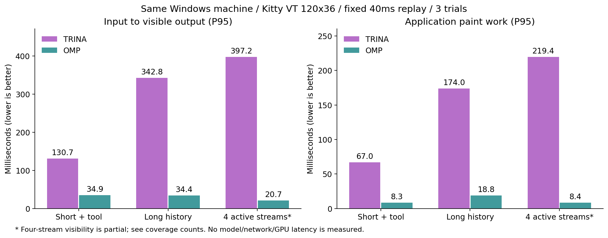

# Trina 与 Oh My Pi 同机同流终端输出评测

后续渲染优化及三轮复测见[优化报告](optimization/README.md)。本页及 `results/` 保留改动前的基线结果。

日期：2026-11-15，Asia/Shanghai。正式运行完成时间：19:58:49。

## 评测结论

在相同机器、120×36 的同一 Kitty VT 终端引擎和固定输入回放下，Trina 当前的终端输出性能低于 Oh My Pi。短输出的可见延迟 P95 为 130.7ms，OMP 为 34.9ms；预载长历史后，分别为 342.8ms 和 34.4ms。Trina 在高延迟绘制帧、输入响应和 CPU 消耗上存在差距，进程内存占用较低。

该结论覆盖生产 UI 组件的输出、排版、差分写入和终端解析链路。模型推理、网络、Agent 决策、SQLite 流事件持久化及 GPU/显示器刷新均未计入。本报告不据此比较完整 Agent 的解题能力或模型 Token 生成速度。



## 环境与版本

| 项目 | 实际配置 |
| --- | --- |
| 机器 | Intel Core i9-14900HX，32 逻辑处理器，约 31.8GiB 内存 |
| 系统 | Windows，内核版本 10.0.26300，x64 |
| Trina 基线 | `5954319baf0d6d943a7fe803c1f79594ce06b0ba`；Python 3.10.11；未修改生产代码 |
| Python UI 依赖 | prompt_toolkit 3.0.52、Rich 13.9.4；完整版本记录见 [python-packages.json](python-packages.json) |
| OMP | npm 发布包 `@oh-my-pi/pi-tui@18.20.2`，实际加载其生产组件 |
| OMP 运行时 | 独立安装的 Bun 1.4.4；全局 Bun 保持原版本 |
| 公共终端 | `kitty-vt-wasm@0.2.0`，120 列×36 行，20,000 行历史，truecolor |
| 输入 | 每条语义事件后等待 40ms，滚动事件等待 140ms；同一夹具文件、分片、标记和历史文本 |
| 轮次 | 每个场景、每种实现各 3 次，共 18 个独立子进程；第二轮交换先后顺序 |

夹具 SHA-256：`d0621ad9bbe0949e696caafc002aaea3b89bb1f486255407b2e646618cd22e69`。

安装目录为项目的 `tmp/omp-output-benchmark`，依赖固定在 [package.json](package.json) 和 [bun.lock](bun.lock)。npm 官方发布信息与完整性值见 [package-sources.json](package-sources.json)，实现文件及结果的 SHA-256 见 [manifest.json](manifest.json)。源码参考缓存中的 18.20.0 未用于计时；正式测试使用实际安装的 18.20.2。

## 场景与实际运行路径

| 场景 | 输入内容 | 每轮观察项 |
| --- | --- | --- |
| 短输出与工具 | 16 段思考、32 段正文/代码、16 段工具输出，预载 73 字符预热内容 | 64 个输出标记、4 次键盘输入 |
| 长历史与代码 | 81 条历史，共 120,183 字符，随后输入 64 段代码 | 64 个输出标记、6 次键盘输入、12 次翻页 |
| 四路活动输出 | 四个独立活动 Markdown 块轮流增长，共 96 段 | 96 个输出标记、8 次键盘输入 |

Trina 使用 `EnhancedConsoleInput`、`TranscriptControl`、Rich Markdown、思考块和工具事件投影。OMP 使用发布包中的 `Composer`、`TranscriptContainer`、`AssistantMessageComponent` 和 `ToolExecutionComponent`。工具参数完成状态、响应结束状态和编辑器挂载均按组件契约设置，工具输出在两边均展开。键盘字符串通过实际输入处理器，未直接写入编辑缓冲区。

两边的终端 I/O 由测试适配器接管，生产渲染器和排版器保持。各自生成的 ANSI 经相同 JSONL 传输方式交给公共终端引擎解析；只有画面中实际出现对应标记，才记录可见延迟。初始化包含固定预热内容，正式输入在就绪后开始。

工具命令和输出属于固定回放材料，命令没有实际执行；画面中的工具完成状态仅用于测试 UI。四路场景衡量四个可变输出块的渲染压力，未运行四个模型、Worker Pool 或真实四宫格面板。

## 指标口径

- 可见延迟：控制进程发送一条带标记的增量，到同一终端引擎的可见画面出现该标记的墙钟时间，包含进程通信、事件等待、应用绘制和终端解析。
- 绘制耗时：应用进入绘制回调到 ANSI 写入完成的时间。保留生产界面的自然活动刷新，两个应用实际产生的帧数可以不同；该值不能直接取倒数当作实际 FPS。
- 键盘延迟：发送键盘字符串到该字符串在编辑区可见的时间。
- CPU：就绪后至结束的进程 CPU 时间，包含渲染与测试适配器开销；表中取三轮中位数。
- 内存：每轮绘制时采集的进程工作集峰值，再取三轮中位数，包含运行时与已加载库。
- P95：合并三轮的对应原始样本后，采用最近秩法计算；键盘样本为 12、18、24 个，属于本次回放的经验分位数。

40ms 是两边使用的相同等待设置，实际发送间隔受系统调度和主进程处理影响；延迟起点使用每条事件的实际发送时间。

## 输出、绘制与输入结果

单位均为毫秒，数值越低代表该指标越快。

| 场景 | Trina 可见延迟 P50 / P95 | OMP 可见延迟 P50 / P95 | Trina / OMP 绘制 P95 | Trina / OMP 键盘 P95 |
| --- | ---: | ---: | ---: | ---: |
| 短输出与工具 | 33.3 / 130.7 | 7.0 / 34.9 | 67.0 / 8.3 | 118.7 / 16.7 |
| 长历史与代码 | 158.4 / 342.8 | 16.9 / 34.4 | 174.0 / 18.8 | 450.0 / 33.7 |
| 四路活动输出 | 134.4 / 397.2 | 6.6 / 20.7 | 219.4 / 8.4 | 441.2 / 31.9 |

短输出和长历史场景，两边三轮均观察到全部 192 个输出标记。四路场景中，Trina 为 176/288，OMP 为 201/288；表中四路 P95 只统计实际可见的标记。其余标记受视口分配、合并刷新或离屏影响，不能按零延迟计入，也不能仅凭该统计认定原始消息丢失。四路数据用于说明压力下的界面表现，不能直接推广为四个真实 Worker 的整体吞吐量。

首个输出可见延迟的三轮中位数：短输出 Trina 13.2ms、OMP 8.1ms；长历史 22.5ms、6.3ms；四路输出 14.9ms、5.5ms。首块均能较快出现，差距主要体现在后续长块更新和偶发长帧。

短输出场景进一步拆分：思考增量 P95 为 Trina 16.7ms、OMP 6.0ms；正文/代码为 128.2ms、36.7ms；工具输出为 174.4ms、35.6ms。

## 资源、帧预算与滚动

| 场景 | Trina / OMP CPU 时间中位数 | Trina / OMP 工作集峰值中位数 | Trina / OMP ANSI 输出量中位数 |
| --- | ---: | ---: | ---: |
| 短输出与工具 | 2047 / 375ms | 50.3 / 149.3MiB | 129,648 / 62,288 字节 |
| 长历史与代码 | 3625 / 814ms | 65.3 / 154.2MiB | 329,354 / 112,698 字节 |
| 四路活动输出 | 3984 / 735ms | 52.7 / 145.3MiB | 157,658 / 119,913 字节 |

以 30FPS 对应的 33.3ms 作为单帧预算，Trina 三种场景分别有 42/188、70/172、75/158 个绘制帧超出预算；OMP 为 0/234、0/237、0/324。公共终端解析的 P95 均低于 0.5ms。该样本中，主要时间差出现在应用侧处理与调度，公共终端解析成本较小。

长历史场景三轮共观察到两边各 36 次有效翻页。Trina 翻页可见变化延迟为 P50 37.6ms、P95 123.8ms；OMP 为 0.45ms、0.91ms。Trina 通过应用输入与内部视口重绘完成翻页，OMP 通过公共终端引擎的原生历史滚动完成。两种实现路径不同，滚动结果单列，不纳入普通增量输出指标，也不解释为相同滚动算法的速度比。

## 终端画面与原始证据

以下图片由实际终端解析后的文本单元生成，保留画面内容与行列位置；配色统一简化。它们属于 VT 文本画面记录，未采集 Windows 桌面像素。

| 场景 | Trina | OMP |
| --- | --- | --- |
| 短输出与工具 | [画面](screens/trina-short.png) | [画面](screens/omp-short.png) |
| 长历史与代码 | [画面](screens/trina-history.png) | [画面](screens/omp-history.png) |
| 四路活动输出 | [画面](screens/trina-four_streams.png) | [画面](screens/omp-four_streams.png) |

- [正式夹具](results/fixtures.json)：相同历史内容、分片、标记、时间间隔和输入序列。
- [逐轮汇总](results/summary.json)：机器、版本、夹具摘要和 18 轮结果。
- [聚合结果](results/aggregated.json)：可复算的分位数、样本数、覆盖率与资源指标。
- `results/<engine>-<scenario>-<trial>.json`：逐帧耗时、ANSI 字节数、实际可见观察、未观察标记及结束前画面。
- [控制台原始输出](benchmark-console.log)：实际执行记录。冒烟运行未纳入正式统计。

画面校验阶段发现，适配器在已结束的工具响应后再次结束正文，会多绘制一次已完成正文；结束状态处理修正后，三轮全部重跑。`results/` 及本报告只使用修正后的数据，早期校准数据不纳入统计。

## 复现

适用环境为 Windows x64，已安装 Python、Trina 依赖和可执行的全局 Bun。Python UI 版本见上表；图片复算使用 Pillow 12.0.0、Matplotlib 3.10.8。安装过程仅使用项目临时目录。

```powershell
& '.\评测\20261115-omp-output-benchmark\setup.ps1'
$env:TRINA_BENCH_TRIALS = '3'
$env:TRINA_BENCH_OUTPUT = 'rerun'
& '.\tmp\omp-output-benchmark\node_modules\@oven\bun-windows-x64\bin\bun.exe' `
  '.\评测\20261115-omp-output-benchmark\run.ts'
```

正式数据复算及图片生成：

```powershell
python -X utf8 '.\评测\20261115-omp-output-benchmark\analyze.py'
```

分析脚本核对夹具摘要、18 轮完整性、键盘观察数量、单路输出覆盖率和非空画面，再复算聚合数据。它只读取正式 `results/`；重新跑出的 `rerun/` 保持独立，避免覆盖本报告原始结果。

## 证据范围

此次实测支持“当前 Trina 的输出渲染尚未达到 OMP 同级，长历史及多活动块下的长帧更明显”。Trina 的内存优势同样出现在三轮样本中。

背景进程、温度和功耗状态未被锁定；三轮交替顺序减少了部分顺序影响，不能代替大样本统计。主题和组件布局保持各自实现，画面并非逐像素等价。测试没有覆盖真实 Windows Terminal/ConPTY、显示器/GPU、网络首字、模型思考、工具真实执行或完整 Agent 协作。之前 300 个突发增量的持久事件压测属于另一条链路，0.384 秒的结果不能作为本报告的实际绘制性能结论。

源码检查显示，Trina 活动正文更新仍对整块执行 Rich Markdown 排版，多活动块较早位置变化还会使后续块重新排版；OMP 有稳定行与 Markdown 实例复用。该实现差异与长块场景的结果相符，精确 CPU 占比尚未通过采样分析确认。
