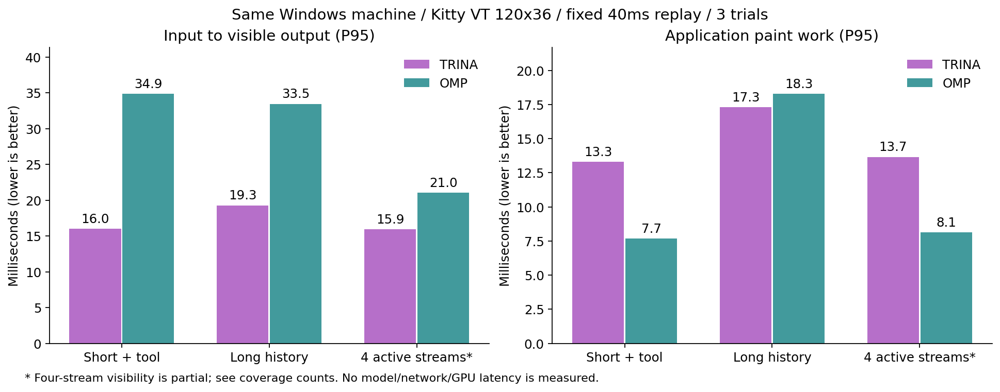

# Trina 终端输出优化与 OMP 同机复测

报告日期：2026-11-16，Asia/Shanghai。运行时间使用 `final/summary.json` 中保存的原始 UTC 时间。执行状态：本地实际执行 UI 回放、生产组件绘制与自动回归；模型和真实工具任务未运行。

## 结论

相同机器、120×36 Kitty VT 引擎及固定 40ms 语义输入流下，优化后 Trina 在三个场景的可见输出 P95 均低于 OMP，短输出为 16.0ms 对 34.9ms，长历史为 19.3ms 对 33.5ms，四路活动块为 15.9ms 对 21.0ms。思考、正文、工具输出和按键的 P95 也分别低于对应 OMP 样本。

Trina 的 CPU 时间仍比 OMP 高约 37%–51%，短场景和四路场景的应用绘制 P95 也较高；应用内翻页仍慢于 OMP 的原生历史滚动。证据支持“本次固定回放的输出响应已追上并超过 OMP”，整体资源效率和滚动性能尚未全面追平。



## 环境、输入与版本

| 项目 | 实际配置 |
| --- | --- |
| 机器 | Intel Core i9-14900HX，32 逻辑处理器，约 31.8GiB 内存 |
| 系统与运行时 | Windows 10.0.26300 x64，Python 3.10.11，隔离安装的 Bun 1.4.4 |
| Trina | 父提交 `c956c042dde0c6ba73953f816bfae80b94fa5408` 加 ADR-0034 的渲染改动；实现指纹见 `final/manifest.json` |
| OMP | 实际 npm 生产组件 `@oh-my-pi/pi-tui@18.20.2`，锁定依赖沿用上级目录 |
| 公共终端 | kitty-vt-wasm 0.2.0，120×36，20,000 行历史，truecolor |
| 主题与刷新 | Trina 适配器固定 `motion=none`；OMP 关闭欢迎动画，保留工具组件自身行为。默认 `full` 主题的动画刷新未作为单独场景计时 |
| 输入 | 短场景 16 段思考、32 段正文/代码、16 段工具输出；长历史预载 81 条、120,183 字符后输入 64 段代码；四路共 96 段 |
| 顺序 | 每场景每实现 3 次，共 18 个独立子进程；第二轮交换实现顺序 |

夹具 SHA-256 为 `d0621ad9bbe0949e696caafc002aaea3b89bb1f486255407b2e646618cd22e69`，与上级旧基线一致。相同等待设置不保证绝对发送周期；每条延迟均从该条实际发送时刻计算。

Trina 使用 `EnhancedConsoleInput`、`TranscriptControl`、生产 Markdown 和工具片段排版器，OMP 使用 Composer、TranscriptContainer、AssistantMessageComponent、ToolExecutionComponent。两边生成的 ANSI 经相同 JSONL 管道送入公共终端引擎，画面出现标记后才计入可见延迟。键盘通过真实输入处理器，不直接改缓冲区。

Trina 四路适配器由旧的字符串回调改用生产 `streaming_answer()`，使其能消费直接样式片段；其输入、分片、标记和语义内容保持。四路是四个可变输出块，未运行真实 Worker Pool 或四宫格。工具命令和结果是固定回放材料，未执行命令。

## 相对旧基线的变化

| 场景 | 旧 Trina 输出 P95 | 新 Trina 输出 P95 | 延迟降幅 |
| --- | ---: | ---: | ---: |
| 短输出与工具 | 130.7ms | 16.0ms | 87.7% |
| 长历史与代码 | 342.8ms | 19.3ms | 94.4% |
| 四路活动块 | 397.2ms | 15.9ms | 96.0% |

旧结果与旧截图保留在上级 `results/`、`screens/`，没有用新数据覆盖。新旧运行的主题、输入和终端条件相同；代码样式与块间距有调整，画面并非逐像素等价。

生产改动包括：CommonMark token 直接生成样式片段，跳过 Rich 排版与 ANSI 反解析；常规代码行使用有界高亮缓存；跨行语法保留整块处理；更新较早活动块时复用后续稳定块；工具卡片在显示帧线性排版；调度间隔收紧到 1/120 秒；静态主题取消空闲重绘。终端滚动区搬运只在重叠行完全相同且尺寸未变时启用。

## 最终输出与输入结果

P95 采用三轮原始样本合并后的最近秩法，以下均为毫秒。每轮的汇总另存于 `final/summary.json`，不把“三轮 P95 的中位数”混作本表。

| 场景 | Trina / OMP 输出 P50 | Trina / OMP 输出 P95 | Trina / OMP 绘制 P95 | Trina / OMP 按键 P95 |
| --- | ---: | ---: | ---: | ---: |
| 短输出与工具 | 6.5 / 6.8 | 16.0 / 34.9 | 13.3 / 7.7 | 11.9 / 16.0 |
| 长历史与代码 | 10.4 / 16.0 | 19.3 / 33.5 | 17.3 / 18.3 | 16.5 / 30.5 |
| 四路活动块 | 10.1 / 6.3 | 15.9 / 21.0 | 13.7 / 8.1 | 14.3 / 33.4 |

短场景细分 P95：思考 Trina 3.8ms、OMP 5.3ms；正文/代码 13.0ms、35.4ms；工具流 28.6ms、35.6ms。输出和按键延迟包括进程通信、等待、绘制与终端解析；绘制耗时只记录组件绘制工作，两者不能相互替代。

短场景和长历史两边均观察到全部 192/192 个输出标记；按键样本分别为 12、18、24 个，均完整。四路 Trina 为 207/288，OMP 为 201/288，可见延迟只统计已经观察到的标记。离屏或合并刷新使部分标记未被观察，不能按零延迟计入，也不能仅凭此认定消息丢失。主题和布局会影响视口覆盖，四路结论具有此限制。

## 资源与滚动

| 场景 | Trina / OMP CPU 中位数 | Trina / OMP 工作集峰值中位数 | Trina / OMP ANSI 字节中位数 | Trina / OMP 帧数（三轮） |
| --- | ---: | ---: | ---: | ---: |
| 短输出与工具 | 578 / 423ms | 42.2 / 150.2MiB | 108,253 / 62,288 | 222 / 234 |
| 长历史与代码 | 1,016 / 672ms | 45.5 / 154.1MiB | 262,062 / 112,698 | 267 / 237 |
| 四路活动块 | 1,078 / 718ms | 43.2 / 144.9MiB | 144,902 / 119,913 | 336 / 324 |

Trina 的 CPU 相对自身旧基线下降约 72%–73%，仍高于 OMP；工作集较低。绘制超过 33.3ms 的帧分别为 Trina 0/222、1/267、0/336，OMP 三场景均为零；Trina 长历史最大帧为 36.2ms。公共终端解析 P95 均低于 0.4ms。

长历史共观察到双方各 36 次有效翻页。Trina 翻页 P95 为 21.9ms，旧基线为 123.8ms；OMP 为 0.62ms。Trina 走应用输入和内部视口重绘，OMP 由公共终端引擎直接滚动原生历史，两条路径不同。该数据保留为体验差距，不能解释成相同滚动算法的倍数排名。

## 画面与可复查材料

画面由真实终端解析后的文本单元生成，配色统一简化，属于 VT 文本画面记录，未采集 Windows 桌面/GPU 像素。

| 场景 | Trina | OMP |
| --- | --- | --- |
| 短输出与工具 | [画面](final/screens/trina-short.png) | [画面](final/screens/omp-short.png) |
| 长历史与代码 | [画面](final/screens/trina-history.png) | [画面](final/screens/omp-history.png) |
| 四路活动块 | [画面](final/screens/trina-four_streams.png) | [画面](final/screens/omp-four_streams.png) |

- [逐轮汇总](final/summary.json)、[原始夹具](final/fixtures.json)、[聚合结果](final/aggregated.json)。
- `final/<engine>-<scenario>-<trial>.json`：每帧耗时、资源、字节数、观察项、未观察标记和最终画面。
- [回放原始输出](final/benchmark-console.log)、[聚合输出](final/analysis-console.log)、[实现与工件指纹](final/manifest.json)。
- [设计决定](../../../design/adr/0034-direct-fragment-terminal-rendering.md)与 `tests/test_markdown_view.py`、`tests/test_transcript.py`、`tests/test_console_session.py`、`tests/test_stream_latency.py`。

源码 `.py/.ts/.ps1` 指纹按仓库 LF 规范计算；`final/` 内运行原件按采集字节计算，避免 Windows 检出行尾转换造成误报。

## 功能与提交验证

| 检查 | 实际结果 | 原始记录 |
| --- | --- | --- |
| 完整工作区回归 | 625 项：615 通过、10 跳过；包含用户先前的未提交修改 | [工作区日志](final/worktree-unit-tests.log) |
| 独立提交副本最终回归 | 621 项：611 通过、10 跳过；不包含用户先前的未提交修改，未出现输入线程关闭异常 | [最终日志](final/staged-final-unit-tests.log) |
| 最终定向回归 | 60 项全部通过，覆盖 Markdown 实体解码后的净化、窗口、弹窗、供应商与 Worker | [定向日志](final/staged-focused-unit-tests.log) |
| 机器规约 | 6 类交付物、24 条需求、65 条规则、169 个测试引用，通过 | [规约结果](final/staged-contract.json) |
| 课程追踪 | 31 份文档、20 条要求、8 项任务、408 个本地链接，通过 | [追踪记录](final/staged-course-pack.log) |

独立副本由 Git 索引导出。10 项跳过属于真实 ELF 回归，要求 Linux 及 r2/GDB/gcc/bwrap，当前 Windows 环境不具备该组合。早期 [提交副本日志](final/staged-unit-tests.log)保留一次 prompt_toolkit 的 `Executor shutdown has been called` 回调异常；嵌套面板改为共用主循环后重新执行，最终日志单独保存。

正式回放完成后补充了弹窗共用主循环和 Markdown 实体解码后的净化，二者均由上述功能测试验证。固定回放不打开弹窗且不包含 HTML 实体，两个分支不参与本次性能样本；实现指纹记录最终交付版本。

## 复现

先按上级 [环境安装](../setup.ps1)准备项目隔离依赖。测试使用 Windows x64 与上级锁定版本，既不替换全局 Bun，也不连接模型网关。

```powershell
$env:TRINA_BENCH_TRIALS = '3'
$env:TRINA_BENCH_OUTPUT = 'rerun-optimized'
Remove-Item Env:TRINA_BENCH_ENGINES -ErrorAction SilentlyContinue
Remove-Item Env:TRINA_BENCH_PROFILE -ErrorAction SilentlyContinue
Remove-Item Env:TRINA_BENCH_SCENARIOS -ErrorAction SilentlyContinue
& '.\tmp\omp-output-benchmark\node_modules\@oven\bun-windows-x64\bin\bun.exe' '.\评测\20261115-omp-output-benchmark\run.ts'
$env:TRINA_BENCH_ANALYZE = 'rerun-optimized'
python -X utf8 '.\评测\20261115-omp-output-benchmark\analyze.py'
```

分析器核对 18 轮、夹具摘要、键盘观察数、单路输出覆盖率与非空画面，再生成分位数、截图和指纹。`TRINA_BENCH_ENGINES=trina` 可用于开发定位；`TRINA_BENCH_PROFILE=1` 的剖析结果有明显计时开销，不纳入正式性能统计。

## 证据范围

本次覆盖模型外的生产 UI 更新、Markdown/代码排版、工具状态投影、实际键盘处理和终端解析。网络、模型推理、SQLite 流事件持久化、真实工具进程、并行解题、ConPTY/Windows Terminal 和显示器刷新均未计入。完整 Agent 端到端速度尚无相同模型、网关、题目和预算下的对照结论。

背景负载、温度和功耗未锁定，三轮交替顺序只能减少部分顺序影响。复杂或非常长的跨行代码仍可能触发整块高亮；默认动画主题会产生额外刷新。当前短/四路绘制成本、CPU 与应用滚动仍有改进空间。
